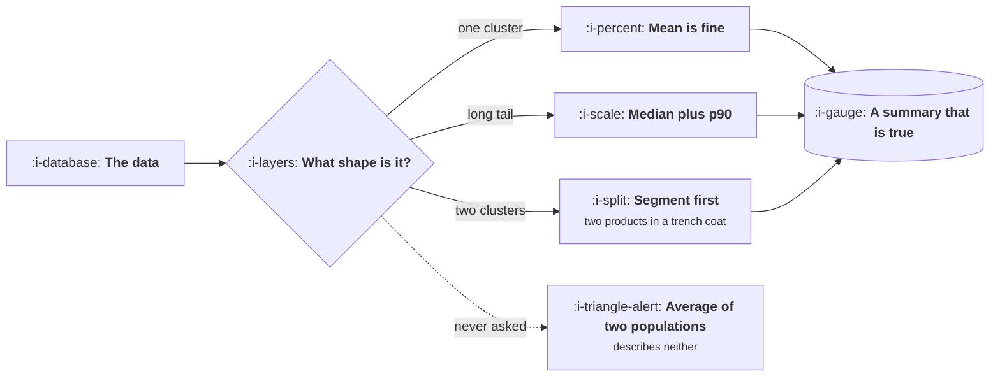

# Rates, Ratios and Averages

```text
Level: Foundations
Prerequisites: The Denominator Problem
Estimated difficulty: 2/5 | Estimated time: 30 min
```

## The idea in one minute

The average is the default summary and it is usually the wrong one, because it assumes a single
population clustered around a middle. Almost nothing in a product looks like that. Usage, session
length, order value, time to complete and revenue per customer are all long tailed or bimodal, and
in both shapes the mean describes a customer who does not exist. The practical rule is to look at
the shape before choosing a summary, and when in doubt report the median alongside a high
percentile, because those two together tell you about the typical case and the case that generates
your support tickets.

## A picture



One question before the summary. Skipping it produces the dotted branch, which is the most common
chart in product management.

## How it really works

### Three shapes, three summaries

**One cluster.** Heights, scores, anything with a natural centre and symmetric spread. The mean is
honest and the median is close to it.

**Long tail.** Session length, order value, usage, revenue per customer. A small number of very
large values drag the mean well above the median. The mean here answers "what is the total divided
by the count", which is a real question, and it does not answer "what is typical", which is the
question people think they asked.

**Two clusters.** Trial users and paying users, mobile and desktop, new and established accounts.
The mean falls in the empty space between them and describes nobody at all. The correct response is
not a better summary, it is to split the populations and report two numbers.

### How to tell which you have, in thirty seconds

Compare the mean and the median. If the mean is much larger, you have a long tail. If the
distribution has two humps, a histogram shows it immediately, and a histogram is a cheap thing to
ask for.

The single most useful habit is to stop asking for averages and start asking for the median and the
ninetieth percentile. Those two, together, cover most product questions.

### Percentiles are the operational summary

For anything a user experiences as waiting, the high percentiles are the product. A mean latency of
two hundred milliseconds with a ninety fifth percentile of four seconds means one request in twenty
feels broken, and those users are the ones who write in and churn. The mean conceals exactly the
population you most need to know about.

The same logic applies beyond latency: the ninetieth percentile of support handling time, of
onboarding duration, of time to first value.

### Ratios of ratios

Averaging percentages across groups of different sizes produces a number that is simply wrong,
because each percentage carries a different weight. If one segment converts at ten percent on a
thousand visitors and another at two percent on fifty thousand, the overall rate is not six
percent. Recompute from the raw counts, always.

This error is common in slide decks because the per segment rates are the numbers that were
available.

### When the average is right

It is right when you want a total divided by a count and you say so: average revenue per account is
a legitimate and useful figure precisely because the total is the thing of interest. The error is
not using the mean; it is using it to describe what is typical.

## Run the numbers

One realistic long tailed distribution, summarised five ways, and the gap between them.

```go
// shapes.go: why the average describes nobody.
package main

import (
	"fmt"
	"sort"
)

// A month of session lengths in minutes, long tailed as real usage is.
func data() []float64 {
	var d []float64
	add := func(n int, v float64) {
		for i := 0; i < n; i++ {
			d = append(d, v)
		}
	}
	add(4200, 0.5)
	add(2600, 2)
	add(1400, 6)
	add(700, 14)
	add(260, 31)
	add(90, 68)
	add(30, 140)
	add(8, 310)
	return d
}

func pct(sorted []float64, p float64) float64 {
	i := int(p / 100 * float64(len(sorted)-1))
	return sorted[i]
}

func main() {
	d := data()
	sort.Float64s(d)
	sum := 0.0
	for _, v := range d {
		sum += v
	}
	mean := sum / float64(len(d))
	fmt.Printf("%d sessions\n\n", len(d))
	fmt.Printf("%-28s %8.1f min\n", "mean", mean)
	fmt.Printf("%-28s %8.1f min\n", "median", pct(d, 50))
	fmt.Printf("%-28s %8.1f min\n", "90th percentile", pct(d, 90))
	fmt.Printf("%-28s %8.1f min\n", "99th percentile", pct(d, 99))

	below := 0
	for _, v := range d {
		if v < mean {
			below++
		}
	}
	fmt.Printf("\n%.0f%% of sessions are below the mean\n", 100*float64(below)/float64(len(d)))
	top := 0.0
	for _, v := range d[len(d)-38:] {
		top += v
	}
	fmt.Printf("the longest 38 sessions, %.2f%% of them, are %.0f%% of all minutes\n",
		100*38/float64(len(d)), 100*top/sum)
	fmt.Println("\nThe mean is a real number about the total. It is not a typical session.")
}
```

The two lines at the bottom are the argument. Seventy three percent of sessions are below the mean,
so quoting five minutes as typical misdescribes three users in four, and the typical session is
actually two minutes. Meanwhile the longest four sessions in every thousand account for a seventh
of all the time spent in the product. Both facts are invisible in a single average and obvious the
moment you ask for percentiles.

## Sector lens

| Sector | Where the average lies most |
|---|---|
| [Enterprise B2B SaaS](../product-by-sector/01-enterprise-b2b-saas.md) | Revenue per account, where a few contracts dominate the mean entirely |
| [Fintech](../product-by-sector/02-fintech.md) | Transaction value, which is long tailed and where the tail is the risk |
| [Ecommerce and D2C](../product-by-sector/03-ecommerce-and-d2c.md) | Order value and repeat rate, both long tailed and both usually averaged |
| [Marketplaces](../product-by-sector/04-marketplaces.md) | Everything, since supply and demand sides are two populations in one chart |
| [Devtools and Infrastructure](../product-by-sector/05-devtools-and-infrastructure.md) | API usage, where a handful of customers are most of the volume |
| [Healthtech](../product-by-sector/06-healthtech-and-regulated-care.md) | Encounter duration, which differs by an order of magnitude across care types |
| [Vertical SaaS](../product-by-sector/07-vertical-saas.md) | Anything, because the customer count is too small for an average to be stable |

## Remember this

* Ask what shape the data is before choosing a summary.
* Long tail: report median and ninetieth percentile. Two clusters: split and report two numbers.
* For anything a user waits for, the high percentile is the product and the mean conceals it.
* Never average percentages across groups of different sizes. Recompute from raw counts.
* The mean is right when you mean total over count, and wrong when you mean typical.

## Try it

1. Run `shapes.go`, then flatten the tail by removing the last two groups. How much does the mean
   move, and how much does the median?
2. Take the three averages your team quotes most and get the median and p90 for each. Note which
   ones were misleading.
3. Find a chart in your company that averages a percentage across segments. Recompute it from raw
   counts.

## Check yourself

1. Why does a mean describe nobody when the data has two clusters, and what should you do instead?
2. Why is the ninety fifth percentile of latency more product relevant than the mean?
3. Why is averaging per segment conversion rates wrong rather than merely imprecise?
