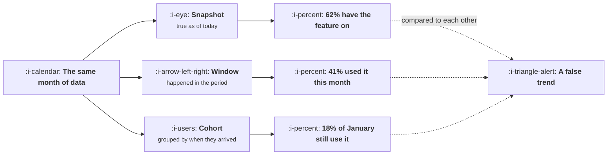

# Windows, Cohorts and Snapshots

```text
Level: Expert
Prerequisites: Rates, Ratios and Averages
Estimated difficulty: 3/5 | Estimated time: 30 min
```

## The idea in one minute

Three different ways of slicing time produce three different correct answers about the same week,
and teams routinely compare them without noticing. A snapshot asks what is true right now. A window
asks what happened in a period. A cohort asks what happened to a group defined by when they
arrived. They answer different questions, they move for different reasons, and the most common
measurement mistake after the denominator problem is reading a window number as though it were a
cohort number, which makes growth look like retention and makes a growing company look healthier
than it is.

## A picture



Three correct answers to what sounds like one question. The failure is comparing them, usually
across quarters, usually in a deck.

## How it really works

### The three, and what each is good for

**Snapshot** is the current state: how many accounts exist, how many have a setting enabled, how
many are on each plan. Good for capacity, support and anything about configuration. Bad for
anything about behaviour, because it has no time dimension at all.

**Window** is activity in a period: monthly active users, orders this quarter, tickets last week.
Good for operational load and for trend lines. Its weakness is that it mixes populations: this
month's number contains people who joined this month and people who joined three years ago, and
those two groups behave nothing alike.

**Cohort** groups by when people arrived and follows them. Good for anything about whether the
product works, because it compares like with like. Its weakness is that it is slow: a twelve month
cohort answer takes twelve months.

### Why a window number flatters a growing company

In a window metric, new users are disproportionately represented because acquisition is growing,
and new users are at their most engaged. So the aggregate number rises even if every individual
cohort is retaining worse than the one before it. The company looks healthy and is getting sicker,
and the only instrument that shows it is a cohort table.

This is the single most important reason to learn cohorts, and it is treated fully in
[Building a Cohort Table](../funnel-retention-and-experiments/04-building-a-cohort-table.md).

### Window length is a choice that changes the answer

A thirty day active window always reports a larger number than a seven day one, and the ratio
between them is itself informative: it tells you how frequently people return. Changing the window
length between reports, which happens innocently when somebody rebuilds a dashboard, produces a
step change that will be investigated as a product event.

State the window in the metric name, exactly as with the denominator.

### Snapshots change retroactively

A snapshot computed today from current state can disagree with a snapshot taken a month ago,
because records were updated, accounts merged, or a field was backfilled. This is why reported
history sometimes changes, which is one of the fastest ways for a dashboard to lose trust. If
history must be stable, store the snapshot rather than recomputing it.

### Comparing like with like

The practical rule: never compare across the three types, and when comparing within a type, hold
everything else fixed. Same window length, same population definition, same unit. Most "the metric
jumped" investigations end with the discovery that one of those three changed.

## Run the numbers

The same underlying behaviour, measured three ways across a year of growth.

```go
// windows.go: why the aggregate rises while every cohort gets worse.
package main

import "fmt"

func main() {
	// Each month brings a larger cohort, and each new cohort retains worse.
	months := 12
	newUsers := make([]float64, months)
	retention := make([]float64, months) // share still active after one month
	for i := 0; i < months; i++ {
		newUsers[i] = 1000 * (1 + 0.18*float64(i))
		retention[i] = 0.46 - 0.018*float64(i)
	}
	fmt.Printf("%7s %12s %14s %16s\n", "month", "new users", "cohort 1mo ret", "monthly active")
	for i := 1; i < months; i++ {
		// Active this month: this month's joiners plus survivors of earlier ones.
		active := newUsers[i]
		for j := 0; j < i; j++ {
			survive := retention[j]
			for k := j + 1; k < i; k++ {
				survive *= 0.93 // later months decay more slowly
			}
			active += newUsers[j] * survive
		}
		fmt.Printf("%7d %12.0f %13.0f%% %16.0f\n", i+1, newUsers[i], 100*retention[i], active)
	}
	fmt.Println("\nEvery cohort retains worse than the one before it.")
	fmt.Println("Monthly active users rises every month. Only the cohort column shows the problem.")
}
```

Read the two right hand columns against each other. Cohort retention falls every single month, from
the mid forties toward the mid twenties, while monthly active users rises every single month
because acquisition is growing faster than retention is deteriorating. A dashboard showing the
right hand column would report a year of uninterrupted growth, and the company would discover the
problem when acquisition slowed, which is the worst possible moment to discover it.

## Sector lens

| Sector | The time slicing error that recurs |
|---|---|
| [Enterprise B2B SaaS](../product-by-sector/01-enterprise-b2b-saas.md) | Snapshot account counts read as growth, when renewals happen annually in lumps |
| [Fintech](../product-by-sector/02-fintech.md) | Window volume rising on a few large customers rather than on breadth |
| [Ecommerce and D2C](../product-by-sector/03-ecommerce-and-d2c.md) | Repeat rate measured in a window rather than by cohort, which flatters badly |
| [Marketplaces](../product-by-sector/04-marketplaces.md) | Active supply as a snapshot, when what matters is supply that transacted |
| [Devtools and Infrastructure](../product-by-sector/05-devtools-and-infrastructure.md) | Signups as a window metric, when adoption takes quarters to appear |
| [Healthtech](../product-by-sector/06-healthtech-and-regulated-care.md) | Encounter windows that mix care types with very different frequencies |
| [Vertical SaaS](../product-by-sector/07-vertical-saas.md) | Small cohorts, so cohort analysis is noisy and must be grouped by quarter |

## Remember this

* Snapshot, window and cohort answer different questions. Never compare across them.
* A window number mixes populations, which flatters any company whose acquisition is growing.
* Window length changes the answer. State it in the metric name.
* Snapshots recomputed from current state change history retroactively. Store them if history
  must be stable.
* When a metric jumps, check whether the window, the population or the unit changed first.

## Try it

1. Run `windows.go`, then set the retention decline to zero. How much of the growth in the right
   hand column survives?
2. Take your main activity metric and find out its window length. Check whether it has ever
   changed.
3. Build a one month retention figure by cohort for the last six months. Compare the trend to your
   aggregate active number.

## Check yourself

1. Why does a window metric rise while every cohort in it is getting worse?
2. When is that divergence discovered, and why is that the worst time?
3. Why can a snapshot taken today disagree with the same snapshot recorded a month ago?
