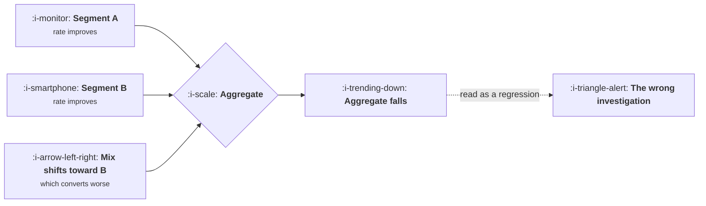

# Simpson's Paradox and Mix Shift

```text
Level: Foundations
Prerequisites: Windows, Cohorts and Snapshots
Estimated difficulty: 3/5 | Estimated time: 30 min
```

## The idea in one minute

A number can improve in every segment and get worse overall. This is not a trick or a rare
curiosity; it happens whenever the mix of segments changes at the same time as the rates within
them, which is most of the time in a growing product. The consequence is that an aggregate metric
is an unreliable narrator: it moves for two completely different reasons, a change in performance
and a change in composition, and it does not tell you which. The habit that protects you is to look
at the segment rates and the segment sizes side by side before interpreting any aggregate movement.

## A picture



Two segments improve, the mix moves, and the total falls. Everything in the diagram is true at the
same time.

## How it really works

### The mechanism

An aggregate rate is a weighted average of segment rates, weighted by segment size. Change the
weights and the aggregate moves even if no rate changed at all. Change both and the aggregate can
go in the opposite direction to every component.

Nothing unusual is happening. It is arithmetic, and it is unintuitive only because people treat an
aggregate as a measurement of performance when it is a measurement of performance and composition
combined.

### Where it bites in practice

**Experiments with unequal allocation.** If a test allocates traffic differently across segments,
the overall result can contradict every segment result. This is the most expensive version, because
a team ships or kills a feature on a number that says the opposite of the truth.

**Channel mix.** Marketing opens a cheap channel with lower intent. Every existing channel's
conversion improves, the blended rate falls, and the product team is asked why conversion dropped.

**Geographic or plan expansion.** Entering a market with lower willingness to pay, or launching a
cheaper plan, lowers average revenue per account while every segment is growing. Entirely healthy,
and it will be read as a problem unless somebody shows the mix.

**Cohort mixing over time.** Covered in the previous lesson; it is the same effect with time as the
segmenting variable.

### The habit

Before interpreting any aggregate movement, ask two questions. Did the rates within segments move,
and did the sizes of the segments move. Any dashboard that shows an aggregate without the
underlying segment sizes is an invitation to misread it.

Practically, this means every important rate should be reported with its segment breakdown
available one click away, and the breakdown should include the counts, not only the rates.

### Decomposing the change

When an aggregate moves, the move can be split into the part caused by rate changes and the part
caused by mix changes. The simple version is to recompute the aggregate using last period's mix
with this period's rates: the difference between that and the actual tells you how much was mix.

That decomposition turns "conversion fell two points" into "rates rose, mix cost us three points,
net minus two", which is a completely different conversation and usually a completely different
response.

## Run the numbers

A real experiment result where the variant wins in both segments and loses overall.

```go
// simpson.go: winning every segment and losing the total.
package main

import "fmt"

type cell struct {
	users, converted float64
}

func (c cell) rate() float64 { return c.converted / c.users }

func main() {
	type arm struct {
		name            string
		desktop, mobile cell
	}
	arms := []arm{
		{"control", cell{1000, 200}, cell{300, 30}},
		{"variant", cell{250, 60}, cell{1100, 130}},
	}
	fmt.Printf("%-10s %22s %22s %22s\n", "", "desktop", "mobile", "overall")
	for _, a := range arms {
		tot := cell{a.desktop.users + a.mobile.users, a.desktop.converted + a.mobile.converted}
		fmt.Printf("%-10s %10.0f %8.1f%% %10.0f %8.1f%% %10.0f %8.1f%%\n",
			a.name, a.desktop.users, 100*a.desktop.rate(),
			a.mobile.users, 100*a.mobile.rate(),
			tot.users, 100*tot.rate())
	}
	c, v := arms[0], arms[1]
	fmt.Printf("\nvariant beats control on desktop by %.1f points\n",
		100*(v.desktop.rate()-c.desktop.rate()))
	fmt.Printf("variant beats control on mobile by %.1f points\n",
		100*(v.mobile.rate()-c.mobile.rate()))
	ct := (c.desktop.converted + c.mobile.converted) / (c.desktop.users + c.mobile.users)
	vt := (v.desktop.converted + v.mobile.converted) / (v.desktop.users + v.mobile.users)
	fmt.Printf("variant loses overall by %.1f points\n", 100*(ct-vt))
	fmt.Println("\nMobile converts worse, and the variant got far more mobile traffic.")
	fmt.Println("Shipping the control here would be shipping the worse experience.")
}
```

Both segment comparisons favour the variant and the aggregate favours the control, decisively. The
cause is visible once you look at the counts rather than the rates: the variant received most of
its traffic from the segment that converts worse, so its blended number is dragged down by
composition rather than by performance.

The practical lesson is that an experiment readout showing only the overall number is not a
readout. Segment counts belong next to segment rates, always, and an allocation that differs by
segment should be treated as a defect in the test rather than something to correct for afterwards.

## Sector lens

| Sector | The mix shift that catches people |
|---|---|
| [Enterprise B2B SaaS](../product-by-sector/01-enterprise-b2b-saas.md) | Moving upmarket lowers win rate while every segment improves |
| [Fintech](../product-by-sector/02-fintech.md) | A new product line with different risk changes blended loss rates |
| [Ecommerce and D2C](../product-by-sector/03-ecommerce-and-d2c.md) | A category or discount push moves average order value with no behaviour change |
| [Marketplaces](../product-by-sector/04-marketplaces.md) | Growth in one category shifts blended take rate and match rate at once |
| [Devtools and Infrastructure](../product-by-sector/05-devtools-and-infrastructure.md) | Free tier growth drags every blended metric, entirely healthily |
| [Healthtech](../product-by-sector/06-healthtech-and-regulated-care.md) | A new care setting with different baseline outcomes changes aggregate quality figures |
| [Vertical SaaS](../product-by-sector/07-vertical-saas.md) | A single large customer joining visibly shifts every average |

## Remember this

* An aggregate rate is a weighted average. Change the weights and it moves with no rate change.
* Every segment can improve while the total falls. It is arithmetic, not an anomaly.
* Before interpreting any aggregate movement, check both segment rates and segment sizes.
* Decompose the change into rate effect and mix effect. It usually changes the response.
* An experiment readout without segment counts is not a readout.

## Try it

1. Run `simpson.go`, then equalise the traffic split across segments. Does the paradox survive?
2. Take an aggregate metric that moved last quarter and decompose it into rate and mix effects.
3. Check whether your experiment tooling reports segment allocation. If not, that is a real risk.

## Check yourself

1. Why can every segment improve while the aggregate falls, without anything unusual happening?
2. What two numbers must you see before interpreting an aggregate movement?
3. Why is unequal allocation across segments a defect in an experiment rather than something to
   adjust for later?
