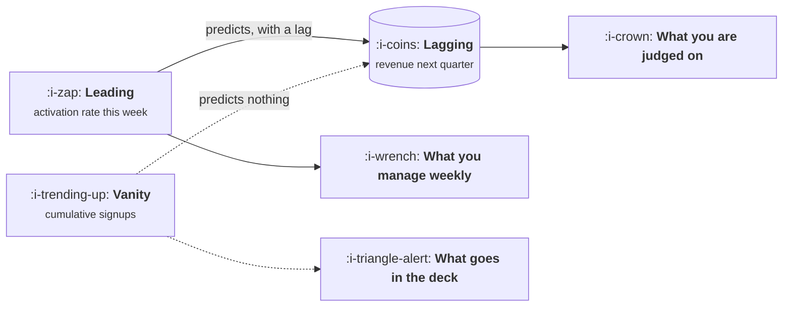

# Leading, Lagging and Vanity

```text
Level: Foundations
Prerequisites: Simpson's Paradox and Mix Shift
Estimated difficulty: 3/5 | Estimated time: 30 min
```

## The idea in one minute

Metrics divide into three kinds by what they can do for you. A lagging metric tells you what
happened and is usually the thing you are judged on. A leading metric moves earlier and predicts
the lagging one, which makes it the thing worth managing week to week. A vanity metric moves
reliably in a pleasing direction and predicts nothing, which makes it worse than useless because it
consumes attention that the other two needed. Telling them apart is not a matter of taste: you can
test it, by checking whether a candidate actually predicts the outcome you care about, and most
candidates do not.

## A picture



Three roles, and only two of them are instruments. The third is a slide.

## How it really works

### The three kinds

**Lagging.** Revenue, retention, net revenue retention, churn. Accurate, trusted, and far too slow
to steer with. By the time a lagging metric tells you something is wrong, the quarter that caused
it is over.

**Leading.** Activation rate, time to first value, weekly active accounts in the first month,
support contact rate for new users. These move within days or weeks and, if genuinely predictive,
give you time to act.

**Vanity.** Cumulative totals, registered users, page views, downloads, followers. They rise
regardless, so they cannot deliver bad news, and a number that cannot deliver bad news is not an
instrument.

### Test whether a leading metric is actually leading

A leading indicator is a claim that one number predicts another. Claims can be tested. Take the
candidate and the outcome, line them up with a plausible lag, and look at whether they move
together historically. If the candidate does not correlate with the outcome at any lag, it is not
leading, whatever anybody says about it in a planning meeting.

This is a half day of analysis that very few teams do, and it routinely demotes one or two
confidently held beliefs about what drives the business.

### Correlation here is weak evidence, and it is still better than nothing

The usual caution applies: a correlation does not establish that improving the leading metric will
improve the outcome. But the absence of a correlation is strong evidence against, and that is the
direction most of the value lies in. You are using it to eliminate candidates, not to confirm them.

Confirmation comes from an experiment that moves the leading metric deliberately and observes
whether the lagging one follows. That is slow and it is the only clean answer.

### Why vanity metrics survive

Three reasons, all structural rather than foolish. They are easy to compute. They always go up,
which makes them pleasant to present. And they are often genuinely correlated with the business in
the early days, when everything is correlated with everything because everything is growing.

The time to kill a vanity metric is when it stops being able to go down, because that is the moment
it stopped being able to inform you.

### Build a small leading set

Three to five leading metrics, each with a demonstrated relationship to a lagging outcome, each
with an owner, reviewed weekly. That is the instrument panel. The lagging metrics go on the monthly
and quarterly reviews, where their slowness does not matter.

## Run the numbers

Three candidate indicators tested against next quarter revenue, to see which actually predict it.

```go
// leading.go: which candidate indicators predict the outcome.
package main

import (
	"fmt"
	"math"
)

func corr(a, b []float64) float64 {
	n := float64(len(a))
	var sa, sb float64
	for i := range a {
		sa += a[i]
		sb += b[i]
	}
	ma, mb := sa/n, sb/n
	var num, da, db float64
	for i := range a {
		x, y := a[i]-ma, b[i]-mb
		num += x * y
		da += x * x
		db += y * y
	}
	return num / math.Sqrt(da*db)
}

func main() {
	// Twelve quarters of history.
	activation := []float64{31, 33, 30, 35, 38, 37, 41, 44, 42, 46, 49, 48}
	ticketRate := []float64{18, 17, 19, 16, 14, 15, 13, 11, 12, 10, 9, 9}
	cumulative := []float64{12, 19, 27, 36, 46, 57, 69, 82, 96, 111, 127, 144}
	// Revenue follows activation with a two quarter lag, plus noise.
	revenue := []float64{100, 104, 108, 112, 119, 128, 134, 146, 158, 163, 177, 190}

	lag := 2
	cands := []struct {
		name string
		s    []float64
	}{
		{"activation rate", activation},
		{"new user ticket rate", ticketRate},
		{"cumulative signups", cumulative},
	}
	fmt.Printf("%-24s %22s %14s\n", "candidate", "correlation with", "verdict")
	fmt.Printf("%-24s %22s\n", "", fmt.Sprintf("revenue %d quarters on", lag))
	for _, c := range cands {
		x := c.s[:len(c.s)-lag]
		y := revenue[lag:]
		r := corr(x, y)
		verdict := "not predictive"
		switch {
		case math.Abs(r) > 0.9:
			verdict = "strong, but check for a shared trend"
		case math.Abs(r) > 0.6:
			verdict = "worth testing with an experiment"
		}
		fmt.Printf("%-24s %22.2f %14s\n", c.name, r, verdict)
	}
	fmt.Println("\nCumulative signups correlates almost perfectly and predicts nothing,")
	fmt.Println("because both it and revenue only go up. That is the trap this test must survive.")
}
```

Look at the verdict column: all three candidates receive the same one, and cumulative signups
scores highest of the three at a perfect 1.00. It is also the only one of the three that is
worthless. Both it and revenue rise every quarter, and any two monotonic series correlate
perfectly, so the test cannot distinguish a genuine predictor from a number that simply goes up.

That is the warning this exercise exists to deliver. A correlation test run on levels will happily
endorse the worst metric on the table, which is how vanity metrics acquire the appearance of
evidence.

The defence is to run the test on changes rather than levels, or simply to apply the rule from the
first lesson: if the number cannot go down, it cannot inform you, and no amount of correlation
rescues it.

## Sector lens

| Sector | A leading metric that actually leads |
|---|---|
| [Enterprise B2B SaaS](../product-by-sector/01-enterprise-b2b-saas.md) | Admin seats provisioned in the first month, which predicts renewal |
| [Fintech](../product-by-sector/02-fintech.md) | First transaction completed within a week of signup |
| [Ecommerce and D2C](../product-by-sector/03-ecommerce-and-d2c.md) | Second purchase within sixty days, which predicts lifetime value |
| [Marketplaces](../product-by-sector/04-marketplaces.md) | Search success rate in a segment, which predicts liquidity |
| [Devtools and Infrastructure](../product-by-sector/05-devtools-and-infrastructure.md) | Time to first successful call, and whether a second call followed |
| [Healthtech](../product-by-sector/06-healthtech-and-regulated-care.md) | Clinician minutes saved per encounter, measured rather than claimed |
| [Vertical SaaS](../product-by-sector/07-vertical-saas.md) | Whether the customer's whole team logged in during week two |

## Remember this

* Lagging tells you what happened, leading lets you act, vanity consumes attention.
* A leading indicator is a testable claim. Test it against the outcome at a plausible lag.
* Absence of correlation is strong evidence against. Presence of it is weak evidence for.
* Any two monotonic series correlate. Test on changes, not levels.
* If a number cannot go down, it cannot inform you, whatever its correlation.
* Three to five leading metrics, owned, reviewed weekly. Lagging metrics belong in the monthly.

## Try it

1. Run `leading.go` with your own history. Which candidates survive, and does the cumulative trap
   appear in your data too?
2. Pick the leading metric your team believes in most and test it against the outcome at two and
   four quarters.
3. List every number in your weekly review that cannot go down. Remove them.

## Check yourself

1. Why is a lagging metric a poor instrument for steering, despite being the one you are judged on?
2. Why does a near perfect correlation sometimes indicate a vanity metric rather than a good one?
3. What kind of evidence would actually confirm that a leading metric drives its outcome?
