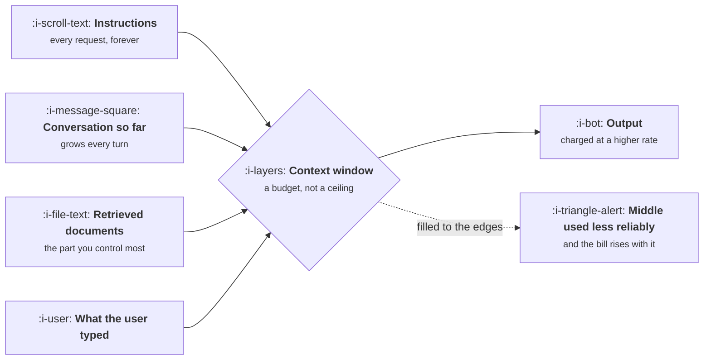

# Tokens and the Context Window

```text
Level: Basic
Prerequisites: The Five Facts
Estimated difficulty: 2/5 | Estimated time: 30 min
```

## The idea in one minute

A model reads and writes in tokens, which are pieces of words, and it can only hold so many at
once. That limit is the context window, and almost everyone treats it as a technical ceiling to
stay under rather than as what it is: a budget you spend on every single request. Everything you
put in front of the model, the instructions, the retrieved documents, the conversation so far,
competes for the same space and is paid for every time. Two consequences follow that decide product
behaviour. Filling the window is expensive and slow, and material in the middle of a long context
gets used less reliably than material at either end.

## A picture



Four inputs, one budget. The instructions box is the one that costs most over a year, because it
is paid on every request and nobody reviews it.

## How it really works

### What a token is, practically

Roughly three quarters of a word in English, so a thousand tokens is about seven hundred and fifty
words, and a page of dense text is around five hundred tokens. Code, identifiers and other
languages run less efficiently, sometimes much less. You do not need precision; you need to be able
to estimate a prompt's size within a factor of two in your head, which the table below supports.

| Thing | Roughly |
|---|---|
| A short chat message | 20 to 60 tokens |
| A page of prose | 500 |
| A long support email thread | 2,000 to 5,000 |
| A typical system prompt with examples | 800 to 3,000 |
| A medium source file | 1,500 to 4,000 |
| A long contract | 20,000 to 60,000 |

### The window is shared, and the sharing is a design decision

A large window does not mean you should fill it. Every token is paid for, adds latency, and
competes for the model's attention with everything else. The product decisions this creates are
real ones:

* How many retrieved documents do you include, and how do you choose them?
* How much conversation history survives, and what is summarised or dropped?
* How long is the instruction block, given it is sent every single time?

Each of those is a tradeoff between quality and cost that belongs to product, not to engineering,
because only product knows what the feature is allowed to cost.

### Material in the middle is used less reliably

Across most models, information at the start and end of a long context is used more reliably than
information in the middle. The practical consequences: put the instruction and the actual question
at the edges, put the most relevant retrieved material first rather than in retrieval order, and
treat a very long context as a signal that retrieval should have been narrower.

### The system prompt is the expensive one

It is sent on every request, it grows by accretion as people add edge case instructions, and nobody
ever deletes from it. A system prompt that grows from eight hundred to three thousand tokens has
roughly tripled the input cost of every request in your product, silently. Reviewing it quarterly,
with deletions, is one of the highest return habits available.

### Output is charged at a higher rate

Output tokens typically cost several times input tokens, so asking for brevity is a real cost
lever, not a style preference. "Answer in under a hundred words" and a schema that forbids
rambling are both cost controls.

### What fills the box in 2026

Context windows span from tens of thousands to over a million tokens depending on model, and the
long end carries a latency and cost penalty that makes it unsuitable for interactive features.
Counting tokens properly is done with the provider's tokeniser; estimating is fine for planning.
Prompt caching, where a repeated prefix is charged at a reduced rate, materially changes the
arithmetic for a fixed instruction block and is worth asking about before optimising anything else.

## Run the numbers

Where a context budget actually goes, and what the instruction block costs over a year.

```go
// context.go: where the context budget goes.
package main

import "fmt"

type part struct {
	name   string
	tokens float64
	every  bool // sent on every request
}

const (
	inPerM       = 3.00
	outPerM      = 15.00
	requestsDay  = 25_000.0
	outputTokens = 400.0
)

func main() {
	parts := []part{
		{"system instructions", 2_400, true},
		{"few shot examples", 1_800, true},
		{"retrieved documents", 6_000, false},
		{"conversation history", 3_200, false},
		{"user message", 180, false},
	}
	total := 0.0
	for _, p := range parts {
		total += p.tokens
	}
	fmt.Printf("%-24s %9s %8s %16s\n", "part", "tokens", "share", "annual cost")
	for _, p := range parts {
		annual := p.tokens / 1e6 * inPerM * requestsDay * 365
		fmt.Printf("%-24s %9.0f %7.0f%% %16.0f\n", p.name, p.tokens, 100*p.tokens/total, annual)
	}
	out := outputTokens / 1e6 * outPerM * requestsDay * 365
	fmt.Printf("%-24s %9.0f %7s %16.0f\n", "output", outputTokens, "", out)
	in := total / 1e6 * inPerM * requestsDay * 365
	fmt.Printf("\ninput %.0f tokens, %.0f a year. Output %.0f tokens, %.0f a year.\n",
		total, in, outputTokens, out)
	fmt.Println("The fixed block is sent on every request and nobody reviews it.")
}
```

Two things to take from this. The fixed block, instructions plus examples, is 31% of the input and
costs a hundred and fifteen thousand a year at this volume, for text that was written once and has
never been revisited. Shortening it is the cheapest saving available and nobody owns it.

The second is the output line. Four hundred tokens is under 3% of everything sent and received, and
it is 13% of the bill, because output is priced five times higher than input. That disproportion is
why asking for brevity is a cost control rather than a style preference, and why a schema that
forbids preamble pays for itself.

## Sector lens

| Sector | Where the budget goes |
|---|---|
| [Enterprise B2B SaaS](../product-by-sector/01-enterprise-b2b-saas.md) | Long documents and per tenant instructions, so the fixed block multiplies by customer |
| [Fintech](../product-by-sector/02-fintech.md) | Policy and rule text in the instructions, which grows with every regulation |
| [Ecommerce and D2C](../product-by-sector/03-ecommerce-and-d2c.md) | Catalogue context, which is large and mostly irrelevant to any one request |
| [Marketplaces](../product-by-sector/04-marketplaces.md) | Listing text from both sides, untrusted and voluminous |
| [Devtools and Infrastructure](../product-by-sector/05-devtools-and-infrastructure.md) | Code, which tokenises badly, so estimates based on prose are wrong |
| [Healthtech](../product-by-sector/06-healthtech-and-regulated-care.md) | Patient records that are long, and legally constrained in what may be sent |
| [Vertical SaaS](../product-by-sector/07-vertical-saas.md) | Industry documents and forms, often scanned, which adds an extraction step first |

## Remember this

* A token is about three quarters of a word. Estimating within a factor of two is enough.
* The context window is a budget spent per request, not a ceiling to stay under.
* Material in the middle of a long context is used less reliably. Put instruction and question at
  the edges.
* The system prompt is sent every time, grows by accretion, and is nobody's job to shrink.
* Output costs several times input, so brevity is a cost control.

## Try it

1. Run `context.go` with your own feature's parts and volume. What does your fixed block cost a
   year?
2. Read your system prompt and delete anything that has not demonstrably changed an output. Measure
   before and after on your eval set.
3. Count the tokens of the largest document your feature might receive. Does it fit, and what
   happens if it does not?

## Check yourself

1. Why is a large context window not an invitation to fill it? Give three costs.
2. Why does putting the most relevant retrieved document first matter more in a long context than a
   short one?
3. Output is a thirtieth of your tokens and a comparable share of cost. What does that imply about
   where to look for savings first?
