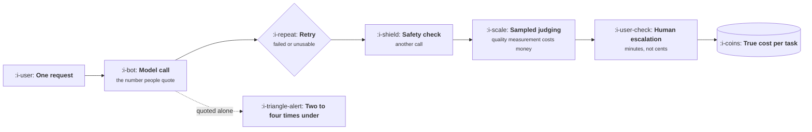

# Cost Per Request

```text
Level: Basic
Prerequisites: Tokens and the Context Window
Estimated difficulty: 2/5 | Estimated time: 30 min
```

## The idea in one minute

Every AI feature has a unit cost, and most feature proposals do not contain it. The number is not
hard: tokens in, tokens out, prices per million, multiplied by how often it runs. What makes it
unreliable in practice is everything around the model call that nobody counts: the retries, the
safety check, the second model grading the first, and the human cleaning up what neither caught.
The first three add perhaps a third. The fourth is on another scale entirely, and any feature where
a person ever touches the output is usually costed an order of magnitude under.

## A picture



Only the first box appears in most estimates. The last box is usually most of the money, and it is
the one that looks like an operations problem rather than part of the feature.

## How it really works

### The headline calculation

```
cost = (input tokens / 1,000,000 × input price) + (output tokens / 1,000,000 × output price)
```

That is the floor. Do it first, because it is thirty seconds of work and it kills some proposals
immediately. A feature with forty thousand input tokens running a hundred thousand times a day is
not a feature, it is a budget line, and knowing that before design is worth more than knowing it
after launch.

### The four things that multiply it

**Retries.** Some share of calls fail, time out, or produce output that does not validate against
your schema. If one call in eight needs a second attempt, your cost is up roughly 12%.

**Guardrails.** An input check, an output check, or both. Each is usually a smaller model, but a
small model running on every request can exceed a large model running on some of them.

**Judging.** If you sample live traffic and score it to detect quality drift, those are model calls
with their own token counts. This is a legitimate and necessary cost and it is never in the
estimate.

**Human escalation.** The share of tasks a person must handle, times minutes, times loaded hourly
cost. This usually dominates everything else. A 5% escalation rate at ten minutes each, at sixty an
hour, is fifty cents per escalated task, which against a two cent model call is the entire cost
structure.

### Per request is not per task

A task a user cares about may take several model calls: a plan, a retrieval, an answer, a check.
Quote the number per unit of useful work, because that is the unit the business cares about and the
unit the price is set against.

### Fixed and variable

The instruction block is fixed and paid every time; the user's content is variable. Separating them
tells you which lever to pull. If the fixed part dominates, shorten the prompt or ask the provider
about caching a repeated prefix. If the variable part dominates, the lever is retrieval: fewer
documents, better chosen.

### Why this matters more than it seems

Every other feature you have ever shipped had a cost of roughly zero per use. This one does not,
which means usage growth is cost growth, your most engaged customers are your most expensive, and
the margin arithmetic in [Revenue and Efficiency](../revenue-and-efficiency/README.md) stops
holding. The full treatment is AI Cost and Margin at Expert level; what belongs in your head at
this stage is that the number exists and you should compute it before designing.

### What fills the box in 2026

Provider pricing pages give the per million rates, and they fall over time, which is a planning
input rather than a reason to ignore cost today. Prompt caching cuts the fixed block substantially
where the prefix repeats. Observability platforms report token spend per feature, which is the
thing to instrument on day one rather than after the first surprising invoice.

## Run the numbers

One feature, fully costed, with the four multipliers made visible.

```go
// costper.go: the true cost of one unit of useful work.
package main

import "fmt"

const (
	inPerM, outPerM = 3.00, 15.00
	fixedIn         = 2_800.0 // instructions and examples, every call
	variableIn      = 5_400.0 // retrieved documents and user content
	outTokens       = 350.0

	callsPerTask = 2.0  // a plan call and an answer call
	retryRate    = 0.12 // share needing a second attempt
	guardTokens  = 1_200.0
	judgeSample  = 0.08 // share of traffic scored
	judgeTokens  = 4_000.0
	escalateRate = 0.05
	escalateMins = 10.0
	humanPerHour = 60.0
)

func call(in, out float64) float64 { return in/1e6*inPerM + out/1e6*outPerM }

func main() {
	base := call(fixedIn+variableIn, outTokens) * callsPerTask
	retries := base * retryRate
	guard := call(guardTokens, 20) * callsPerTask
	judge := call(judgeTokens, 60) * judgeSample
	human := escalateRate * escalateMins / 60 * humanPerHour

	rows := []struct {
		name string
		v    float64
	}{
		{"model calls", base},
		{"retries", retries},
		{"guardrails", guard},
		{"sampled judging", judge},
		{"human escalation", human},
	}
	total := 0.0
	for _, r := range rows {
		total += r.v
	}
	fmt.Printf("%-20s %12s %9s\n", "component", "per task", "share")
	for _, r := range rows {
		fmt.Printf("%-20s %12.4f %8.0f%%\n", r.name, r.v, 100*r.v/total)
	}
	fmt.Printf("\ntrue cost per task %.4f, against a quoted model cost of %.4f\n", total, base)
	fmt.Printf("the quote is %.1f times under\n", total/base)
}
```

Look at the share column rather than the total. Retries, guardrails and judging together add about
a third to the model call, which is the figure to carry for a fully automated feature. Human
escalation is 87% of the cost here, and it comes from one assumption: that five percent of tasks
need ten minutes of somebody's time.

That single line is why the quote is nearly ten times under. It also reframes escalation rate as a
cost metric rather than only a quality one: dropping it from 5% to 3% saves more than any prompt
optimisation available to you, and it is the kind of improvement that comes from better retrieval
or a narrower task rather than from cheaper tokens.

## Sector lens

| Sector | What dominates the unit cost |
|---|---|
| [Enterprise B2B SaaS](../product-by-sector/01-enterprise-b2b-saas.md) | Long documents, so the variable input dominates and retrieval quality is the lever |
| [Fintech](../product-by-sector/02-fintech.md) | Human review, because the escalation rate is deliberately high |
| [Ecommerce and D2C](../product-by-sector/03-ecommerce-and-d2c.md) | Volume. Unit cost is tiny and the multiplication is enormous |
| [Marketplaces](../product-by-sector/04-marketplaces.md) | Guardrails, since both sides supply untrusted text that must be checked |
| [Devtools and Infrastructure](../product-by-sector/05-devtools-and-infrastructure.md) | Output tokens, because code is long and priced at the higher rate |
| [Healthtech](../product-by-sector/06-healthtech-and-regulated-care.md) | Human review, which is mandatory rather than an escalation path |
| [Vertical SaaS](../product-by-sector/07-vertical-saas.md) | Document extraction before anything else runs, which adds a whole call |

## Remember this

* Compute the headline cost first. It takes thirty seconds and kills some proposals outright.
* Four multipliers: retries, guardrails, judging, human escalation. The first three add about a
  third; escalation can add an order of magnitude.
* Quote per task, not per call. A task is several calls.
* Split fixed from variable. It tells you whether to shorten the prompt or narrow retrieval.
* Human escalation usually dominates, which makes escalation rate a cost lever.

## Try it

1. Run `costper.go` with your feature's real numbers. What is the ratio between the true cost and
   the quoted one?
2. Set `escalateRate` to zero and see what share of the cost disappears. That is the value of a
   quality improvement, in money.
3. Find the last AI feature proposal at your company and check whether it contained a unit cost at
   all.

## Check yourself

1. A fully automated feature is costed about a third under, and one with human escalation nearly
   ten times under. What explains the difference in scale?
2. Why does splitting fixed from variable input tell you which optimisation to attempt?
3. Escalation rate is usually described as a quality metric. Why is it equally a cost metric?
