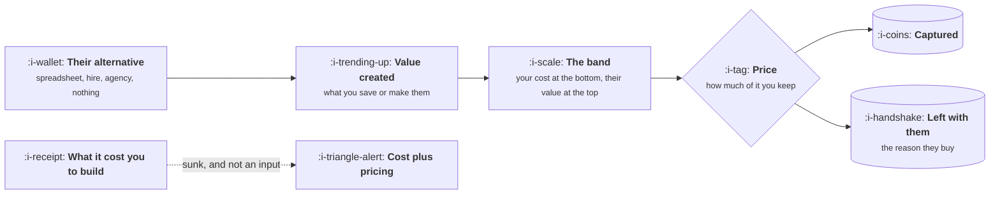

# What Pricing Actually Is

```text
Level: Foundations
Prerequisites: What a Product Manager Does
Estimated difficulty: 2/5 | Estimated time: 25 min
```

## The idea in one minute

Price is the share of the value you created that you keep. It is not a function of what the product
cost to build, which is sunk and irrelevant, and it is not a function of what competitors charge,
which tells you about their costs and their segment rather than about your value. Pricing from cost
or from the competitor is the single most common error, and it is an error in both directions: it
undercharges when you have created a lot of value cheaply, and it overcharges when you have spent
heavily on something nobody wanted. The useful question is always what the customer's alternative
costs them, because that is the number your price is actually measured against.

## A picture



Note that some value must be left with the customer. A price that captures everything is a price
nobody accepts, because the reason to switch disappears.

## How it really works

### The band

Your cost to serve is the floor. The value the customer gets is the ceiling. Everything in between
is negotiable, and the band is usually enormous, which is why pricing feels arbitrary and why small
changes in approach move revenue so much.

For most software the floor is low and irrelevant to the decision; the interesting end is the
ceiling, which means the work is understanding value rather than understanding cost. The exception
is any product with a real marginal cost, which now includes anything with a model in it, where the
floor comes up to meet you.

### Value is measured against the alternative

A customer does not compare your price to zero. They compare it to what they do today, which costs
them something already:

| Their alternative | What it costs them | What that tells you |
|---|---|---|
| A spreadsheet somebody maintains | Hours a week, times a salary | A defensible annual number |
| A junior hire | The salary, loaded | An upper bound most buyers accept |
| An agency or contractor | An invoice they can show you | The easiest anchor to price against |
| A competitor | Their price, plus switching cost | Useful, but tells you about them |
| Nothing | The cost of the problem being unsolved | The hardest to establish and the most common |

The last row is where most products actually live, and it is why discovery and pricing are the
same conversation: if nobody can state what the problem costs them today, you cannot price it and
probably should not build it.

### Why cost plus pricing is wrong in both directions

If you build something in two weeks that saves a customer fifty thousand a year, cost plus pricing
charges them for two weeks. If you spend two years building something nobody values, cost plus
pricing produces a number no one will pay. The cost of building tells you whether the business
works at a given price, which is a different and later question.

### Why copying a competitor is also wrong

Their price encodes their cost structure, their segment, their funding position and their history.
Copying it imports all four. It is worth knowing as a reference point for what the market finds
normal, and it is not an input to what you should charge.

### Price is a product decision

Three reasons it belongs with product rather than purely with finance. The value metric determines
what the product optimises for, since customers will change behaviour to manage their bill. Tiers
are a design of which problems you solve for whom. And a price change is a product migration with
communication, grandfathering and churn risk, which is programme work rather than a number edit.

### The uncomfortable part

Pricing well requires asking people what things cost them and what they would pay, which feels
intrusive, and most teams avoid it by inferring a price from internal logic instead. Everything in
this topic is downstream of being willing to have that conversation.

### What fills the box in 2026

Billing and metering through Stripe Billing, Orb, Metronome or Chargebee, and the choice matters
more once usage pricing is involved. Willingness to pay research is interviews and surveys rather
than software. Anything with a model in it needs cost per task from
[AI Cost and Margin](../ai-cost-and-margin/README.md) before a price can be set at all, because
that is the case where the floor genuinely constrains you.

## Sector lens

| Sector | What sets the ceiling |
|---|---|
| [Enterprise B2B SaaS](../product-by-sector/01-enterprise-b2b-saas.md) | Headcount replaced or risk avoided, and procurement benchmarks against both |
| [Fintech](../product-by-sector/02-fintech.md) | Often a share of the money moved, so the ceiling is set by the transaction |
| [Ecommerce and D2C](../product-by-sector/03-ecommerce-and-d2c.md) | Contribution margin per order. The floor is real and close to the ceiling |
| [Marketplaces](../product-by-sector/04-marketplaces.md) | Take rate against what each side could get by going around you |
| [Devtools and Infrastructure](../product-by-sector/05-devtools-and-infrastructure.md) | Engineering time saved, benchmarked against building it in house |
| [Healthtech](../product-by-sector/06-healthtech-and-regulated-care.md) | Reimbursement rules, which may cap the price regardless of value |
| [Vertical SaaS](../product-by-sector/07-vertical-saas.md) | What the whole workflow costs them today, including the people doing it |

## Remember this

* Price is the share of created value you keep, not a markup on cost.
* The band runs from your cost to their value, and it is usually wide.
* Value is measured against their actual alternative, which is often a spreadsheet or nothing.
* Cost plus pricing undercharges cheap wins and overcharges expensive mistakes.
* A competitor's price encodes their situation, not your value.
* Some value must be left with the customer, or there is no reason to switch.

## Try it

1. For your product, write down the alternative five real customers use today and what it costs
   them. If you cannot fill three rows, that is the finding.
2. Compute your band: cost to serve one customer, and the annual value one customer gets. Where in
   that band does your price sit?
3. Ask one customer directly what they were doing before, and what that cost. Most people answer
   readily and nobody has asked them.

## Check yourself

1. Why is the cost of building a product irrelevant to its price, and what question is it relevant
   to?
2. What changes about the band when the product has a real marginal cost per use?
3. Why does pricing belong with product rather than only with finance? Give the three mechanisms.
