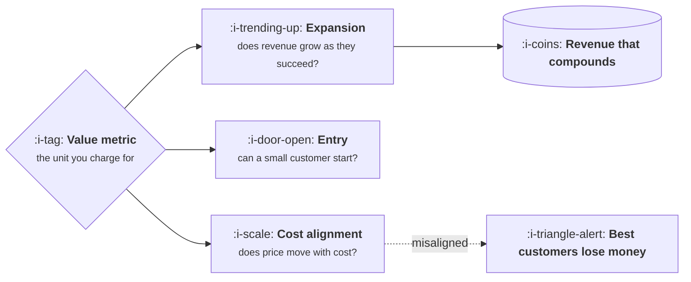

# The Value Metric

```text
Level: Foundations
Prerequisites: What Pricing Actually Is
Estimated difficulty: 3/5 | Estimated time: 35 min
```

## The idea in one minute

The value metric is the unit you charge for: a seat, a message, a transaction, a gigabyte, a
resolved ticket. It is the highest leverage pricing decision because it decides three things at
once, before any number is chosen. It decides whether your revenue grows as the customer succeeds,
whether a small customer can afford to start, and whether your cost and your price move together or
against each other. Choosing badly is expensive to undo, because customers build their own planning
around it. And one specific failure has become common: picking a seat metric for a product whose
cost scales with usage, which is a slow margin leak pointed directly at your best customers.

## A picture



Three tests on one choice. Most pricing discussions argue about the number at the end and never
examine the unit at the start.

## How it really works

### The three tests

**Does it grow with the customer's success?** If a customer gets twice the value next year, does
your revenue rise? A metric that does not grow means every price increase must be negotiated, and
expansion revenue, which is the cheapest revenue there is, does not exist.

**Can a small customer start?** If the smallest sensible use of the product costs a thousand a
month, you have excluded the segment that would have grown into your mid market. Good value metrics
are small enough at the bottom that starting is easy.

**Does it track your cost?** Previously an afterthought, now the sharpest of the three. If serving a
customer costs you more as they use more, and your price does not move with usage, your margin
falls as engagement rises.

### The candidates

| Metric | Grows with success | Easy to start | Tracks cost | Best for |
|---|---|---|---|---|
| Seats | Weakly, by headcount | Yes | Poorly, once there is a model | Collaboration tools where value is per person |
| Usage, raw units | Strongly | Yes | Well | Infrastructure, anything metered |
| Credits | Strongly | Yes | Well, if priced right | AI features with varied task costs |
| Transactions | Strongly | Yes | Well | Payments, commerce, anything per event |
| Outcomes | Strongly | Varies | Poorly, risk sits with you | Where the outcome is measurable and attributable |
| Flat fee | No | Yes | No | Simplicity, small markets, early products |

Seats are the default because they are predictable and easy to forecast, and that predictability is
exactly what breaks when cost became variable.

### The alignment failure, concretely

A seat priced product adds a feature with a per use cost. Light users subsidise heavy ones, which
is fine while the spread is narrow. As the feature succeeds, the heaviest users become
unprofitable, and they are also your most engaged, most referenceable, least likely to churn
customers. The incentive this creates is to make your best customers use the product less, which
is the clearest sign a value metric is wrong.

The program below finds the usage level where that happens.

### Changing it later is a migration

Customers have built budgets, approvals and internal allocations around the current unit. Changing
it means every account is repriced, some go up, and you learn which ones were unprofitable by
losing them. It is doable, it is a programme with grandfathering and communication, and it is
dramatically cheaper to get approximately right at the start.

### A practical middle path

Many products land on a hybrid: a seat or platform fee for predictability, plus a usage component
for the part that costs you money. This keeps the forecastability finance wants while protecting
margin, and it is currently the most common shape for products with a model inside them. The
hazard is complexity: two metrics is near the limit of what a buyer will reason about, and three
is a product nobody can estimate the bill for.

## Run the numbers

A seat price against a usage distribution, with a per task cost. The question is which share of
customers is unprofitable and whether they are the ones you most want.

```go
// metric.go: where a seat price stops covering the cost of use.
package main

import "fmt"

const (
	seatPrice   = 40.0  // per seat, per month
	seatsAvg    = 12.0  // seats on an average account
	costPerTask = 0.055 // inference, retries and judging for one task
	serveFixed  = 60.0  // hosting, support and everything else, per account
)

// Usage is long tailed. Each decile uses a different number of tasks a month.
var tasksByDecile = []float64{40, 110, 210, 350, 560, 860, 1_350, 2_200, 4_100, 11_000}

func main() {
	revenue := seatPrice * seatsAvg
	fmt.Printf("account revenue %.0f a month, fixed cost to serve %.0f\n\n", revenue, serveFixed)
	fmt.Printf("%8s %10s %12s %12s  %s\n", "decile", "tasks", "task cost", "margin", "verdict")
	unprofitable := 0
	for i, t := range tasksByDecile {
		cost := serveFixed + t*costPerTask
		margin := revenue - cost
		verdict := "fine"
		if margin < 0 {
			verdict = "loses money"
			unprofitable++
		} else if margin < 0.3*revenue {
			verdict = "thin"
		}
		fmt.Printf("%8d %10.0f %12.2f %12.2f  %s\n", i+1, t, t*costPerTask, margin, verdict)
	}
	fmt.Printf("\n%d of 10 deciles lose money, and they are the heaviest users.\n", unprofitable)
	fmt.Println("A seat price asks your most engaged customers to be your least profitable.")
}
```

The shape is the point, not the exact figures. Margin is comfortable across most of the
distribution and then collapses at the top, and the collapse happens precisely among the customers
you would choose if you could only keep some. Two fixes exist and both are unit changes rather than
price changes: add a usage component above an included allowance, or move to credits entirely. A
price rise across the board does not fix it, because it taxes the profitable deciles to subsidise
the top one.

## Sector lens

| Sector | The value metric that fits |
|---|---|
| [Enterprise B2B SaaS](../product-by-sector/01-enterprise-b2b-saas.md) | Seats, often with a platform fee. Procurement wants a forecastable number |
| [Fintech](../product-by-sector/02-fintech.md) | Transaction volume or a spread, which aligns naturally with both value and cost |
| [Ecommerce and D2C](../product-by-sector/03-ecommerce-and-d2c.md) | Orders or gross merchandise value, because that is what the merchant counts |
| [Marketplaces](../product-by-sector/04-marketplaces.md) | Take rate on transaction value, varied by segment |
| [Devtools and Infrastructure](../product-by-sector/05-devtools-and-infrastructure.md) | Usage, almost always, because it matches how adoption actually grows |
| [Healthtech](../product-by-sector/06-healthtech-and-regulated-care.md) | Per provider or per encounter, constrained by what the payer will reimburse |
| [Vertical SaaS](../product-by-sector/07-vertical-saas.md) | Often a flat fee plus payments, where payments become the larger line |

## Remember this

* The value metric is the unit, and it is a bigger decision than the number.
* Three tests: grows with their success, cheap to start, tracks your cost.
* The cost test used to be an afterthought and is now the sharpest one.
* A seat price on a usage heavy product makes your best customers your least profitable.
* Fixing misalignment is a unit change, not a price rise. A price rise taxes the wrong people.
* Changing the metric later is a migration with churn, so get it approximately right early.

## Try it

1. Run `metric.go` with your own usage distribution and cost per task. How many deciles lose money,
   and who is in the top one?
2. Score your current value metric against the three tests. Any no is a thing to plan for.
3. Write the hybrid version of your pricing: platform fee plus usage above an allowance. Would a
   buyer be able to estimate their bill from it?

## Check yourself

1. Why does a value metric that fails the growth test make every price increase a negotiation?
2. A seat priced product becomes unprofitable at the top decile. Why does raising the seat price
   not fix it?
3. What makes changing the value metric expensive later, beyond the repricing itself?
