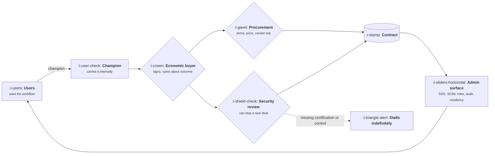

# Enterprise B2B SaaS

```text
Level: Sectors
Prerequisites: AI Product Shapes
Estimated difficulty: 3/5 | Estimated time: 40 min
```

## The idea in one minute

In enterprise software the person who signs is not the person who uses, and that single separation
generates almost every other property of the sector. It produces a buying committee rather than a
buyer, a cycle measured in months, a security review that can stop a deal that sales has already
won, and a category of product work that no user will ever notice or thank you for: tenancy,
single sign on, provisioning, roles, audit logs, data residency and retention. That work is not
overhead. It is the price of entry, it takes two to four engineer quarters to do properly, and it
has to be priced into the decision to move upmarket rather than discovered afterwards.

## A picture



Follow the loop at the bottom. The admin surface exists to satisfy the two gates in the middle, and
the users at the start only benefit from it indirectly, by being allowed to keep using the product.

## How it really works

### Who is in the room

| Role | Cares about | Kills the deal by |
|---|---|---|
| User | Whether the daily workflow is better | Not adopting after purchase, which kills the renewal instead |
| Champion | Being right, and their own credibility | Leaving the company, which is the most common cause of a stalled deal |
| Economic buyer | The business outcome and the budget line | Deciding the problem is not worth the money this year |
| Procurement | Terms, price benchmarking, vendor concentration | Extracting a discount that ruins the deal economics, or delaying past quarter end |
| Security and IT | Risk, and their own liability | Finding a missing control with no remediation path |
| Legal | Liability, data processing, indemnities | Deadlocking on a clause nobody at your company can approve |

The practical implication for product: you are building for at least three audiences with different
and sometimes opposed interests, and only one of them will ever give you usable feedback.

### The cycle, and what it does to the loop

Two to twelve months from first contact to signature, then weeks to months to deploy, then a
renewal decision a year later. Your learning loop is as long as that chain unless you deliberately
build shorter ones.

What this means in practice is that you cannot run the loop from
[The Product Loop](../the-product-function/02-the-product-loop.md) on outcomes. You run it on
leading signals: how many security reviews raised the same gap, how many deals stalled at the same
stage, how many admins asked for the same report. Those are available in weeks, and the honest
version of enterprise product measurement is mostly counting recurring objections.

### The admin surface nobody asked for

This is the defining product work of the sector and it is consistently underestimated. The minimum
credible set as of October 2026:

* **Single sign on** through SAML and increasingly OIDC, because IT will not manage another
  password directory.
* **Provisioning** through SCIM, so that an employee leaving the customer loses access without a
  support ticket.
* **Roles and permissions** with enough granularity to express "can see spend but not change it",
  which arrives in every second security questionnaire.
* **Audit logs** that are exportable, immutable and complete enough to answer "who changed this".
* **Data residency**, meaning the customer can require that their data stays in a named region.
* **Retention and deletion** controls, with a defensible answer to "prove it is gone".
* **Tenancy isolation**, which is an architectural decision made far earlier than anyone realises.

None of these show up in a demo. All of them appear in the security questionnaire, and the
questionnaire arrives after sales has already told the customer the deal is nearly done.

### The security review is a product problem

Teams treat the review as a sales obstacle, which is why it keeps hurting them. It is a product
requirement arriving through an unusual channel. The useful response is mechanical: keep a register
of every control ever asked for, how many deals asked, and the value of those deals. Within two
quarters that register tells you precisely which three items to build, with the revenue attached,
and it converts an annoying interruption into the best prioritised backlog in the company.

Certifications are the compressed version of the same thing. SOC 2 Type II and ISO 27001 do not
prove you are secure; they prove you have controls and evidence, which is what lets a reviewer
approve you without personally auditing you. Below roughly fifty thousand in annual contract value
they are rarely demanded. Above it they are table stakes.

### What this does to the roadmap

Three structural consequences.

1. **A permanent tax.** Expect twenty to thirty percent of engineering capacity on the admin
   surface and compliance work indefinitely, not as a one off project.
2. **The loudest customer is not the largest market.** One enterprise customer can generate a
   quarter of roadmap requests. The discipline is to build what several customers need and to
   refuse the rest, visibly and politely. See the refusals signal in
   [What Good Looks Like](../the-product-function/06-what-good-looks-like.md).
3. **Deprecation becomes expensive.** Contracts constrain what you may remove and when, so
   decisions you make now are harder to undo than in any other sector.

### What fills the box in 2026

Identity is Okta, Microsoft Entra, Auth0 or Keycloak, with WorkOS and similar products existing
specifically to sell you the admin surface rather than build it. Compliance automation is Vanta or
Drata. Security questionnaire handling is Whistic or a maintained trust centre page. Contract and
billing complexity lands in Salesforce plus a billing system such as Chargebee, Maxio or Stripe
Billing. The pattern worth noticing is that an entire tooling category exists because this
sector's unglamorous requirements are so predictable.

## Run the numbers

Moving upmarket is usually argued as a revenue story. It is really a story about whether the
contract value covers a fixed cost of entry plus a permanent capacity tax. This program computes
the annual contract value at which it starts paying.

```go
// upmarket.go: what enterprise readiness costs, and the contract value that covers it.
package main

import (
	"fmt"
	"math"
)

const (
	engineerQuarter = 55_000.0 // one engineer, one quarter, fully loaded
	readinessQtrs   = 10.0     // SSO, SCIM, roles, audit, residency, tenancy work
	auditAnnual     = 45_000.0 // SOC 2 Type II plus pen test plus tooling
	taxFraction     = 0.25     // share of the team spent on this work permanently
	teamSize        = 6.0
	grossMargin     = 0.80

	// The point of the model: winning an enterprise deal costs roughly the same
	// whether the contract is small or large. Account executive and solutions
	// engineer time, legal review, the security questionnaire, and the three
	// losses you worked to get this win.
	costPerWin = 25_000.0
)

func main() {
	setup := readinessQtrs * engineerQuarter
	annual := auditAnnual + taxFraction*teamSize*4*engineerQuarter
	fmt.Printf("one off readiness build   %10.0f\n", setup)
	fmt.Printf("annual compliance and tax %10.0f\n", annual)
	fmt.Printf("cost to win one deal      %10.0f\n\n", costPerWin)

	fmt.Printf("%10s %18s %12s  %s\n", "ACV", "yr1 contribution", "wins needed", "verdict")
	for _, acv := range []float64{15_000, 40_000, 80_000, 150_000, 400_000} {
		contribution := acv*grossMargin - costPerWin
		if contribution <= 0 {
			fmt.Printf("%10.0f %18.0f %12s  %s\n", acv, contribution, "never",
				"cost of sale exceeds the margin")
			continue
		}
		need := math.Ceil(annual / contribution)
		verdict := "viable enterprise motion"
		if need > 25 {
			verdict = "needs a volume motion instead"
		}
		fmt.Printf("%10.0f %18.0f %12.0f  %s\n", acv, contribution, need, verdict)
	}
	fmt.Println("\nWins needed is how many new customers a year it takes to cover compliance and the tax.")
	fmt.Println("The fixed cost of winning a deal is what makes small enterprise contracts lose money.")
}
```


The row that changes behaviour is the first one. At fifteen thousand of contract value the cost of
winning the deal exceeds everything the deal produces in its first year, so the deal is only
rational if you are confident about renewal and expansion. That is a bet on net revenue retention,
and it should be made explicitly rather than discovered two years later. At forty thousand the deal
is profitable but you need so many of them that you are really running a volume motion with
enterprise overheads, which is the worst position in the table. The economics only become
comfortable around eighty thousand, which is why that number keeps appearing as the threshold for
a genuine enterprise motion.

## The AI layer

Two uses genuinely earn their place in this sector. The first is the security questionnaire:
answering a four hundred item questionnaire from your own control documentation is exactly the task
models are good at, and it reliably removes days of senior time per deal, at cents of inference. The
answers still need a human signature, because a wrong answer here is a contractual
misrepresentation rather than an error. The second is the objection register described above:
clustering sales call notes and review threads into recurring gaps is a genuine prioritisation
input.

The thing to be careful about is the opposite direction: enterprise buyers now ask how you use
models on their data, and the answers they require are specific. Expect to need a named list of
subprocessors, a statement about whether customer data trains anything, regional processing
guarantees and a way to switch the feature off per tenant. Those are product requirements with
engineering cost, and they are now arriving in the same questionnaire as the rest.

## What it changes for each function

| Function | The delta |
|---|---|
| Product | A permanent capacity tax, three audiences, and deprecation constrained by contract |
| Growth | Self service activation barely exists, because the user cannot buy. Growth is pipeline and expansion |
| Go to market | Procurement and security are real stages, and the champion leaving is a top cause of loss |
| Operations | Contract complexity drives the data model, billing, and revenue recognition |
| AI | Per tenant controls, subprocessor disclosure and training opt out become table stakes |

## Remember this

* The buyer is not the user, and nearly every property of the sector follows from that.
* The admin surface costs two to four engineer quarters and then a permanent capacity tax of
  roughly a quarter of the team.
* The security review is a product backlog arriving through the wrong door. Keep a register with
  deal value attached.
* Measure on recurring objections and stalled stages, because outcomes arrive on renewal cycles.
* The cost of winning a deal is roughly fixed, so small enterprise contracts lose money. Below
  about eighty thousand in contract value the economics are either negative or need volume.

## Try it

1. Run `upmarket.go` with your own contract values and `salesCostRatio`. At what ACV does your
   current motion stop working?
2. Build the objection register from the last ten deals: every control or feature a reviewer asked
   for, how many asked, and the value behind each. Rank by value.
3. List which of the seven admin surface items you have today, honestly, and estimate the remaining
   work in engineer quarters. Compare that against your next upmarket revenue target.

## Check yourself

1. Why does a champion leaving the customer stall a deal more reliably than a competitor winning it?
2. Certifications do not prove a product is secure. What do they actually let a reviewer do, and
   why does that make them worth buying?
3. One enterprise customer generates a quarter of your roadmap requests. What specific artifact
   from the foundations topic protects you here, and what does it have to contain?
