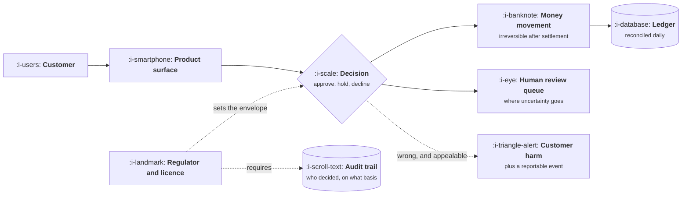

# Fintech

```text
Level: Sectors
Prerequisites: AI Product Shapes
Estimated difficulty: 4/5 | Estimated time: 40 min
```

## The idea in one minute

In fintech, being wrong moves money, and a regulator has an opinion about how you were wrong. That
produces two constraints no other sector has at the same strength: there is a legal envelope around
what the product may do, decided before any design work, and every mistake has a counterparty who
loses something real. The consequence for product work is that the roadmap contains large items
nobody asked for and no user will see, that error tolerance for anything touching money is near
zero, and that a model is almost never allowed to be the final decision maker on an outcome a
customer can appeal.

## A picture



The two dotted arrows from the regulator are the whole difference. One constrains what the decision
may be, the other requires you to be able to explain it afterwards, and the second is the one teams
forget until an audit.

## How it really works

### The envelope comes before the design

In most sectors you design the product and then check it is legal. Here the order inverts: what you
are licensed to do, in which jurisdictions, with whose money, determines which products exist at
all. A product manager who cannot describe their own firm's permissions is going to propose things
that cannot be built, repeatedly, and lose credibility doing it.

The practical move is to learn the envelope once, properly, as a one page artifact: what the firm is
permitted to do, under whose licence, in which markets, with which required disclosures, and what
needs a filing or a new permission. That page saves more roadmap time than any prioritisation
framework.

### Money movement is irreversible in a way product work usually is not

Software mistakes are normally reversible: redeploy and the wrong thing stops happening. A payment
that settled is a thing that happened to somebody else's balance. The design consequence is that
the product needs explicit states for in flight, settled, reversed and disputed, and those states
have to be visible in the interface rather than implied, because the customer's mental model of
"did it work" has to match the ledger's.

Reconciliation is the operational heart of it: an independent check that what you believe happened
matches what the money rails say happened, run daily. Breaks are normal, and a product that has no
surface for investigating a break has pushed that work onto a spreadsheet somebody maintains
privately.

### Where a model may and may not decide

As of October 2026, the working rule across most jurisdictions is that a model may surface, rank,
explain and draft, but a decision that materially affects a customer and is appealable needs a
basis you can state and, usually, a human who can be named. That shapes products precisely:

| Task | Model's role | Why |
|---|---|---|
| Transaction monitoring | Rank and cluster alerts for a reviewer | Volume is impossible by hand, but every alert outcome is auditable |
| Fraud scoring | Score, with a threshold the firm sets and documents | The threshold is a product decision and a risk decision at once |
| Credit decisions | Support only, in most regimes | An adverse decision usually requires a statable reason and a right to contest |
| Customer support | Answer, draft and route, with hard stops on advice | Anything that reads as financial advice is a regulated act |
| Reconciliation breaks | Propose the match, a human confirms | A wrong match quietly corrupts the ledger |
| Document extraction | Extract, with confidence surfaced | Cheap to verify, enormous volume, a genuinely good fit |

The pattern is consistent: models are good here where the volume is unmanageable and the
verification is cheap, and they are constrained wherever the output is itself the decision.

### Explainability is a product requirement, not a model property

If a decision is appealable, you have to be able to say why it was made. The usual mistake is to
treat that as a modelling problem to solve later. It is a product design decision made early:
capture the inputs that drove the decision at the moment it was made, store them with the outcome,
and build the screen where a reviewer reads them. A system that can produce the right answer but
cannot reconstruct its basis six months later will fail an audit regardless of how accurate it is.

### What fills the box in 2026

Payments and movement run through Stripe, Adyen, Checkout or direct rails. Bank data comes through
Plaid, TrueLayer or equivalent. Identity and anti money laundering checks go to Persona, Alloy,
ComplyAdvantage or Sardine. Ledgers are increasingly a dedicated service rather than rows in the
application database, which is the single most useful architectural choice in the sector. The
compliance calendar, not the tooling, is what actually governs delivery dates.

## Run the numbers

A fraud or monitoring model is a threshold, and the threshold is a product decision. Move it one
way and you block good customers; move it the other and losses rise and the review queue floods.
This computes the total cost of a threshold, including the part nobody counts, which is the
reviewer.

```go
// threshold.go: where to set a fraud threshold, counting all three costs.
package main

import "fmt"

const (
	daily        = 40_000.0 // transactions a day
	fraudRate    = 0.004    // share that are genuinely fraudulent
	avgLoss      = 180.0    // lost per fraudulent transaction that goes through
	avgValue     = 95.0     // margin lost when a good customer gives up
	abandonRate  = 0.25     // share of wrongly held customers who do not come back
	reviewMins   = 6.0      // minutes a reviewer spends on one held transaction
	reviewerCost = 45.0     // loaded cost per hour
)

// A threshold trades detection against false positives. Tighter catches more
// fraud and holds more good customers.
type point struct {
	name     string
	caught   float64 // share of fraud caught
	falsePos float64 // share of good transactions wrongly held
}

func main() {
	points := []point{
		{"loose", 0.45, 0.0005},
		{"moderate", 0.70, 0.0020},
		{"tight", 0.88, 0.0060},
		{"very tight", 0.95, 0.0150},
	}
	fraud, good := daily*fraudRate, daily*(1-fraudRate)
	fmt.Printf("%-12s %11s %9s %9s %11s\n", "threshold", "fraud loss", "review", "lost", "total/day")
	best, bestCost := "", 0.0
	for i, p := range points {
		loss := fraud * (1 - p.caught) * avgLoss
		heldGood := good * p.falsePos
		review := (fraud*p.caught + heldGood) * reviewMins / 60 * reviewerCost
		lost := heldGood * abandonRate * avgValue
		total := loss + review + lost
		fmt.Printf("%-12s %11.0f %9.0f %9.0f %11.0f\n", p.name, loss, review, lost, total)
		if i == 0 || total < bestCost {
			best, bestCost = p.name, total
		}
	}
	fmt.Printf("\nlowest total cost: %s at %.0f a day\n", best, bestCost)
	fmt.Println("Loosest and tightest both cost roughly twice the optimum, for opposite reasons.")
}
```

The curve has an interior minimum, and both ends are roughly twice as expensive as the middle for
opposite reasons. Loose loses money to fraud. Very tight loses four times more money to customers
who were never fraudulent and gave up while held, plus a review queue that now costs more than the
fraud it is catching.

That last point is the one left out of most threshold discussions. Fraud losses have an owner who
reports them. The review queue is a headcount line in a different team, and the customers who
abandoned are not in anybody's report at all, which is why the pressure in these conversations is
almost always toward tightening. The threshold that minimises total cost is a product decision made
jointly with risk, and it moves whenever volume or mix changes.

## What it changes for each function

| Function | The delta |
|---|---|
| Product | A legal envelope decided before design, irreversible actions, and explainability built in at capture time |
| Growth | Onboarding cannot be frictionless, because identity verification is mandatory and costs conversion |
| Go to market | Risk and compliance join the buying committee, and security review is stricter than elsewhere |
| Operations | Reconciliation, audit trails and regulatory reporting are daily work rather than projects |
| AI | Models rank, explain and draft. They rarely decide anything a customer can appeal |

## Remember this

* The licence envelope comes before the design. Learn it once, as one page.
* Money movement is irreversible, so in flight, settled, reversed and disputed are product states.
* Reconciliation is the operational heart, and a break with no investigation screen becomes a
  private spreadsheet.
* Models rank, cluster, extract and draft here. They do not make appealable decisions.
* Explainability is captured at decision time or it does not exist. It is not a modelling problem.
* A fraud threshold has three costs: losses, review time, and customers who gave up. Only the
  first has an owner who reports it, which is why thresholds drift tight.

## Try it

1. Run `threshold.go`, then raise `reviewMins` to 15 to model a complex case. Does the cheapest
   threshold move, and in which direction? Then set `abandonRate` to zero and see which end of the
   table that argument favours.
2. Write your own firm's envelope on one page: permissions, jurisdictions, required disclosures,
   and what needs a filing. Show it to someone in compliance and count the corrections.
3. Take an AI feature you are considering. Decide whether its output is a decision a customer could
   appeal. If it is, redesign it so a person is named on the outcome.

## Check yourself

1. Why does a tighter fraud threshold stop being cheaper past a certain point, and which cost
   reveals that?
2. A model is accurate enough to make credit decisions. Name two reasons it still may not.
3. What has to be captured at the moment a decision is made so that it can be explained a year
   later, and why can it not be reconstructed afterwards?
