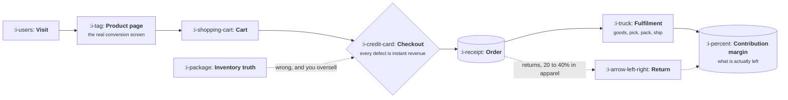

# Ecommerce and D2C

```text
Level: Sectors
Prerequisites: AI Product Shapes
Estimated difficulty: 3/5 | Estimated time: 35 min
```

## The idea in one minute

Ecommerce looks like a funnel business and is actually a margin business wearing a funnel costume.
Conversion rate is the metric everyone optimises, and contribution margin per order is the number
that decides whether the company survives, because every order carries real costs that software
businesses do not have: the goods, the shipping, the payment fee, and the quarter of orders that
come back. The product consequences follow directly. Inventory truth is the hardest engineering
problem in the building, the checkout is the only screen where a defect is instantly expensive, and
any feature with a per use cost has to justify itself against a margin measured in single digit
dollars.

## A picture



Everything above the order line is the funnel people optimise. Everything below it decides whether
the order was worth having, and only the second half is on the dotted paths.

## How it really works

### Contribution margin per order is the real metric

The arithmetic that matters is one line: selling price, minus cost of goods, minus shipping, minus
the payment fee, minus the amortised cost of returns, minus discounts. What remains has to cover
acquisition and everything else. In apparel, a forty dollar order can leave under eight dollars of
contribution, and in categories with free returns it can be negative for the segment that returns
most.

This is why the sector punishes product decisions that would be free elsewhere. A feature that adds
twenty cents per order to cost has spent two and a half percent of contribution. Every lesson in
this course about cost per task lands harder here than anywhere else.

### Returns are a product surface, not an operations problem

In categories where returns run from twenty to forty percent, the return is part of the product.
The decisions are product decisions: what the policy is, how the size guidance works, whether you
show fit information from other customers, whether exchange is easier than refund, and whether you
identify the segment that is unprofitable and stop acquiring it.

The highest leverage work here is usually preventing the return rather than processing it, and that
is almost always an information problem on the product page.

### Inventory truth is the hard problem

Multiple channels, a warehouse, in flight orders, reservations that expire, and a physical world
where things get damaged. The product question is what you promise the customer, and the honest
options are to show a conservative number, to show real availability and risk overselling, or to
hold stock on add to cart and lose the sale when the hold expires. All three are wrong in different
ways and the choice is yours to make explicitly.

### Where a model pays for itself

The economics are unforgiving, so the useful AI features here are the ones that move margin rather
than delight. As of October 2026 the ones that reliably clear the bar:

| Feature | Why it pays | Watch for |
|---|---|---|
| Product data enrichment | Catalogue attributes drive search and filters, and doing it by hand does not scale | Wrong attributes are worse than missing ones |
| Size and fit guidance | Directly reduces the most expensive return class | Needs real return reason data to work |
| Search and recommendation | Classic ranking, long predating generative models, still the biggest lever | Novelty effects, and cannibalising what people would have bought anyway |
| Support deflection | Where is my order is most of the volume and is fully answerable | Must be grounded in real order state, never guessed |
| Review and content summarisation | High volume, cheap to verify, improves the product page | Fabricated summaries are a consumer law problem |

The feature that gets proposed most and pays least is a conversational shopping assistant. It
carries a per session inference cost against a single digit dollar contribution, and in most
catalogues good search and filters answer the same need for nothing.

### What fills the box in 2026

Storefronts are Shopify, commercetools or a custom frontend against a headless backend. Payments
are Stripe, Adyen or PayPal. Search and merchandising go to Algolia, Constructor or Bloomreach.
Marketing automation is Klaviyo or Braze. Subscriptions add Recharge or similar. The platform
decision constrains the product far more here than in software, because the checkout is usually
not yours to change.

## Run the numbers

One order, broken into what is actually left, and what an AI feature costs against it.

```go
// contribution.go: what is left of an order, and what a feature may cost per session.
package main

import "fmt"

type category struct {
	name       string
	price      float64
	discount   float64 // average discount actually given
	cogsRate   float64 // cost of goods as a share of net price
	shipping   float64 // what you pay, not what you charge
	returnRate float64
	returnCost float64 // handling and restocking on a returned order
	conversion float64 // orders per session
}

const (
	payRate  = 0.029
	payFixed = 0.30
	aiShare  = 0.03   // share of contribution you will spend on inference
	callCost = 0.0225 // one model call at 5k in, 500 out, 2026 frontier prices
)

// contribution is what one average order leaves behind, averaged over the
// orders that stick and the ones that come back.
func (c category) contribution() float64 {
	net := c.price - c.discount
	fee := net*payRate + payFixed
	kept := net - net*c.cogsRate - c.shipping - fee
	// A return refunds the customer, so you keep nothing and still paid to
	// ship it out, to take it back, and the payment fee is not returned.
	returned := -(c.shipping + c.returnCost + fee)
	return (1-c.returnRate)*kept + c.returnRate*returned
}

func main() {
	cats := []category{
		{"apparel", 68, 9, 0.38, 7.50, 0.32, 6.00, 0.025},
		{"beauty", 42, 4, 0.28, 5.00, 0.06, 3.00, 0.035},
		{"homeware", 135, 12, 0.45, 18.00, 0.14, 15.00, 0.018},
		{"supplements", 55, 6, 0.22, 5.50, 0.03, 3.00, 0.040},
	}
	fmt.Printf("%-13s %7s %13s %8s %12s %13s\n",
		"category", "price", "contribution", "margin", "AI/order", "calls/session")
	for _, c := range cats {
		con := c.contribution()
		perOrder := aiShare * con
		// You pay for inference on every session, not only the ones that buy.
		perSession := perOrder * c.conversion
		fmt.Printf("%-13s %7.0f %13.2f %7.0f%% %12.3f %13.2f\n",
			c.name, c.price, con, 100*con/c.price, perOrder, perSession/callCost)
	}
	fmt.Println("\nAI budget is three percent of contribution per order, spread over every session.")
	fmt.Println("Nobody here can afford a conversation. One call per visitor is roughly the ceiling.")
}
```

The last column is the one to take into a planning meeting, and the step that produces it is the
one teams skip. Contribution is earned per order. Inference is paid per session, including the
ninety seven percent of sessions that buy nothing. So the per order budget has to be multiplied by
the conversion rate before it means anything, and when you do that, every category here lands at
roughly one model call per visitor. Apparel manages less than half of one.

That settles the shopping assistant argument before anybody builds a prototype. A conversation is
ten or more calls against a budget of one, so it can only work if it is restricted to sessions that
have already shown intent, which is a different and much smaller feature than the one usually
proposed.

## What it changes for each function

| Function | The delta |
|---|---|
| Product | Margin per order constrains every feature, returns are a design surface, and inventory truth is the hard problem |
| Growth | Acquisition cost competes directly with contribution, so the two have to be read on one line |
| Go to market | There is no sales motion. Merchandising, lifecycle messaging and the product page do the selling |
| Operations | Inventory, fulfilment and returns are the operation, and they are physical |
| AI | Features must pay for themselves in cents per order. Enrichment and deflection clear the bar; conversation usually does not |

## Remember this

* Contribution margin per order, not conversion rate, decides whether the business works.
* Returns are a product surface. Preventing one beats processing one, and it is an information
  problem on the product page.
* Inventory truth has three honest answers and all of them are wrong in different ways. Choose
  explicitly.
* An AI feature here has a budget in cents per order, and you must multiply it by the conversion
  rate, because you pay for inference on the sessions that buy nothing too.
* The most proposed feature, a shopping assistant, is usually the least affordable.

## Try it

1. Run `contribution.go` with your own category's numbers. What is your budget per order for
   anything inferred?
2. Set `returnRate` for apparel to 0.45, which is normal for some fit sensitive lines. At what point
   does contribution go negative, and what would you change first?
3. List the last three AI features proposed for your product. Price each per session, not per
   order, and compare against the budget you just computed.

## Check yourself

1. Why can a high converting ecommerce business still be unprofitable, and which number reveals it?
2. The three honest answers to inventory availability each fail differently. Name the failure of
   each, and which customer notices.
3. A feature is priced at three cents per order and your budget is four. Why might it still be
   unaffordable, and what number did you forget?
