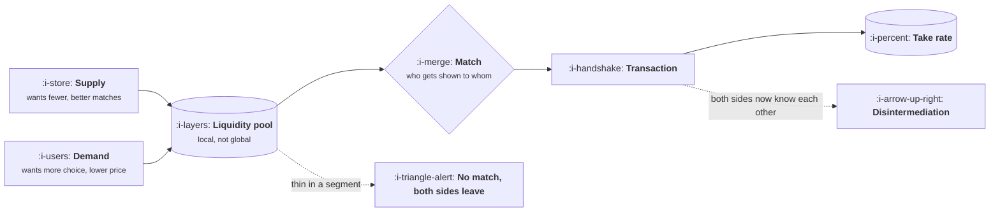

# Marketplaces

```text
Level: Sectors
Prerequisites: AI Product Shapes
Estimated difficulty: 4/5 | Estimated time: 40 min
```

## The idea in one minute

A marketplace has two customers whose interests genuinely oppose each other, and the product's job
is to decide, repeatedly and deliberately, which one loses. Everything distinctive about the sector
follows from that: liquidity is the only metric that matters and it is local rather than global,
the cold start problem has no solution that is not expensive, the take rate is a product lever
rather than a finance setting, and both sides have a standing incentive to transact around you.
A feature that improves the experience of one side at the expense of the other is not a tradeoff to
be optimised away. It is the job.

## A picture



The match box is where the product actually lives. Everything else is plumbing around the single
decision of who gets shown to whom, and that decision is where you choose which side loses.

## How it really works

### Liquidity is local

The fatal mistake is reading liquidity as one number. A marketplace with excellent overall
liquidity can be completely broken in a city, a category, a price band or a date range, and the
users who hit the broken segment do not experience an average. They experience no match, and they
do not come back.

So the metric is fill rate within the narrowest segment a user actually shops in, reported as a
distribution rather than a mean. The useful version of that chart shows the share of searches that
returned nothing usable, broken out by segment, and it is almost always worse than the headline.

### The cold start has no cheap answer

Neither side arrives before the other. The honest options are all expensive: subsidise one side,
fake supply until real supply arrives, constrain the market to a single narrow segment until it is
dense, or be the supply yourself at the start. Picking one and committing beats drifting between
them, and the choice of which side to subsidise comes down to which is harder to acquire and which
has more alternatives.

The constraint strategy is underused and usually correct. A marketplace that works perfectly in one
city and one category beats one that works badly everywhere, because liquidity compounds locally
and reputation travels.

### Disintermediation is a product problem

Once two parties meet, they can transact without you, and in high value or repeat categories they
will. Telling them not to does nothing. What works is making the platform genuinely better to stay
on: payments protection, dispute resolution, insurance, scheduling, records, and a reputation that
only exists inside the system. Each of those is a product investment justified entirely by leakage.

The measure is repeat transactions per matched pair. If it falls after the first transaction, you
are being used as an introduction service and the take rate is a finder's fee rather than a
platform fee.

### Take rate is a product lever

Take rate changes behaviour on both sides, and the right number differs by segment. A high take
rate on a low margin category pushes supply off platform; a low one on a category where you provide
real protection leaves money on the table. It is a pricing decision and belongs with the product
team, not purely with finance.

### Where a model helps, and where it is dangerous

Matching and ranking are the oldest and still the largest application. Trust and safety is the
second: fake listings, scam patterns and stolen accounts arrive at volumes no review team can read.
Both are high volume with cheap verification, which is the pattern that works.

The danger is specific to this sector. Every ranking decision moves money between sellers, so a
model that cannot be explained becomes a fairness problem the moment a seller notices their
position changed. Sellers do notice, they compare, and they organise. Any ranking change needs a
statable basis and ideally a seller facing explanation, which is a product requirement that teams
from other sectors do not expect.

### What fills the box in 2026

Payments and split settlement through Stripe Connect or Adyen for Platforms. Identity and trust
through Persona or Veriff. Search and ranking through a vector or hybrid system, increasingly with
a model in the reranking step. Messaging between sides is usually built in house because it is the
leakage surface and nobody wants to outsource it.

## Run the numbers

Liquidity saturates, which is why the first units of supply in a segment are worth far more than
the hundredth. This computes fill rate against supply depth and the cost of buying each additional
filled transaction through a subsidy.

```go
// liquidity.go: why the first listings in a segment are worth the most.
package main

import (
	"fmt"
	"math"
)

const (
	matchProb = 0.09    // chance any one listing satisfies a given searcher
	searches  = 4_000.0 // searches a week in this segment
	takeValue = 11.00   // what you earn on a filled transaction
	subsidy   = 40.00   // cost of acquiring one more listing
)

// fill is the chance at least one of n listings matches a searcher.
func fill(n float64) float64 { return 1 - math.Pow(1-matchProb, n) }

func main() {
	fmt.Printf("%8s %10s %14s %16s\n", "listings", "fill rate", "filled/week", "cost per extra fill")
	prev := 0.0
	for _, n := range []float64{1, 3, 5, 10, 20, 40, 80} {
		f := fill(n)
		filled := f * searches
		gained := filled - prev
		perFill := math.Inf(1)
		if gained > 0 {
			// The listings added since the last row, times what each cost.
			perFill = subsidy * (n - prevN(n)) / gained
		}
		fmt.Printf("%8.0f %9.0f%% %14.0f %16.2f\n", n, 100*f, filled, perFill)
		prev = filled
	}
	fmt.Printf("\nA filled transaction earns %.2f. Subsidising stops paying where the last column passes it.\n", takeValue)
	fmt.Println("Depth in one segment beats breadth across many, and the arithmetic is why.")
}

// prevN returns the previous step in the sequence above.
func prevN(n float64) float64 {
	steps := []float64{0, 1, 3, 5, 10, 20, 40, 80}
	for i, s := range steps {
		if s == n {
			return steps[i-1]
		}
	}
	return 0
}
```

Read the last column against the take value. The first listings in an empty segment buy filled
transactions at about eleven cents each, a hundredth of what one is worth. By forty listings the
segment is 98% filled and the price has risen to a dollar fifty. By eighty it is nearly eighteen
dollars, well past the eleven a transaction earns, and every further listing is subsidy spent on a
segment that was already solved.

That is the arithmetic case for constraining your market. The same budget that takes one segment
from empty to dense, where it buys transactions at pennies, buys almost nothing when it is spread
across ten segments that each stay thin. It is also the case for knowing where each of your
segments sits on this curve, because the ones past the knee should have their acquisition spend
moved rather than increased.

## What it changes for each function

| Function | The delta |
|---|---|
| Product | Two opposed customers, and deciding which one loses is the job. Ranking changes are fairness events |
| Growth | Growth means liquidity in a segment, not users. Acquiring the wrong side makes things worse |
| Go to market | You sell to both sides separately, and one of them has no budget line for you |
| Operations | Payouts, disputes, tax and trust are the operation, on both sides |
| AI | Matching and trust and safety are the wins. Unexplainable ranking becomes a seller fairness problem |

## Remember this

* Liquidity is local. A global average hides segments where the product simply does not work.
* The cold start has four honest answers and all are expensive. Constraining the market is the
  most underused and usually the best.
* Disintermediation is fought with product value, never with policy. Measure repeat transactions
  per matched pair.
* Take rate is a product lever that varies by segment.
* Every ranking change moves money between sellers, so it needs a statable basis.

## Try it

1. Run `liquidity.go`, then set `matchProb` to 0.02 to model a highly specific category. How much
   deeper does supply have to go before the segment works at all?
2. Compute fill rate for your narrowest real segment rather than overall. How far is it from the
   headline number?
3. For your last ranking change, write the one sentence explanation you would give a seller whose
   position fell. If you cannot, that is the finding.

## Check yourself

1. Why does a marketplace with 80% overall fill rate still lose users at a rate that looks
   inexplicable from the dashboard?
2. You can subsidise either side. What two questions decide which?
3. Why is an unexplainable ranking model a bigger problem in a marketplace than in a retailer?
