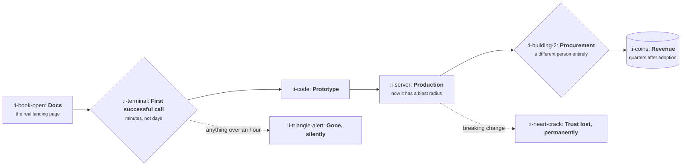

# Devtools and Infrastructure

```text
Level: Sectors
Prerequisites: AI Product Shapes
Estimated difficulty: 3/5 | Estimated time: 35 min
```

## The idea in one minute

Your users can read the source, run the competitor in a terminal in four minutes, and will tell you
precisely why you are wrong in public. That removes the information asymmetry a product manager
normally relies on and replaces it with a different asset: being genuinely useful, quickly, with
documentation that works. The whole funnel compresses into one metric, time to first successful
call, and everything downstream is a consequence of it. Adoption is free, voluntary and bottom up;
payment arrives quarters later from somebody who was not in the room when the decision was made.

## A picture



The gap between the first box and the last is measured in quarters, and nothing in between produces
revenue. That lag is the defining financial fact of the sector.

## How it really works

### Documentation is the product surface

For most software, docs are support material. Here they are where evaluation happens. A developer
decides whether to use your product by reading, and the thing they are evaluating is partly your
product and partly whether your docs suggest a team that will still be answering questions in two
years.

Practical consequences: the quickstart must actually work, copied verbatim, on a clean machine. Code
samples must be tested in continuous integration, because a sample that no longer compiles is read
as abandonment. Error messages are documentation, and they are read far more often than the docs
site.

### Time to first successful call is the metric

Everything in the funnel is downstream of how long it takes to get one thing working. Not signup,
not a tutorial completed: one real call returning a real result. Measure it in minutes, measure the
distribution rather than the median, and treat anything that pushes the long tail past an hour as a
production incident, because the user who hits it leaves without telling you.

The usual offenders are account creation before any value, a key that requires an email round trip,
a required cloud configuration, and a quickstart that assumes a tool the reader does not have.

### Adoption and purchase are different events, months apart

A developer adopts. Finance or procurement pays, later, usually when usage crosses a threshold or
a security review is triggered. Two things follow. First, usage based pricing fits the sector
naturally because it matches how adoption actually grows. Second, your free tier is a sales channel
with a real cost, and it has to be sized against the conversion lag rather than against this
quarter's bill.

### Breaking changes are the one unforgivable act

Trust in this sector is built slowly and lost in one release. A breaking change that was not
announced, versioned and given a migration path costs you not only the affected users but the
reputation that brings the next ones. Versioning policy, deprecation windows and a changelog that
reads like it was written by a person are product decisions with direct revenue consequences.

### Where AI lands here

This is the one sector where the users are also the people building AI products, which makes them
simultaneously the most receptive and the least impressed audience you will meet. Code generation,
documentation search and log explanation all work. The bar on correctness is high because the
output is executable, and a wrong answer in a terminal costs more than a wrong answer in a chat
window.

The specific opportunity as of October 2026 is making your product legible to somebody else's
agent: a clear tool interface, machine readable docs, predictable errors and an integration surface
designed to be called by a program rather than clicked. An increasing share of first calls now come
from an agent acting on a developer's behalf, and products that are hard for an agent to use are
being skipped the same way products with bad docs were skipped before.

### What fills the box in 2026

Documentation on Mintlify, Docusaurus or Fern. Interactive quickstarts in the browser. Auth through
API keys first, with OAuth and organisation scoping added for the enterprise motion. Metering and
billing through Orb, Metronome or Stripe. Observability for your own users is increasingly part of
the product rather than an internal tool.

## Run the numbers

The sector's funnel has one stage that dominates. This shows what improving each stage is worth,
which is usually not where the effort goes.

```go
// ttfc.go: which stage of a developer funnel is actually worth fixing.
package main

import "fmt"

type stage struct {
	name string
	rate float64 // share who get through
}

const (
	visitors   = 12_000.0 // docs visitors a month
	annualPaid = 9_600.0  // revenue from one converted account, per year
)

func through(stages []stage) float64 {
	v := visitors
	for _, s := range stages {
		v *= s.rate
	}
	return v
}

func main() {
	base := []stage{
		{"reach the quickstart", 0.55},
		{"first successful call", 0.28},
		{"build a prototype", 0.45},
		{"reach production", 0.30},
		{"convert to paid", 0.35},
	}
	fmt.Printf("baseline: %.0f paying accounts a year, %.0f of revenue\n\n",
		through(base), through(base)*annualPaid)
	fmt.Printf("%-24s %14s %16s\n", "improve by a fifth", "accounts/yr", "revenue added")
	for i := range base {
		lifted := make([]stage, len(base))
		copy(lifted, base)
		lifted[i].rate *= 1.2
		gain := through(lifted) - through(base)
		fmt.Printf("%-24s %14.1f %16.0f\n", base[i].name, through(lifted), gain*annualPaid)
	}
	fmt.Println("\nEvery stage gives the same relative lift, so the question is which is cheapest to move.")
	fmt.Println("First call sits at 28% and is the only one a weekend of work can change.")
}
```

The arithmetic is deliberately flat: lifting any stage by a fifth produces the same revenue,
because the funnel is multiplicative. That is the point. Since the money is identical, the decision
is entirely about which stage is cheapest to improve, and first successful call at 28% is both the
worst performing and the only one you can move with documentation work rather than a sales motion.
Teams usually attack the conversion stage at the bottom, which costs the most and is the hardest
to shift.

## What it changes for each function

| Function | The delta |
|---|---|
| Product | Docs are the product surface, errors are documentation, and breaking changes are unforgivable |
| Growth | Bottom up and voluntary. The free tier is a sales channel with a real inference and compute bill |
| Go to market | Adoption and purchase are different people, quarters apart. Usage pricing fits naturally |
| Operations | Metering, quotas and abuse handling are core, not peripheral |
| AI | High correctness bar because output is executable. The new surface is being usable by somebody else's agent |

## Remember this

* You have no information asymmetry. Credibility comes from the product working quickly.
* Time to first successful call is the metric. Watch the tail, not the median.
* Adoption and payment are separate events months apart, which is why usage pricing fits.
* A breaking change costs more than the users it breaks.
* Being easy for an agent to call is now part of being easy to adopt.

## Try it

1. Run `ttfc.go` with your own funnel rates. Which stage is worst, and is it the one your team is
   working on?
2. Time your own quickstart on a clean machine with no cached credentials. Record the number. Most
   teams are shocked by it.
3. Read your three most common error messages as if you had never seen the product. Would each tell
   you what to do next?

## Check yourself

1. Why does the usual product manager advantage of having talked to more users fail in this sector,
   and what replaces it?
2. Lifting any funnel stage by the same proportion adds the same revenue. What does that imply about
   how to choose which one to work on?
3. What does designing for an agent caller change about your API surface that designing for a human
   does not?
