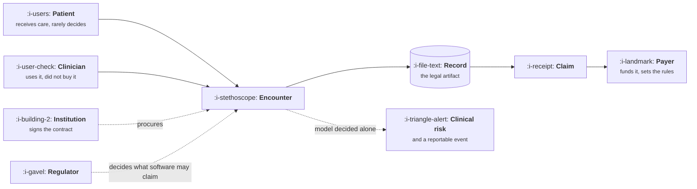

# Healthtech and Regulated Care

```text
Level: Sectors
Prerequisites: AI Product Shapes
Estimated difficulty: 4/5 | Estimated time: 40 min
```

## The idea in one minute

Three different people occupy the roles that are usually one: the person who uses the product, the
person who buys it, and the person who pays for the care. They want different things and only one
of them is in the room during research. On top of that sits clinical risk, which means some
decisions are not yours at any level of model accuracy, and a privacy regime strict enough to
determine your architecture. The product work that actually succeeds here is almost never
diagnosis. It is removing documentation and coordination burden from a clinician whose day is
already full, in a way that survives an audit.

## A picture



Five parties, and your user is not any of the three who control money or rules. Designing as though
the clinician is the customer produces something nobody can buy; designing as though the
institution is the customer produces something nobody uses.

## How it really works

### The clinician's day is the constraint

A clinician has a fixed number of minutes per patient and is already behind. Any product that adds
a step, however valuable, competes against that. The features that succeed remove work: ambient
documentation, order preparation, prior authorisation paperwork, referral coordination, and finding
the relevant history in a record that has grown for twenty years.

The test a product manager should apply before anything else is whether the feature gives the
clinician minutes back today, in the clinical workflow, without them changing where they work.
Anything requiring a second screen or a separate login has already lost.

### Three customers, three different conversations

| Role | Wants | Measures success by | In the room during research? |
|---|---|---|---|
| Clinician | Minutes back, no new logins, no new liability | Whether they would miss it after a week | Yes, briefly, if you are lucky |
| Institution | Throughput, compliance, risk reduction, cost | Contract outcomes and audit results | During procurement |
| Payer | Appropriate care at lower total cost | Claims data, months later | Almost never |
| Patient | Access, clarity, not being harmed | Rarely asked at all | Rarely |

The practical consequence is that the pitch, the product and the evidence are three different
artifacts, and the evidence is what institutions actually buy.

### Clinical risk sets a ceiling no accuracy reaches

Software that diagnoses, screens or recommends treatment is regulated as a medical device in most
jurisdictions, with everything that implies: an intended use statement, risk classification,
clinical evaluation, a quality system, and change control that makes a prompt edit a documented
event. That is a different company shape, not a harder sprint.

Most healthtech products deliberately stay on the other side of that line by being explicitly
documentation, administration or coordination tools, with a clinician reviewing and signing
everything that touches care. Knowing exactly where the line is, for your jurisdiction and claims,
is the single most valuable piece of knowledge a product manager in this sector can hold.

### Privacy decides your architecture

Patient data has a strict regime, and the decisions it forces happen early: where data may be
processed and stored, how long it is retained, what may be used to improve a model, which
subprocessors are permitted, and what the consent covers. Each of those constrains design before
any interface exists, and retrofitting them is close to a rewrite.

For AI features this is sharp. Sending patient data to a third party model provider requires a
contract, a documented data flow, usually a commitment that nothing is retained or trained on, and
in some settings processing within a specific region. That is a procurement conversation, and it
belongs at the start of the feature rather than at the end.

### Where models actually work here

The pattern that succeeds is high volume, clinician verified, administratively scoped:

* **Ambient documentation.** The clearest win in the sector. Minutes back per encounter, output
  reviewed and signed by the clinician, no clinical claim made.
* **Prior authorisation and claims.** Enormous paperwork burden, structured output, cheap to check.
* **Record search and summarisation.** With citations into the source record, always.
* **Coding support.** Suggested codes a coder confirms, never submitted automatically.
* **Patient communication drafting.** Clinician reviews before sending.

What does not work, regardless of benchmark scores, is anything that produces a clinical conclusion
without a named person signing it.

### What fills the box in 2026

Integration happens through FHIR APIs into Epic, Oracle Health or the local record system, and
that integration is usually the hardest and longest part of any build. Infrastructure must support
a business associate agreement or the local equivalent. Model providers are chosen partly on
whether they will sign one and offer regional processing with no retention.

## What it changes for each function

| Function | The delta |
|---|---|
| Product | Three customers, a clinical risk ceiling, privacy deciding architecture, and minutes back as the test |
| Growth | No self service. Growth is reference customers and clinical evidence |
| Go to market | Procurement runs six to twenty four months, and security and clinical review both gate it |
| Operations | Audit trails, consent management, retention and incident reporting are continuous obligations |
| AI | Administrative and documentation tasks with a clinician signing. Never an unsigned clinical conclusion |

## Remember this

* Three customers, and your user controls neither the money nor the rules.
* The first test is whether it gives a clinician minutes back today, in their existing workflow.
* Know exactly where the medical device line is for your claims. Crossing it changes the company,
  not the sprint.
* Privacy constrains architecture before design starts, and retrofitting it is a rewrite.
* Models here do documentation, administration and search, with a person signing anything clinical.

## Try it

1. Write the intended use statement for a feature you are considering, in one sentence, as a
   regulator would read it. Does it claim anything clinical?
2. Map your data flow for one AI feature: every system the patient data touches, every subprocessor,
   where it is stored, how long, and what the consent says. Most teams find a surprise.
3. Shadow a clinician for two hours. Count the minutes lost to documentation and coordination, and
   compare that against the feature you were going to build.

## Check yourself

1. Why does designing for the clinician alone produce a product nobody can buy, and designing for
   the institution alone produce one nobody uses?
2. A model scores better than clinicians on a diagnostic benchmark. Name two reasons it still may
   not make the diagnosis in your product.
3. Which privacy decisions have to be made before any interface is designed, and why is retrofitting
   them close to a rewrite?
