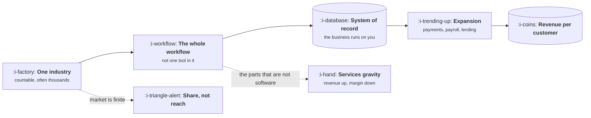

# Vertical SaaS

```text
Level: Sectors
Prerequisites: AI Product Shapes
Estimated difficulty: 3/5 | Estimated time: 35 min
```

## The idea in one minute

Vertical software wins a small market completely rather than a large one partially, and that
inversion changes every default. The market is countable, often in thousands of businesses rather
than millions, so growth comes from share and from revenue per customer instead of from reach. You
replace a workflow rather than a tool, which means you absorb the parts of the job that are not
software, and that is where the services gravity comes from: the pull toward doing the work for the
customer, which raises revenue and destroys margin. This is also the sector where AI has the
strongest case, because narrow domains with repetitive document work are exactly what models are
good at, and nobody else is going to build it for an industry of four thousand firms.

## A picture



The two dotted paths are the sector's characteristic traps: a ceiling you can actually hit, and a
pull toward doing the work yourself.

## How it really works

### The market is countable, which changes the arithmetic

You can usually write down how many potential customers exist. That single fact reorganises
everything. Addressable market is a multiplication you can defend rather than a slide; a 20% share
is realistic rather than fantastical; and growth past a point must come from revenue per customer
rather than from new logos, because there are no more logos.

It also means losing a customer is not noise. In a market of four thousand, every churned account
is a quarter of a percent of your total opportunity and a reference your competitor now has.

### You replace a workflow, not a tool

Horizontal software does one thing for everyone. Vertical software does everything for someone,
which means the product has to cover the unglamorous ends of the job: scheduling, compliance
documents specific to the industry, the forms the local regulator wants, the way this trade
actually quotes work. Those are the parts that create switching costs, and they are the parts a
horizontal competitor will never build.

The design consequence is that domain vocabulary is not decoration. Using the industry's own words,
correctly, is most of what makes the product feel like it was built by someone who understands the
business, and getting one wrong is read as evidence that you do not.

### Services gravity

Customers will ask you to do the work rather than give them the software to do it, and they will
pay. Accepting raises revenue immediately and lowers gross margin permanently, and it is almost
impossible to reverse because the customers who bought services bought a relationship.

The honest positions are to refuse and stay software, to offer services deliberately as a priced
onboarding product with a defined end, or to become a services business with software attached and
value the company accordingly. All three work. Drifting into the third while telling investors you
are the first is what goes wrong.

### Expansion is where the money is

Once you are the system of record, adjacent revenue becomes available: payments, payroll, lending,
insurance, marketplace take. These often exceed the software subscription, and they are only
available because the workflow runs on you. Which is why the system of record position, not the
feature set, is the real strategic goal.

### Why AI fits this sector better than most

Three reasons. The domain is narrow, so the set of tasks is small enough to evaluate properly. The
work is repetitive and document heavy, which is the shape models handle well. And nobody else is
coming: an industry of four thousand firms will never get a dedicated model from a frontier lab,
so whatever you build is the only thing that exists.

The constraint is that contract values are often modest, so the cost per task arithmetic matters
as much as in ecommerce. A feature costing a dollar per use against a two hundred dollar monthly
subscription has a small budget.

### What fills the box in 2026

The stack is unremarkable and that is the point: a standard web application, a payments provider,
and whatever industry specific integrations exist, which are often file based, elderly and
undocumented. Time spent on those integrations is usually the real moat, because it is tedious and
nobody wants to do it twice.

## Run the numbers

Vertical markets are finite, so the question is what revenue per customer has to be for the company
to work at all. This computes the ceiling and what expansion revenue does to it.

```go
// ceiling.go: what a finite market can actually be worth.
package main

import "fmt"

type market struct {
	name      string
	firms     float64 // total addressable businesses
	share     float64 // realistic share at maturity
	subscript float64 // annual software subscription per customer
	expansion float64 // annual adjacent revenue per customer
}

func main() {
	markets := []market{
		{"small, high value", 4_000, 0.30, 9_600, 14_000},
		{"medium", 26_000, 0.18, 4_200, 5_500},
		{"large, low value", 180_000, 0.08, 1_320, 900},
	}
	fmt.Printf("%-20s %9s %8s %14s %14s %14s\n",
		"market", "firms", "share", "software only", "with expansion", "share needed")
	for _, m := range markets {
		customers := m.firms * m.share
		soft := customers * m.subscript
		both := customers * (m.subscript + m.expansion)
		// Share you would need, on software alone, to reach fifty million.
		needed := 50_000_000 / (m.firms * m.subscript)
		note := fmt.Sprintf("%.0f%%", 100*needed)
		if needed > 1 {
			note = "impossible"
		}
		fmt.Printf("%-20s %9.0f %7.0f%% %14.0f %14.0f %14s\n",
			m.name, m.firms, 100*m.share, soft, both, note)
	}
	fmt.Println("\nShare needed is what software alone would require to reach fifty million of revenue.")
	fmt.Println("Expansion revenue is not an upsell here. For two of these it is the entire thesis.")
}
```

The last column is the argument. To reach fifty million on software subscriptions alone, the small
high value market would need more than every firm in it, which is to say it cannot; the medium
market needs 46%, which essentially nobody achieves; and even the large low value market needs 21%,
which is a dominant position.

Now read the two columns before it. At the realistic shares in column three, none of these three
businesses reaches fifty million on software, and adding expansion revenue roughly doubles every
one of them, taking the medium market most of the way there. That is why vertical companies move
into payments, payroll and lending, and why it is a strategic requirement rather than opportunism.
In a finite market, once share stops growing, revenue per customer is the only axis left.

## What it changes for each function

| Function | The delta |
|---|---|
| Product | Replace the workflow, not the tool. Domain vocabulary is a correctness requirement |
| Growth | Finite market, so growth is share then revenue per customer. Word of mouth is the real channel |
| Go to market | Associations, trade events and reference customers are the channel. Everyone knows each other |
| Operations | Services gravity has to be priced and bounded, or margin leaks away permanently |
| AI | The strongest case of any sector, limited by modest contract values and therefore by cost per task |

## Remember this

* The market is countable, so addressable market is a defensible multiplication and share has a real
  ceiling.
* You replace a workflow, which means owning the unglamorous parts. That is the switching cost.
* Services gravity raises revenue and permanently lowers margin. Choose a position rather than
  drifting into one.
* Expansion revenue is the thesis, not an upsell, because revenue per customer is the only axis
  left once share saturates.
* AI fits unusually well here, and is constrained by contract value rather than by capability.

## Try it

1. Run `ceiling.go` with your own market size and pricing. What share would software alone require,
   and is that number achievable?
2. Count your actual addressable firms from a real source, an industry register or an association
   membership list. Compare it to the number in your last deck.
3. List the revenue you earn that is really services. Compute gross margin with and without it.

## Check yourself

1. Why does a finite market make revenue per customer a strategic question rather than a pricing
   one?
2. Services gravity is hard to reverse. What specifically makes it hard, and which of the three
   honest positions is the dangerous one?
3. Why is an industry of four thousand firms a better AI opportunity than a market of four million
   consumers, and what limits it?
