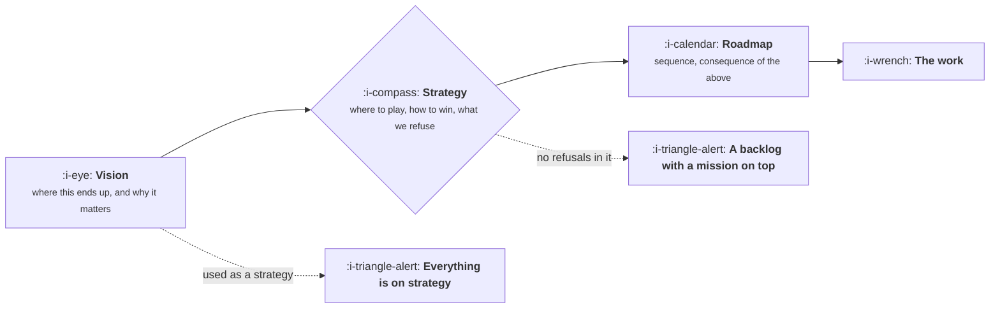

# Strategy, Vision and Roadmap

```text
Level: Foundations
Prerequisites: What a Product Manager Does
Estimated difficulty: 2/5 | Estimated time: 25 min
```

## The idea in one minute

Three different artifacts get called strategy, and conflating them produces the most common
organisational failure in product work: a prioritised list of features with a mission statement on
top, which nobody can use to make a decision. A vision describes a future state and is motivational.
A strategy is a choice about where to compete and how to win there, and it is only a strategy if
something was refused. A roadmap is a sequence, downstream of both. The test that separates them is
simple: if your strategy document contains no sentence beginning "we are not", it is a vision or a
plan wearing the word.

## A picture



The two dotted paths are the failures, and the second is the subtler one: a vision broad enough to
be inspiring will justify any piece of work, which is why it cannot do a strategy's job.

## How it really works

### What each one is

| Artifact | Answers | Time horizon | Test that it is real |
|---|---|---|---|
| Vision | What the world looks like if we succeed, and why that is worth doing | Three to ten years | Would it still motivate if the roadmap changed entirely? |
| Strategy | Where we compete, how we win there, what we are giving up | One to three years | Does it contain explicit refusals? |
| Roadmap | What happens in what order, and roughly when | One to four quarters | Could somebody else build it from this? |
| Backlog | Candidate work, unordered | None | Is it visibly not a plan? |

### A strategy is a choice, so it costs something

The definitional property is that choosing one thing forecloses another. "We will serve mid market
companies in Europe, winning on implementation speed, which means we will not pursue enterprise
deals that require a six month security review this year" is a strategy. It names the segment, the
basis of winning, and the thing refused.

"We will delight our customers with an innovative platform" is not a strategy. Nothing is
foreclosed, so nothing can be decided with it.

### Why the vision cannot do the strategy's job

A good vision is deliberately broad so it survives changes in plan. That same breadth means it
cannot discriminate between two proposals, because both will fit under it. When a company uses its
vision as its strategy, every project can be justified, prioritisation becomes a negotiation about
who argues best, and the loudest function wins repeatedly.

### Why the roadmap cannot either

A roadmap is a consequence. If you have a strategy, the roadmap is an argument about sequencing and
dependencies, which is a tractable conversation. Without one, the roadmap becomes the place where
strategy is implicitly decided, one quarter at a time, by whoever has the most urgent request. The
symptom is a roadmap that changes shape completely every quarter while everybody insists the
strategy is unchanged.

### How to tell which one your company has

Ask three people in different functions what the company is not doing this year. If the answers
agree, there is a strategy. If the answers are vague or contradictory, there is a vision and a
backlog, and the gap between them is being filled by argument.

### What a product manager does about this at the team level

You usually cannot write the company's strategy, and you can always write your team's: the segment
you are serving, what you are winning on, what you are not doing this year, and what would make you
change your mind. One page. It is also the fastest way to discover whether the company's strategy
exists, because the moment you publish a refusal, anybody who disagrees will say so.

### What fills the box in 2026

Nothing useful. This is organisational writing, and the tooling question is a distraction. The one
practical habit worth adopting is keeping the strategy page dated and versioned next to the decision
log, so that when it changes you can see what changed and why, which is the thing that builds trust
in strategy over several quarters.

## Sector lens

| Sector | What changes about strategy |
|---|---|
| [Enterprise B2B SaaS](../product-by-sector/01-enterprise-b2b-saas.md) | Segment choice is the whole strategy, because the cost of serving a segment is enormous |
| [Fintech](../product-by-sector/02-fintech.md) | The licence envelope constrains where you may play before you choose |
| [Ecommerce and D2C](../product-by-sector/03-ecommerce-and-d2c.md) | Category and margin structure decide strategy more than product capability |
| [Marketplaces](../product-by-sector/04-marketplaces.md) | Which side you favour, and in which segment you build liquidity first, is the strategy |
| [Devtools and Infrastructure](../product-by-sector/05-devtools-and-infrastructure.md) | Where you sit in a stack, and what you deliberately do not do, is the entire positioning |
| [Healthtech](../product-by-sector/06-healthtech-and-regulated-care.md) | Which side of the medical device line you sit on is a strategic choice about the company |
| [Vertical SaaS](../product-by-sector/07-vertical-saas.md) | Which industry, and how deep before going wide. The market is finite so the choice is binding |

## Remember this

* Vision is a future state, strategy is a choice with refusals, roadmap is a consequence.
* If no sentence begins "we are not", it is not a strategy.
* A vision cannot discriminate between proposals, which is why using it as strategy makes the
  loudest function win.
* Without a strategy, the roadmap becomes where strategy is decided, badly, one quarter at a time.
* Ask three people what you are not doing this year. Agreement means a strategy exists.

## Try it

1. Ask three colleagues in different functions what the company is not doing this year. Write down
   the answers verbatim.
2. Write your team's one page strategy: segment, basis of winning, refusals, and what would change
   your mind. Publish it and see who objects.
3. Take your current roadmap and try to derive it from the strategy. Anything you cannot derive is
   either a gap in the strategy or work that should not be there.

## Check yourself

1. Why can a good vision justify any piece of work, and why is that a feature of visions rather
   than a flaw?
2. What is the single test that distinguishes a strategy from a plan?
3. A roadmap changes shape completely every quarter while leadership insists the strategy is stable.
   What is actually happening?
