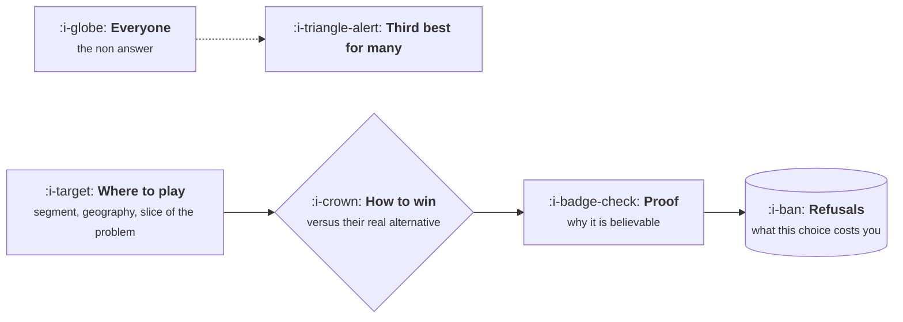

# Where to Play and How to Win

```text
Level: Foundations
Prerequisites: Strategy, Vision and Roadmap
Estimated difficulty: 3/5 | Estimated time: 30 min
```

## The idea in one minute

A strategy is two choices and nothing else. Where to play is the segment, the geography and the
part of the problem you are taking. How to win is the reason a customer in that segment picks you
over the alternative they would otherwise use, which is usually not a competitor. Both have to be
specific enough to be wrong. The common failure is answering the first question with "everyone" and
the second with a list of features, which produces a company that is the third best option for
several segments rather than the obvious choice for one.

## A picture



The last box is the one that makes it a strategy. Choices that cost nothing were not choices.

## How it really works

### Where to play, specifically

A usable answer names a segment you could count, and the three axes are usually who, where and
which part of the problem. "Finance teams at companies between 200 and 2000 people in the UK and
Ireland, for month end close only" is a place to play. It can be sized, it can be wrong, and it
tells you what to build.

The test is whether somebody could draw a list of target accounts from the sentence without asking
a follow up question.

### How to win, against the real alternative

The alternative is rarely a competitor. It is usually a spreadsheet, a junior hire, an agency, or
doing nothing. Your basis of winning has to be stated against whatever they are actually doing,
and there are a limited number of honest ones:

| Basis | Works when | Breaks when |
|---|---|---|
| Faster to value | The alternative is slow to set up or slow to produce an answer | A competitor simplifies, which is cheap to copy |
| Deeper in the domain | The segment has specific workflows nobody general serves | You widen and the depth dilutes |
| Cheaper to run | Your cost structure is genuinely different, not just your price | Somebody with more capital prices below you |
| Already where they work | You own an adjacent workflow or a system of record | They move their work somewhere else |
| Trusted with the risk | The decision carries risk and you carry it credibly | A single public failure |

Being better is not on the list, because it is not a mechanism. Each row above says why you are
better and why that persists, which is the part that makes it strategic rather than a claim.

### Proof, and why it is the hard part

A basis of winning needs a reason it is believable now, not aspirationally. If you win on
implementation speed, what makes you fast that a competitor cannot copy in a quarter? If the answer
is "we work hard at it", you do not yet have a strategy, you have an intention. Durable answers
usually come from a structural asset: an integration nobody else built, data you have and they do
not, a cost structure, or a position in a workflow.

### The refusals are the test

Choosing mid market means declining enterprise deals that would distort the roadmap. Choosing one
geography means saying no to revenue elsewhere. If your strategy has never cost you a deal, it is
not operating. The useful artifact is a short list of what you have actually turned down, kept
visibly, because it is evidence the strategy is real.

### Scoring segments rather than arguing about them

Segment choice is usually settled by whoever is most senior in the room, and it does not have to
be. Four factors make it tractable: how many there are, how much each is worth, how well you can
serve them with what you have, and how hard they are to reach. The program below makes the
comparison explicit, and its main value is that it exposes which factor somebody is weighting
without saying so.

## Run the numbers

Four candidate segments, scored on size, value, fit and reachability, against the honest
alternative each one currently uses.

```go
// segments.go: scoring where to play.
package main

import (
	"fmt"
	"sort"
)

type segment struct {
	name        string
	firms       float64 // how many exist
	annualValue float64 // what one is worth to you a year
	fit         float64 // how well today's product serves them, 0 to 1
	reach       float64 // how cheaply you can get to them, 0 to 1
	alternative string
}

// winnable is the share of the segment you could plausibly take in three years,
// which is dragged down by both poor fit and poor reach.
func (s segment) winnable() float64 { return 0.25 * s.fit * s.reach }

func (s segment) prize() float64 { return s.firms * s.winnable() * s.annualValue }

func main() {
	ss := []segment{
		{"enterprise, global", 4_000, 140_000, 0.35, 0.25, "an incumbent suite"},
		{"mid market, UK and Ireland", 11_000, 18_000, 0.80, 0.70, "a spreadsheet"},
		{"mid market, all Europe", 68_000, 18_000, 0.55, 0.30, "a spreadsheet"},
		{"small business, global", 900_000, 1_900, 0.45, 0.15, "doing nothing"},
	}
	sort.Slice(ss, func(i, j int) bool { return ss[i].prize() > ss[j].prize() })
	fmt.Printf("%-28s %8s %7s %7s %9s %13s  %s\n",
		"segment", "firms", "fit", "reach", "winnable", "three yr prize", "their alternative")
	for _, s := range ss {
		fmt.Printf("%-28s %8.0f %7.2f %7.2f %8.1f%% %13.0f  %s\n",
			s.name, s.firms, s.fit, s.reach, 100*s.winnable(), s.prize(), s.alternative)
	}
	fmt.Println("\nThe largest segment is rarely the largest prize, because fit and reach multiply.")
	fmt.Println("Anybody arguing for the big number is implicitly assuming fit and reach they do not have.")
}
```

Read the winnable column against the firm count. Small business has eighty times the firms of the
UK and Ireland segment and produces a prize only slightly larger, because a fit of 0.45 and a reach
of 0.15 multiply into a winnable share of under two percent. Enterprise has eight times the annual
value per customer and finishes last for the same reason. The UK and Ireland segment has the
highest winnable share on the table by a factor of three, on the fewest firms.

So the arithmetic does not say "pick the small segment". It says the two soft numbers, fit and
reach, swing the answer more than the two hard ones, and they are exactly the numbers people assert
rather than measure. When somebody argues for the largest market, they are implicitly claiming a
fit and a reach they have not demonstrated, and this table is how you ask them for it.

Three honest limits. Fit and reach are estimates, so run it pessimistic and optimistic and see
whether the ordering survives; if it does, stop arguing. There is no cost side here, and a segment
needing a year of product investment to reach that fit is not comparable to one you can serve today.
And it cannot capture whether a segment is a stepping stone to a larger one, which is sometimes the
whole reason to choose it.

## Sector lens

| Sector | What decides where to play |
|---|---|
| [Enterprise B2B SaaS](../product-by-sector/01-enterprise-b2b-saas.md) | Contract value against cost of sale. Below a threshold the segment cannot work at all |
| [Fintech](../product-by-sector/02-fintech.md) | Licensing decides the geography before anything else does |
| [Ecommerce and D2C](../product-by-sector/03-ecommerce-and-d2c.md) | Category margin structure. Some categories cannot fund acquisition at any scale |
| [Marketplaces](../product-by-sector/04-marketplaces.md) | Where liquidity can be reached first. Depth in one segment beats breadth everywhere |
| [Devtools and Infrastructure](../product-by-sector/05-devtools-and-infrastructure.md) | Which layer of the stack, and what you deliberately leave to others |
| [Healthtech](../product-by-sector/06-healthtech-and-regulated-care.md) | Which payer and which care setting. The rules differ enough to be separate markets |
| [Vertical SaaS](../product-by-sector/07-vertical-saas.md) | Which industry, and the choice is close to irreversible |

## Remember this

* Two choices: where to play and how to win. Everything else is a plan.
* A place to play is specific enough to draw a target list from the sentence.
* The alternative is usually a spreadsheet, a junior hire or nothing, and you win against that.
* Being better is not a basis of winning. Name the mechanism and why it persists.
* Fit and reach multiply, so the biggest segment is usually not the biggest prize.
* If the strategy has never cost you a deal, it is not operating.

## Try it

1. Run `segments.go` with your real candidates. Then set fit and reach to pessimistic values and
   check whether the ordering survives.
2. Write your basis of winning in one sentence, against the alternative your customers actually
   use. Name the structural reason it persists.
3. List the deals or segments you have turned down this year because of the strategy. An empty list
   is the finding.

## Check yourself

1. Why is "we are better" not a basis of winning, and what would turn it into one?
2. Fit and reach multiply into winnable share. Explain why that makes the largest segment usually
   the wrong choice.
3. A strategy has produced no refused deals in a year. What are the two possible explanations, and
   how would you tell them apart?
