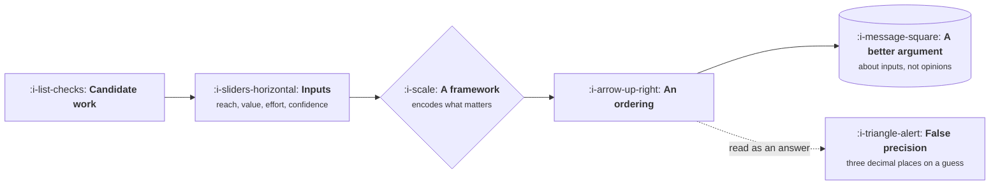

# Prioritisation That Survives Contact

```text
Level: Expert
Prerequisites: What Good Looks Like
Estimated difficulty: 3/5 | Estimated time: 30 min
```

## The idea in one minute

Prioritisation frameworks do not rank your work. They make the assumptions behind a ranking
visible, so that an argument about priorities becomes an argument about inputs, which is a much
better argument to have. That is their entire value, and it is substantial. The failure is treating
the output number as an answer: the same four items, scored honestly by the same person using two
respectable frameworks, come out in different orders, because each framework encodes a different
opinion about what matters. Choose one deliberately, know which opinion you just adopted, and use
the score to locate disagreement rather than to end it.

## A picture



The arrow that matters points at the argument, not at the ordering.

## How it really works

### What each framework actually believes

| Framework | Formula, roughly | What it believes | Where it misleads |
|---|---|---|---|
| RICE | reach × impact × confidence ÷ effort | Breadth is the main source of value | Punishes deep work for a small, valuable segment |
| Value over effort | value ÷ effort | Simplicity beats precision | Hides where value came from, so nobody can challenge it |
| Weighted shortest job first | cost of delay ÷ duration | Urgency compounds, so timing is value | Needs a cost of delay nobody can estimate honestly |
| Kano | delight, performance, basic | Some things only matter by their absence | Says nothing about effort or sequence |
| Opportunity scoring | importance minus satisfaction | Fix what matters and is bad, not what is already good | Survey based, so it inherits every sampling problem |

None is wrong. Each one is a claim about what makes work valuable, and your product has a true
answer to that question which may not match the framework you inherited.

### Why the order changes

Reach and effort are usually estimated within a factor of two. Impact is a guess on an invented
scale. Multiplying three uncertain numbers and dividing by a fourth produces an output whose
uncertainty is larger than the gaps between most items, which is why items two through six are
effectively tied and presenting them as ranked is false precision.

The honest reading is tiers, not a list: things clearly worth doing, things clearly not, and a
middle band where the score has stopped discriminating and judgement takes over.

### Use it to find disagreement

The genuinely valuable move is to have two or three people score the same items independently and
compare, not to average. Where scores differ by a lot, somebody knows something the others do not,
and that conversation is the output. Averaging destroys exactly the signal you were looking for.

### What frameworks cannot see

Four things, all of which have to be handled outside the score:

* **Dependencies.** A low scoring item that unblocks three high scoring ones.
* **Strategy.** Work that is on strategy but scores badly today, which is most strategic work.
* **Compounding.** Platform and quality work whose value appears later and never in a quarterly score.
* **Obligation.** Regulatory, security and contractual work, which is not optional at any score.

A team that scores everything and ships the top ten will systematically underinvest in all four.

### What fills the box in 2026

Whatever your issue tracker supports, and a spreadsheet is genuinely fine and often better, because
it makes the inputs visible and editable in a meeting. The thing to resist is any tool that hides
the inputs behind a computed score, because the inputs were the product.

## Run the numbers

The same five items, scored once, ranked by two respectable frameworks.

```go
// frameworks.go: the same items, two orderings.
package main

import (
	"fmt"
	"sort"
)

type item struct {
	name       string
	reach      float64 // users affected per quarter
	impact     float64 // 0.25 low, 1 medium, 3 high
	confidence float64 // 0 to 1
	weeks      float64
	delayCost  float64 // value lost per week of delay
}

func (i item) rice() float64 { return i.reach * i.impact * i.confidence / i.weeks }
func (i item) wsjf() float64 { return i.delayCost / i.weeks }

func order(items []item, f func(item) float64) []string {
	s := append([]item(nil), items...)
	sort.Slice(s, func(a, b int) bool { return f(s[a]) > f(s[b]) })
	out := make([]string, len(s))
	for i, x := range s {
		out[i] = x.name
	}
	return out
}

func main() {
	items := []item{
		{"bulk editing", 2_600, 1, 0.8, 4, 1_800},
		{"onboarding rebuild", 9_000, 1, 0.5, 8, 2_400},
		{"audit log", 320, 3, 0.9, 3, 9_000},
		{"search speed", 7_400, 0.25, 0.9, 2, 900},
		{"billing fixes", 1_100, 1, 0.95, 1.5, 4_200},
	}
	r, w := order(items, item.rice), order(items, item.wsjf)
	fmt.Printf("%6s  %-22s %-22s\n", "rank", "RICE", "cost of delay")
	for i := range r {
		flag := ""
		if r[i] != w[i] {
			flag = "  <- differs"
		}
		fmt.Printf("%6d  %-22s %-22s%s\n", i+1, r[i], w[i], flag)
	}
	fmt.Println("\nSame numbers, same person, two defensible frameworks, different plans.")
	fmt.Println("RICE rewards breadth. Cost of delay rewards urgency and small items.")
}
```

The two columns are the point. Nobody lied and nobody made an arithmetic error; the frameworks
simply disagree about whether a feature that touches nine thousand users slightly is worth more
than one that protects revenue from three hundred. That is a real question about your business, and
it should be answered on purpose rather than inherited from whichever template the team started
with.

## Sector lens

| Sector | Which framework fits, and why |
|---|---|
| [Enterprise B2B SaaS](../product-by-sector/01-enterprise-b2b-saas.md) | Cost of delay, because work is attached to named deals with dates |
| [Fintech](../product-by-sector/02-fintech.md) | Obligation first. A large share of the roadmap is not scoreable at all |
| [Ecommerce and D2C](../product-by-sector/03-ecommerce-and-d2c.md) | Reach based scoring works, because traffic makes impact measurable afterwards |
| [Marketplaces](../product-by-sector/04-marketplaces.md) | Score per side separately, then decide which side you are serving this quarter |
| [Devtools and Infrastructure](../product-by-sector/05-devtools-and-infrastructure.md) | Reach is misleading when adoption lags release by quarters |
| [Healthtech](../product-by-sector/06-healthtech-and-regulated-care.md) | Clinical risk and obligation dominate, and scoring applies to what is left |
| [Vertical SaaS](../product-by-sector/07-vertical-saas.md) | Small reach numbers make RICE useless. Revenue per customer is the better input |

## Remember this

* A framework makes assumptions visible. It does not produce an answer.
* Each one encodes a belief about what value is. Choose the belief deliberately.
* The output has more uncertainty than the gaps between items. Read tiers, not a ranking.
* Score independently and compare rather than average. The disagreement is the finding.
* Frameworks cannot see dependencies, strategy, compounding or obligation. Handle those outside.

## Try it

1. Run `frameworks.go` with five real items. Does the ordering change between the two columns, and
   which one matches your instinct?
2. Have two colleagues score the same five items independently. Look only at the largest
   disagreement and discuss that one.
3. Take your current top ten and mark which of the four invisible categories each item belongs to.
   Count how many are dependencies, strategy, compounding or obligation.

## Check yourself

1. Why does averaging independent scores destroy the thing you were trying to learn?
2. Why is a ranked list of ten items usually false precision, and what should replace it?
3. Name the four things no scoring framework can see, and give an example of each from your own
   backlog.
