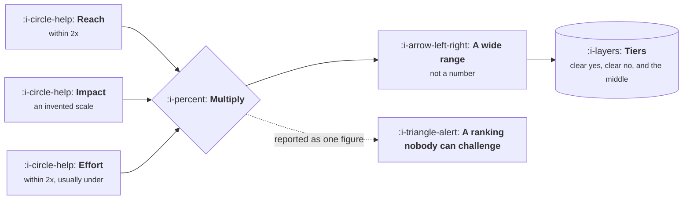

# Scoring Without Fooling Yourself

```text
Level: Foundations
Prerequisites: Prioritisation That Survives Contact
Estimated difficulty: 3/5 | Estimated time: 30 min
```

## The idea in one minute

Putting numbers on guesses does not remove the guessing, it hides it. Every input to a priority
score is uncertain by a factor of two or more, and multiplying several such numbers produces a
result whose range is wide enough to swallow the differences between most of the items on your
list. The practical consequence is that a ranked list of ten is honestly a list of two or three
groups, and claiming more resolution than that invites arguments that cannot be settled. Scoring is
still worth doing. It is worth doing with ranges rather than points, and with the result read as
tiers.

## A picture



Three uncertain inputs do not produce one certain output. They produce a range, and the range is
the honest answer.

## How it really works

### Where the uncertainty comes from

**Reach** is usually knowable within a factor of two, from data, and is the most reliable input.

**Impact** is a guess expressed on a scale somebody invented, often one to three or a set of
labels. Nobody can distinguish a 2 from a 3 reliably, and two people rarely agree.

**Effort** is systematically underestimated, which is well documented and persists even among
people who know about it. Treat a stated estimate as the optimistic end of a range.

**Confidence**, where a framework includes it, is the only input that is explicitly about
uncertainty, and it is the one most often set to a round number nobody thought about.

### Ranges, not points

Score each input as a low and a high rather than a single figure, then compute the score at both
ends. You get a band per item. Items whose bands do not overlap are genuinely ordered; items whose
bands overlap are tied, and saying so is more useful than pretending otherwise.

This takes about twice as long and removes most priority arguments, because the argument moves to
whether the bands are right, which is answerable.

### The forecast interval trick

A faster version: ask people for an eightieth percentile range rather than a number. "I am eighty
percent sure the effort is between three and nine weeks" is a statement somebody can be held to and
scored on later, and it is far more informative than "six weeks". It also surfaces the items where
the range is enormous, which are the items that need a cheap test before they need a score.

### Calibration beats precision

The estimate that matters is not whether you said six weeks, but whether your ranges contain the
truth about eighty percent of the time. That is measurable: record the range, record the outcome,
score yourself quarterly. Teams that do this for two quarters produce visibly better plans, and
the improvement comes from the ranges widening to honest values rather than from the point
estimates improving.

### When scoring is the wrong instrument

If the band on an item spans an order of magnitude, the correct next action is not a better
estimate, it is a cheap experiment that narrows the band. Spending an afternoon reducing
uncertainty is worth more than spending an hour arguing about a number nobody can know yet.

## Run the numbers

Five items scored with ranges rather than points, and the question of which orderings are real.

```go
// ranges.go: which of these items are genuinely ranked.
package main

import "fmt"

type item struct {
	name               string
	reachLo, reachHi   float64
	impactLo, impactHi float64
	effortLo, effortHi float64
}

func (i item) low() float64  { return i.reachLo * i.impactLo / i.effortHi }
func (i item) high() float64 { return i.reachHi * i.impactHi / i.effortLo }

func main() {
	items := []item{
		{"bulk editing", 1_800, 3_400, 0.7, 1.5, 3, 7},
		{"onboarding rebuild", 6_000, 12_000, 0.4, 1.5, 6, 14},
		{"audit log", 250, 400, 2.0, 3.0, 2, 5},
		{"search speed", 6_000, 9_000, 0.15, 0.4, 1.5, 3},
		{"billing fix", 1_000, 1_200, 1.8, 2.2, 1.0, 1.5},
	}
	fmt.Printf("%-22s %12s %12s   %s\n", "item", "low", "high", "band")
	for _, i := range items {
		fmt.Printf("%-22s %12.0f %12.0f   %.1fx\n", i.name, i.low(), i.high(), i.high()/i.low())
	}
	fmt.Println()
	for a := 0; a < len(items); a++ {
		for b := a + 1; b < len(items); b++ {
			x, y := items[a], items[b]
			switch {
			case x.low() > y.high():
				fmt.Printf("%-22s clearly beats %s\n", x.name, y.name)
			case y.low() > x.high():
				fmt.Printf("%-22s clearly beats %s\n", y.name, x.name)
			default:
				fmt.Printf("%-22s and %s overlap, so they are tied\n", x.name, y.name)
			}
		}
	}
	fmt.Println("\nOnly the pairs that do not overlap are genuinely ordered.")
}
```

Count the settled pairs. Out of ten comparisons, exactly one is decided by the arithmetic, and it
is decided because the billing fix has a narrow band on every input rather than because its score
is especially high. The other nine are genuinely tied on the evidence available.

That is the result to take into a planning meeting. A list of five items supports one confident
statement about order, and the remaining choices belong to strategy, dependency or obligation
rather than to the score. It also shows where estimating effort pays: the item with tight ranges is
the only one that can be argued for on the numbers, which is an argument for narrowing bands rather
than for computing more decimal places.

## Sector lens

| Sector | Which input is least reliable |
|---|---|
| [Enterprise B2B SaaS](../product-by-sector/01-enterprise-b2b-saas.md) | Reach, because a few accounts dominate and an average is meaningless |
| [Fintech](../product-by-sector/02-fintech.md) | Effort, because compliance review is not in anybody's estimate |
| [Ecommerce and D2C](../product-by-sector/03-ecommerce-and-d2c.md) | Impact, which is the one you can actually measure afterwards, so measure it |
| [Marketplaces](../product-by-sector/04-marketplaces.md) | Reach, since an effect on one side changes behaviour on the other |
| [Devtools and Infrastructure](../product-by-sector/05-devtools-and-infrastructure.md) | Reach, because adoption lags release by quarters |
| [Healthtech](../product-by-sector/06-healthtech-and-regulated-care.md) | Effort, by a wide margin, because integration work is unknowable in advance |
| [Vertical SaaS](../product-by-sector/07-vertical-saas.md) | Impact, because small customer counts make every estimate anecdotal |

## Remember this

* Three uncertain inputs produce a range, not a number.
* Score with low and high values. Overlapping bands mean tied, and saying so is useful.
* Ask for an eightieth percentile range rather than an estimate.
* Calibration is measurable and improves plans faster than precision does.
* A band spanning an order of magnitude calls for a cheap test, not a better guess.

## Try it

1. Run `ranges.go` with your own items. How many of your pairwise comparisons are genuinely
   settled?
2. Ask your team for eightieth percentile ranges on the next three estimates. Record them, and
   check in a quarter how many contained the truth.
3. Find the item on your list with the widest band and design a one day test that narrows it.

## Check yourself

1. Why does multiplying three estimates produce an output less reliable than any of its inputs?
2. What is the practical difference between a tied pair and a ranked pair when you still have to
   choose one?
3. Why is calibration more useful to measure than accuracy?
