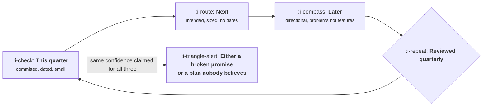

# The Roadmap Problem

```text
Level: Foundations
Prerequisites: Scoring Without Fooling Yourself
Estimated difficulty: 3/5 | Estimated time: 30 min
```

## The idea in one minute

A roadmap has to do two incompatible things. It has to be stable enough that other people can plan
against it, and flexible enough to absorb what you learn, which is the entire point of shipping.
Most roadmap disputes are an argument about which of those two to sacrifice, conducted by people
who each believe the other is being unreasonable. The resolution is not a format. It is to vary
the strength of the commitment by horizon: near work is committed, middle work is intended, far
work is directional, and saying which is which converts a promise nobody can keep into one you
can.

## A picture



One roadmap, three different strengths of claim. Presenting all three with equal confidence is the
failure.

## How it really works

### Why accuracy collapses with horizon

Each item's duration is uncertain, and a sequence of uncertain items compounds. An item estimated
at six weeks might take four or twelve; two such items in sequence have a range wider than either.
By the fourth item out, the range covers most of a year, which means a date attached to it is not a
forecast, it is a wish with a calendar entry.

This is arithmetic, not pessimism, and the program below shows it. It is also why the correct
response to "when will the fifth thing be done" is a range so wide it sounds unhelpful, and the
honest move is to say why rather than to invent a narrower one.

### Three strengths of commitment

| Horizon | Strength | What you state | What changes it |
|---|---|---|---|
| This quarter | Committed | Specific work, with dates where somebody depends on them | Only an incident or an explicit decision |
| Next quarter | Intended | Named work, sized, no dates | New evidence, which is expected |
| Beyond | Directional | The problems you expect to work on, not the features | Routinely, and that is correct |

Writing the far column as problems rather than features is the single highest value habit here. A
problem survives learning, a feature does not, and promising a feature two quarters out commits you
to a solution before discovery has happened.

### Make the uncertainty explicit rather than hiding it

Two failure modes, both common. A roadmap of specific dated features for twelve months, which
everybody in the company treats as a promise and which breaks by March. Or a roadmap so vague that
nobody can plan a launch, hire against it, or tell a customer anything, which is read as the
product team avoiding accountability.

Labelled horizons solve both, and the label has to be loud. If sales reads the "later" column as a
commitment because the formatting does not distinguish it, you have the first failure anyway.

### What other people actually need

Each audience needs a different cut, and giving everyone the same document is why roadmap meetings
go badly:

* **Engineering** needs the next two to three items in enough detail to prepare, plus the direction
  so architecture choices are not immediately wrong.
* **Sales and success** need what is committed, what is not, and what they may say to a customer.
  The third of those is the one they actually want and rarely get in writing.
* **Leadership** needs the bets and the reasoning, not the list.
* **Support** needs dates for anything that changes behaviour.

### When to break a commitment

Sometimes correct. The rules that keep it from being corrosive: break it explicitly rather than
quietly, state what you learned that changed it, tell the people who planned against it before
they find out, and record it in the decision log. A team that does this can break a commitment
twice a year without losing credibility. A team that lets commitments quietly slip loses it after
the first one.

### What fills the box in 2026

Whatever your tracker offers, plus a one page summary that is written for humans. The summary is
the artifact people actually read, and it is the one place the horizon labels can be made
unmissable. Do not let the tool's columns define your commitment levels, because they were designed
for a different question.

## Run the numbers

How fast forecast accuracy decays, with realistic per item uncertainty.

```go
// horizon.go: why a dated plan collapses a few items out.
package main

import (
	"fmt"
	"math"
)

// Each item's duration is estimated, with real spread. Variances add in sequence.
type est struct {
	name  string
	weeks float64
	sd    float64 // standard deviation, in weeks
}

func main() {
	plan := []est{
		{"bulk editing", 4, 1.4},
		{"audit log", 3, 1.0},
		{"onboarding rebuild", 8, 3.2},
		{"billing fixes", 2, 0.8},
		{"search speed", 3, 1.2},
	}
	mean, variance := 0.0, 0.0
	fmt.Printf("%-22s %8s %10s %12s %16s\n", "finishing", "mean", "spread", "80% range", "buffer for 80%")
	for _, e := range plan {
		mean += e.weeks
		variance += e.sd * e.sd
		sd := math.Sqrt(variance)
		lo, hi := mean-1.28*sd, mean+1.28*sd
		// A dated plan promises the mean, which is a coin flip. This is what
		// you would have to add to be right eight times in ten.
		fmt.Printf("%-22s %7.0fw %9.1fw %6.0f to %-4.0f %15.1fw\n", e.name, mean, sd, lo, hi, 1.28*sd)
	}
	sd := math.Sqrt(variance)
	fmt.Printf("\nthe fifth item has an 80%% range of %.0f weeks, on a %.0f week plan\n", 2*1.28*sd, mean)
	fmt.Println("A date on the fifth item is not a forecast. Commit to the first two.")
}
```

Read the last column. A plan that publishes the mean is promising a date it will hit half the time,
so the buffer column is what you would have to add to be right eight times in ten. For the first
item that is under two weeks, which is a normal amount of padding. By the fifth it is five weeks on
a twenty week plan, a quarter of the whole thing, and that is before anything unplanned arrives.

Nobody will accept a plan with twenty five percent padding written on it, and nobody should accept
a plan without it either. That contradiction is the roadmap problem, and the structure above is the
way out: date the near work where the buffer is small and honest, size the middle, and describe the
far work as problems so there is no date to be wrong about.

## Sector lens

| Sector | What the roadmap must survive |
|---|---|
| [Enterprise B2B SaaS](../product-by-sector/01-enterprise-b2b-saas.md) | Contractual commitments made in deals, which turn a roadmap item into an obligation |
| [Fintech](../product-by-sector/02-fintech.md) | Regulatory deadlines, which are genuinely fixed and reorder everything else |
| [Ecommerce and D2C](../product-by-sector/03-ecommerce-and-d2c.md) | Seasonal peaks, where a freeze window removes weeks of capacity |
| [Marketplaces](../product-by-sector/04-marketplaces.md) | Work on both sides, which doubles the dependency surface |
| [Devtools and Infrastructure](../product-by-sector/05-devtools-and-infrastructure.md) | Public commitments, which are read as contracts by your users |
| [Healthtech](../product-by-sector/06-healthtech-and-regulated-care.md) | Validation cycles that add fixed, unavoidable time to anything clinical |
| [Vertical SaaS](../product-by-sector/07-vertical-saas.md) | Industry calendars, where a missed window means waiting a year |

## Remember this

* A roadmap must be stable enough to plan against and flexible enough to learn. Vary commitment by
  horizon rather than choosing one.
* Committed, intended, directional. Label them loudly or they are all read as promises.
* Write far horizon work as problems, not features. Problems survive learning.
* Each audience needs a different cut, especially what sales may tell a customer.
* Breaking a commitment explicitly is survivable. Letting it slip quietly is not.

## Try it

1. Run `horizon.go` with your current plan. At which item does the range exceed what you would be
   comfortable publishing?
2. Take your roadmap and label every item committed, intended or directional. Count how many are
   currently presented as if they were the first.
3. Rewrite your furthest column as problems rather than features. Notice which items you cannot
   rewrite, and ask why they are there.

## Check yourself

1. Why does forecast accuracy collapse with horizon even when every individual estimate is
   unbiased?
2. Why does writing far horizon work as problems rather than features reduce broken promises?
3. What distinguishes a broken commitment that costs credibility from one that does not?
