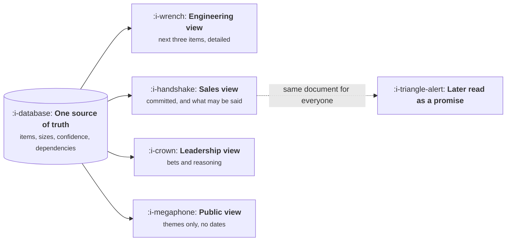

# Now, Next, Later or Dates

```text
Level: Expert
Prerequisites: The Roadmap Problem
Estimated difficulty: 2/5 | Estimated time: 25 min
```

## The idea in one minute

The format argument is really an argument about who absorbs uncertainty. Dates move it onto the
product team, who will be wrong in public. Now, next and later move it onto everybody else, who now
cannot plan a launch, a hire or a customer conversation. Neither is principled; both are a transfer.
The workable answer is that the format should differ by audience and by horizon, which means
maintaining one source of truth and more than one view of it, and being explicit that the views
differ on purpose rather than because somebody has old information.

## A picture



Four audiences, one underlying list. The failure is not having four views; it is having one and
letting each audience interpret it their own way.

## How it really works

### What each format costs

| Format | Good at | Costs you |
|---|---|---|
| Dated plan | Letting others plan around you | Breaks publicly, repeatedly, and teaches people to discount you |
| Now, next, later | Honest about uncertainty, easy to maintain | Nobody can plan a launch or answer a customer |
| Themes only | Survives any amount of learning | Reads as evasion to anyone who needs specifics |
| Dates on the near, themes on the far | Matches reality | Requires discipline to keep the boundary visible |

The fourth is what most teams converge on after being burned by the first two, and the discipline
it requires is making the boundary unmissable rather than a formatting subtlety.

### Who actually needs a date

Fewer people than ask. The honest test is whether somebody is making a commitment that depends on
yours. A marketing launch, a customer contract, a conference, a partner integration or a hiring
plan are real dependencies. "I would like to know" is not, and treating it as one is how a team
ends up with fifteen dates it cannot keep.

When somebody needs a date, ask what they will do with it. Often the real need is "will this be
before or after the end of Q3", which is a much easier question to answer honestly.

### Give sales the third column

Sales teams do not primarily want dates. They want to know what they are allowed to say, and they
will invent an answer if you do not supply one. The most valuable roadmap artifact in a company
with a sales team is a short list with three columns: shipped, committed, and not committed but
being explored, with a sentence for each about what may be told to a customer.

That document prevents more damage than any amount of roadmap formatting, and almost nobody writes
it.

### Public roadmaps are a different artifact

Anything customer visible should contain themes and no dates, because a public date becomes a
commitment in the customer's planning and in their renewal conversation. The exception is a
deprecation, where a date is mandatory and the obligation runs the other way.

### Keep one source of truth

The views differ; the underlying list must not. The moment there are two lists, they diverge within
a month and the contradiction surfaces in front of a customer. Generate views from one list, state
on each view what it is and what it omits, and date each view so nobody is reading a stale one.

## Sector lens

| Sector | Which format is forced on you |
|---|---|
| [Enterprise B2B SaaS](../product-by-sector/01-enterprise-b2b-saas.md) | Dates, because deals are signed against them. Keep the committed list very short |
| [Fintech](../product-by-sector/02-fintech.md) | Dates for regulatory items, which are externally fixed and non negotiable |
| [Ecommerce and D2C](../product-by-sector/03-ecommerce-and-d2c.md) | Seasonal dates, since peak windows do not move for anybody |
| [Marketplaces](../product-by-sector/04-marketplaces.md) | Themes, with coordinated dates whenever both sides must change together |
| [Devtools and Infrastructure](../product-by-sector/05-devtools-and-infrastructure.md) | Themes publicly, dates only for deprecations, where they are an obligation |
| [Healthtech](../product-by-sector/06-healthtech-and-regulated-care.md) | Dates that include validation time, which is routinely forgotten |
| [Vertical SaaS](../product-by-sector/07-vertical-saas.md) | Industry calendar dates, where missing a window costs a year |

## Remember this

* The format argument is about who absorbs uncertainty, not about principles.
* Dates on the near work, themes on the far, with the boundary made unmissable.
* Only give dates to people making a commitment that depends on yours. Ask what they will do with it.
* Sales wants to know what they may say, not when it ships. Write that document.
* Public roadmaps carry themes and no dates, except deprecations, where a date is required.
* One source of truth, several views, each labelled with what it omits.

## Try it

1. List everyone who has asked you for a date this quarter and what they were going to do with it.
   How many had a real dependency?
2. Write the three column document for sales this week: shipped, committed, exploring, with what
   may be said about each.
3. Check whether your team has one list or several. If several, find the first contradiction.

## Check yourself

1. Why is "now, next, later" not more honest than dates, merely differently distributed?
2. What question should you ask when somebody requests a date, and why does it usually change the
   answer you need to give?
3. Why does a public roadmap date become a problem at renewal rather than at launch?
