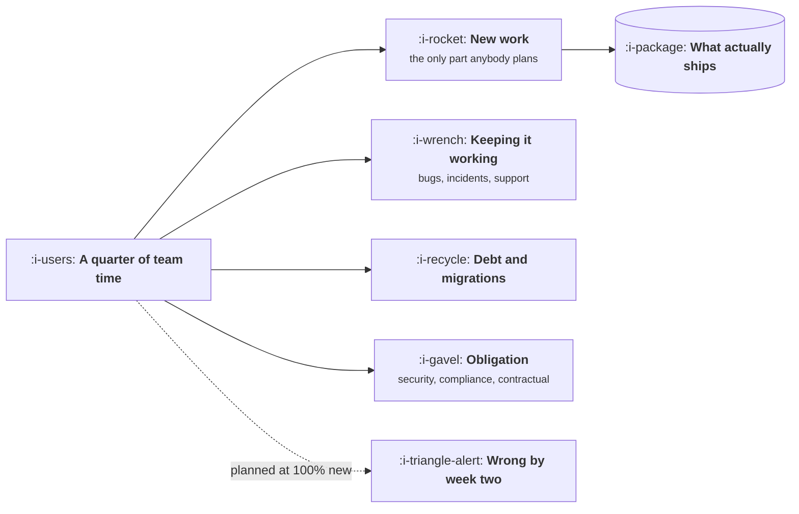

# Capacity Allocation

```text
Level: Expert
Prerequisites: The Roadmap Problem
Estimated difficulty: 3/5 | Estimated time: 30 min
```

## The idea in one minute

A quarter does not contain a quarter's worth of new work. Support escalations, incidents, security
findings, bugs, migrations and the work somebody promised a customer all arrive whether or not they
were planned, and together they routinely consume a third to a half of a team's time. Teams that
plan as though all capacity is available do not get more done; they get the same amount done and a
plan that was wrong from the first week, plus an uncomfortable conversation every month about why.
Allocating capacity to categories up front is not pessimism. It is the only version of the plan
that can survive contact.

## A picture



Four categories compete for one budget. Only the first is usually on the plan, and the other three
do not wait to be scheduled.

## How it really works

### The four categories

**New work** is what the roadmap describes and what everybody means by progress.

**Keeping it working** is bugs, incidents, support escalations, and the question from another team
that takes half a day. It is not optional and it is not predictable item by item, but it is very
predictable in aggregate, which is what makes it plannable.

**Debt and migrations** is work that makes future work cheaper. It never scores well against new
work in a quarterly comparison, which is exactly why it needs a protected allocation rather than a
place in the queue.

**Obligation** is security findings, compliance deadlines and contractual commitments. Not
negotiable at any priority score.

### Measure before you argue

The allocation argument is usually conducted on opinion. It does not have to be: look at the last
two quarters and categorise what actually happened. Most teams discover that keeping it working
was somewhere between twenty five and forty percent, which is both higher than the plan assumed and
stable enough to plan against next time.

That measurement converts the conversation from "we should spend less time on bugs" into "here is
what it costs, so here is what we can commit to", which is a conversation you can win.

### Protected allocations beat good intentions

An allocation only works if it is defended when the quarter gets tight, which is precisely when
debt work is first to be cut. The practical protection is to treat the allocation as a commitment
of the same kind as a roadmap item, with a named owner and something visible to show at the end of
the quarter. Debt work with no deliverable is debt work that gets cancelled.

### The unplanned work ratio is a signal

If keeping it working rises quarter over quarter, that is a quality problem being paid for in
capacity rather than fixed. If it falls after an investment in reliability, that is the return on
that investment, and it is the clearest number you will ever have for justifying the next one.

### Small teams, lumpy work

On a team of three or four, a single incident week is a large share of the quarter, and averages
are misleading. The honest version at small scale is to plan less, keep the committed list very
short, and treat the rest as intended rather than promised.

## Run the numbers

What a quarter actually holds, and what that does to a plan built on the headline number.

```go
// capacity.go: what is left after everything that was not on the plan.
package main

import "fmt"

const (
	people       = 6.0
	weeksQuarter = 13.0
	holidayRate  = 0.08 // leave, public holidays, sickness
	meetingRate  = 0.15 // rituals, interviews, planning, reviews
)

type bucket struct {
	name  string
	share float64 // share of remaining engineering time, measured from last quarter
}

func main() {
	gross := people * weeksQuarter
	available := gross * (1 - holidayRate) * (1 - meetingRate)
	fmt.Printf("gross capacity      %6.1f person weeks\n", gross)
	fmt.Printf("after leave         %6.1f\n", gross*(1-holidayRate))
	fmt.Printf("after meetings      %6.1f\n\n", available)

	buckets := []bucket{
		{"keeping it working", 0.30},
		{"debt and migrations", 0.12},
		{"obligation", 0.08},
	}
	left := available
	fmt.Printf("%-24s %14s %10s\n", "category", "person weeks", "share")
	for _, b := range buckets {
		w := available * b.share
		left -= w
		fmt.Printf("%-24s %14.1f %9.0f%%\n", b.name, w, 100*b.share)
	}
	fmt.Printf("%-24s %14.1f %9.0f%%\n", "new work", left, 100*left/available)
	fmt.Printf("\nA plan assuming %.0f person weeks of new work has %.0f.\n", gross, left)
	fmt.Printf("That is %.0f%% of the headline number, which is where plans go wrong in week two.\n",
		100*left/gross)
}
```

The final percentage is the number to carry into planning. A team of six for thirteen weeks sounds
like seventy eight person weeks of capacity, and the new work available is a fraction of that once
leave, meetings and the three unplanned categories are taken out. Planning against the headline
figure is not optimism, it is arithmetic nobody did, and it produces a plan that is already wrong
before anybody has written code.

## Sector lens

| Sector | What eats capacity |
|---|---|
| [Enterprise B2B SaaS](../product-by-sector/01-enterprise-b2b-saas.md) | Customer escalations and security findings, both arriving with deal value attached |
| [Fintech](../product-by-sector/02-fintech.md) | Obligation is a far larger slice, and it has externally fixed dates |
| [Ecommerce and D2C](../product-by-sector/03-ecommerce-and-d2c.md) | Peak readiness and freeze windows remove weeks from two quarters a year |
| [Marketplaces](../product-by-sector/04-marketplaces.md) | Trust and safety work, which arrives in bursts and cannot be deferred |
| [Devtools and Infrastructure](../product-by-sector/05-devtools-and-infrastructure.md) | Support of your own interface, plus deprecations you promised earlier |
| [Healthtech](../product-by-sector/06-healthtech-and-regulated-care.md) | Validation and documentation, which is a fixed tax on everything clinical |
| [Vertical SaaS](../product-by-sector/07-vertical-saas.md) | Customer specific requests and integrations with elderly industry systems |

## Remember this

* A quarter does not hold a quarter of new work. Four categories compete for the time.
* Measure the last two quarters before arguing about allocation. The number is stable.
* Protect the debt allocation with an owner and a deliverable, or it is cut when things get tight.
* A rising unplanned ratio is a quality problem being paid for in capacity.
* On a small team the variance dominates the average. Commit to less.

## Try it

1. Run `capacity.go` with your own team size and measured shares. What percentage of the headline
   number is actually available for new work?
2. Categorise last quarter's completed work into the four buckets. Compare the real split to what
   your plan assumed.
3. Give your debt allocation a named owner and one visible deliverable this quarter, then see
   whether it survives.

## Check yourself

1. Why does planning at full capacity produce the same output as planning honestly, but a worse
   quarter?
2. Why does debt work need a protected allocation rather than a place in the priority queue?
3. What does a rising "keeping it working" share tell you, and what would make it fall?
