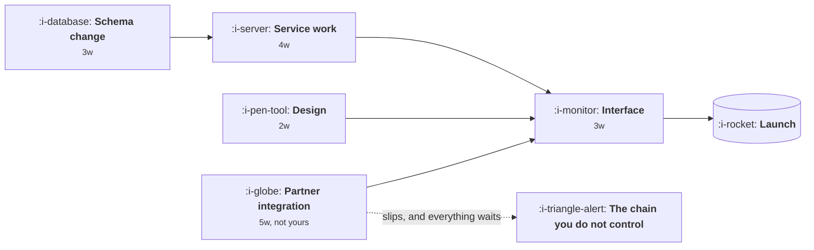

# Dependencies and the Critical Path

```text
Level: Expert
Prerequisites: Capacity Allocation
Estimated difficulty: 3/5 | Estimated time: 30 min
```

## The idea in one minute

Most plans are presented as a list and executed as a graph. The list says what you are doing; the
graph says what has to finish before what else can start, and only the graph tells you when
anything will be done. Two consequences follow and both are counterintuitive. Delay on one
particular chain of work moves the whole date, while delay anywhere else is absorbed for free, so
knowing which chain that is tells you where to spend attention. And the most valuable thing you can
do to a plan is usually not to speed anything up but to remove a dependency, because that changes
the shape of the graph rather than one number in it.

## A picture



Three chains converge on the interface. Only the longest sets the date, and here it is schema into
service at seven weeks, not the partner integration at five. The external dependency is the one
that feels alarming and it has two weeks of slack, which is exactly the kind of thing you cannot
see from a list.

## How it really works

### The critical path, without the jargon

Lay out the work as boxes and arrows. Any path from start to finish has a total duration. The
longest path is the critical path, and its length is your earliest possible finish. Everything not
on it has slack: it can slip by that much without moving the date at all.

This matters for attention. Status updates usually report on everything equally, and most of what
they report cannot affect the outcome. Ask instead which items are on the critical path and report
on those, which is usually two or three things rather than fifteen.

### Slack is a real and usable number

Work with four weeks of slack genuinely can be late by three without consequence. Knowing that
stops you spending escalation capital on something that did not need it, and it is also how you
decide where to add people: adding capacity to a task with slack does nothing at all, which is
why the famous observation about late projects and more people is true more often than it should
be.

### Dependencies you do not control are different

A dependency on another team, a partner or a vendor has the same effect on the graph and a
completely different risk profile, because you cannot see the status, you cannot reprioritise it,
and you usually learn about a slip late. Three practices help: ask for their estimate as a range
rather than a date, agree a check in cadence before you need it, and design a fallback that lets
you ship something without them.

The fallback is the valuable one. A dependency with a credible fallback has stopped being on the
critical path in the way that matters.

### Removing a dependency beats accelerating one

Given a choice between making a four week task take three, and removing an arrow so two things
happen in parallel, the second is almost always worth more. It changes the structure. Common ways
to remove one: agree an interface up front so two teams build against a contract rather than
sequentially, stub the dependency, narrow scope so the dependent part is not needed in version
one, or reorder so the uncertain work starts first.

### Start the uncertain thing first

If one item has a wide range, starting it early converts an unknown into a known while you still
have time to react. Teams routinely do the opposite, scheduling the comfortable work first because
it feels productive, and discover the problem in the last three weeks when nothing can be changed.

## Run the numbers

A small plan as a graph. The program finds the critical path, the slack on everything else, and
what a slip does depending on where it lands.

```go
// critical.go: which delays move the date, and which are free.
package main

import "fmt"

type task struct {
	name  string
	weeks float64
	after []string
}

func finish(tasks map[string]task, name string, memo map[string]float64) float64 {
	if v, ok := memo[name]; ok {
		return v
	}
	t := tasks[name]
	start := 0.0
	for _, dep := range t.after {
		if f := finish(tasks, dep, memo); f > start {
			start = f
		}
	}
	memo[name] = start + t.weeks
	return memo[name]
}

func project(tasks map[string]task, ends []string) float64 {
	memo := map[string]float64{}
	out := 0.0
	for _, e := range ends {
		if f := finish(tasks, e, memo); f > out {
			out = f
		}
	}
	return out
}

func main() {
	base := map[string]task{
		"schema":  {"schema", 3, nil},
		"service": {"service", 4, []string{"schema"}},
		"design":  {"design", 2, nil},
		"partner": {"partner", 5, nil},
		"ui":      {"ui", 3, []string{"service", "design", "partner"}},
	}
	ends := []string{"ui"}
	baseline := project(base, ends)
	fmt.Printf("baseline finish: %.0f weeks\n\n", baseline)

	fmt.Printf("%-10s %14s %10s\n", "slips 2w", "new finish", "slack")
	for name, t := range base {
		shifted := map[string]task{}
		for k, v := range base {
			shifted[k] = v
		}
		t.weeks += 2
		shifted[name] = t
		f := project(shifted, ends)
		slack := "0, on the critical path"
		if f == baseline {
			slack = "absorbed, free"
		}
		fmt.Printf("%-10s %13.0fw %10s\n", name, f, slack)
	}
	fmt.Println("\nOnly delays on the critical path move the date. The rest are free, and")
	fmt.Println("most status reporting is about the ones that are free.")
}
```

Run it and notice which tasks matter. Design and the partner integration can both slip two weeks
for free, while schema, service and the interface move the launch one for one. The partner slip is
the interesting case: it has exactly two weeks of slack, so two weeks is absorbed and three would
not be, which is the kind of threshold worth knowing before you agree a check in cadence with them.

That is the map of where attention is worth spending, and it is usually different from where
attention is currently spent, because status meetings tend to give every workstream equal time and
the external dependency tends to get the most of it regardless of whether it is critical.

## Sector lens

| Sector | The dependency that bites |
|---|---|
| [Enterprise B2B SaaS](../product-by-sector/01-enterprise-b2b-saas.md) | Customer side work: their IT, their security review, their test environment |
| [Fintech](../product-by-sector/02-fintech.md) | Partner banks and processors, whose timelines you cannot influence at all |
| [Ecommerce and D2C](../product-by-sector/03-ecommerce-and-d2c.md) | Physical operations and inventory, which have lead times software does not |
| [Marketplaces](../product-by-sector/04-marketplaces.md) | Both sides must be ready together, which doubles the surface |
| [Devtools and Infrastructure](../product-by-sector/05-devtools-and-infrastructure.md) | Your own deprecation promises, which are dependencies you created earlier |
| [Healthtech](../product-by-sector/06-healthtech-and-regulated-care.md) | Record system vendors and validation cycles, both slow and both external |
| [Vertical SaaS](../product-by-sector/07-vertical-saas.md) | Industry systems with annual release cycles and no support contract |

## Remember this

* Plans are lists, execution is a graph. Only the graph tells you a date.
* The critical path sets the finish. Everything else has slack and can slip for free.
* Report on the critical path, not on everything equally.
* Removing a dependency is usually worth more than accelerating a task.
* A dependency with a credible fallback has stopped being critical.
* Start the most uncertain work first, while you can still react.

## Try it

1. Run `critical.go` with your current plan's tasks and dependencies. Which items are free to slip?
2. For every external dependency you have, write down the fallback. Any blank is your real risk.
3. Look at your last status update and count how much of it concerned work with slack.

## Check yourself

1. Why does adding people to a task with slack have no effect on the date?
2. What makes removing a dependency structurally more valuable than shortening a task?
3. Why do teams schedule the comfortable work first, and what does it cost them?
