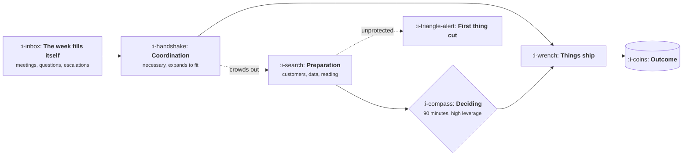

# The Job on a Tuesday

```text
Level: Foundations
Prerequisites: What a Product Manager Does
Estimated difficulty: 1/5 | Estimated time: 25 min
```

## The idea in one minute

Job descriptions describe product management as owning strategy and driving outcomes. A Tuesday
describes it as about six hours of conversation, an hour of writing, and perhaps ninety minutes
where you are actually deciding anything. That gap is not a failure of the job, it is the job: the
deciding is cheap in hours and expensive in preparation, and the conversation is how the preparation
gets done and how the decision gets carried out by people who do not report to you. The useful
skill for a new product manager is recognising which minutes are which, because the week fills
itself with coordination by default and nobody will protect the rest of it for you.

## A picture



The dotted path is the whole problem. Coordination is urgent and visible, preparation is neither,
and the decision quality you are judged on comes from the part that gets cut.

## How it really works

### What a real week contains

Roughly, for a product manager on one team at a company of a few hundred people:

| Activity | Typical hours | What it is for |
|---|---|---|
| Team rituals | 4 to 6 | Standup, planning, retro, refinement |
| Scheduled meetings with other functions | 5 to 8 | Design, engineering leads, support, sales, data |
| Unscheduled questions and escalations | 4 to 7 | Someone is blocked, or a customer asked something |
| Writing | 3 to 5 | Specs, decision memos, readouts, updates |
| Customer contact | 1 to 3 | Calls, reading tickets, watching sessions |
| Data | 1 to 2 | Funnels, cohorts, checking something you suspect |
| Actually deciding | 1 to 2 | The thing the job exists for |

That totals a long week, and two rows add up to under four hours. Those two rows, customer contact
and data, are what makes the deciding row any good, and they are the rows nobody notices missing
for about two months.

### The job is mostly conversation, and that is not waste

New product managers often feel fraudulent because the day was all talking. The talking is the
mechanism: an engineer who understands why makes fifty small decisions correctly without asking,
a designer given a constraint rather than a solution produces something better than your sketch,
and a support lead who heard about a launch beforehand writes the macro before the tickets arrive.
None of that happens by document alone.

What is waste is conversation without a decision attached, which is most recurring meetings after
their third occurrence.

### The ninety minutes

The deciding is a small number of hours a week, and it is worth protecting as literally as a
meeting in a calendar. The signature of a good decision hour is that it produces something written:
a choice, what you are not doing, and what would prove it wrong. If a week passes with no written
decision, the week was coordination.

### What to do in your first weeks about this

Three things, in order:

1. **Measure where the hours go** for two weeks, honestly, with the table above. Nearly everybody
   is shocked by how small the customer contact row is.
2. **Put the two scarce rows in the calendar as recurring blocks**, because unprotected time is
   allocated by whoever asks last.
3. **Decline or shorten one recurring meeting** and watch whether anything breaks. Usually nothing
   does, and you have bought back the only hours that compound.

### What fills the box in 2026

Calendar, a document tool, and the issue tracker. The genuinely useful addition is anything that
puts customer contact in front of you without you seeking it: support tickets routed to your inbox,
session recordings sampled weekly, a channel where sales posts losses. The tooling matters much
less than whether the contact is automatic or requires initiative, because initiative loses to a
full calendar.

## Run the numbers

Hours are the budget. This takes a week's allocation and reports what share went to the three jobs,
and what the decision quality rests on.

```go
// week.go: where the hours actually went.
package main

import "fmt"

type block struct {
	name    string
	hours   float64
	job     int // 1 decide, 2 align, 3 own, 0 none of them
	prepare bool
}

func main() {
	week := []block{
		{"team rituals", 5, 2, false},
		{"cross function meetings", 6.5, 2, false},
		{"questions and escalations", 5.5, 2, false},
		{"writing", 4, 1, false},
		{"customer contact", 1.5, 1, true},
		{"looking at data", 1, 3, true},
		{"deciding", 1.5, 1, false},
	}
	total, prep, deciding := 0.0, 0.0, 0.0
	jobs := map[int]float64{}
	for _, b := range week {
		total += b.hours
		jobs[b.job] += b.hours
		if b.prepare {
			prep += b.hours
		}
		if b.name == "deciding" {
			deciding = b.hours
		}
	}
	fmt.Printf("total %.1f hours\n\n", total)
	names := map[int]string{1: "decide", 2: "align", 3: "own", 0: "neither"}
	for _, j := range []int{1, 2, 3, 0} {
		if jobs[j] > 0 {
			fmt.Printf("%-10s %5.1f h %6.0f%%\n", names[j], jobs[j], 100*jobs[j]/total)
		}
	}
	fmt.Printf("\ndeciding, as a block         %.1f h, %.0f%% of the week\n", deciding, 100*deciding/total)
	fmt.Printf("preparation, customers and data %.1f h, %.0f%% of the week\n", prep, 100*prep/total)
	fmt.Printf("every decision this week rested on those %.1f hours\n", prep)
	fmt.Println("Below about 10%, your information advantage is decaying and nobody will tell you.")
}
```

Two readings, and the second is the one that matters. Job two, aligning other people, is 68% of the
week, which sounds alarming and is simply what the job is. Deciding as a block is 6%, which is also
fine, because deciding is supposed to be a small number of high leverage hours rather than a large
number of mediocre ones.

The number to watch is the last line. Those two and a half hours of customer contact and data are
what make the 6% any good, and they are 10% of the week. Below that, your information advantage
from [Influence Without Authority](../the-product-function/04-influence-without-authority.md) is
decaying, the decisions get worse slowly, and nobody tells you because it looks like a busy week
from outside.

## Sector lens

| Sector | What the week looks like instead |
|---|---|
| [Enterprise B2B SaaS](../product-by-sector/01-enterprise-b2b-saas.md) | More coordination, because sales and customer success both need you. Customer contact is easier to get and skewed toward buyers |
| [Fintech](../product-by-sector/02-fintech.md) | A standing compliance conversation, and more reading than in other sectors |
| [Ecommerce and D2C](../product-by-sector/03-ecommerce-and-d2c.md) | More data hours, fewer interview hours, because the traffic answers faster than people do |
| [Marketplaces](../product-by-sector/04-marketplaces.md) | Two sets of customer conversations, and they disagree |
| [Devtools and Infrastructure](../product-by-sector/05-devtools-and-infrastructure.md) | Customer contact is public: forums, issues and your own product's logs |
| [Healthtech](../product-by-sector/06-healthtech-and-regulated-care.md) | Clinician time is nearly impossible to get, so one hour is worth five elsewhere |
| [Vertical SaaS](../product-by-sector/07-vertical-saas.md) | Customers will talk to you for an hour happily, and that access is the job's main advantage |

## Remember this

* A real week is mostly conversation, a few hours of writing, and under two hours of deciding.
* The conversation is the mechanism, not the overhead. Conversation without a decision is the waste.
* Customer contact and data are under four hours and carry the quality of everything else.
* Unprotected time is allocated by whoever asks last.
* A week with no written decision was a week of coordination.

## Try it

1. Run `week.go` with your own hours from last week, honestly. What percentage was preparation?
2. Keep the table for two weeks without changing anything, then look. Most people find the customer
   contact row is zero in at least one of the two weeks.
3. Decline one recurring meeting for a month. Write down what you expected to break, then check.

## Check yourself

1. Why is conversation the mechanism of the job rather than overhead, and what distinguishes the
   conversation that is waste?
2. Deciding is only about six percent of the week. Why is that acceptable, and what makes those
   hours good or bad?
3. Which row shrinks first under pressure, how long before anybody notices, and what do they notice
   instead?
