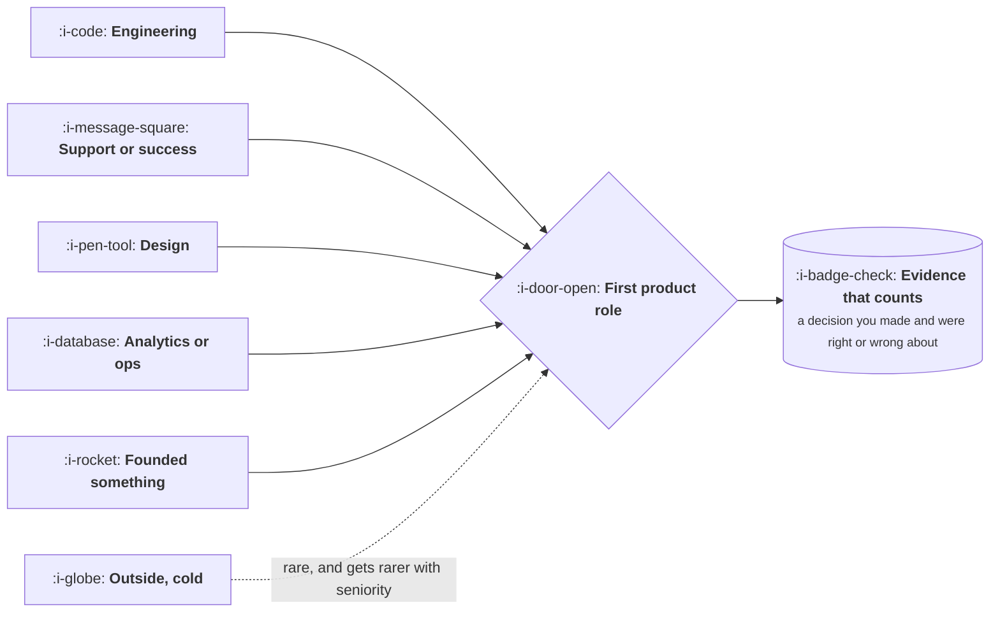

# How People Actually Get In

```text
Level: Foundations
Prerequisites: The Job on a Tuesday
Estimated difficulty: 1/5 | Estimated time: 25 min
```

## The idea in one minute

Almost nobody is hired into their first product role from outside. The route that works, for the
large majority, is to already be inside a company doing adjacent work and to start doing the job
before anybody gives you the title. That is not a trick, it is a consequence of how the role is
assessed: there is no portfolio of work you can show, no certification anybody believes, and the
only reliable evidence that somebody can do the job is that they have been doing a recognisable
version of it. Understanding which route you are on changes what you should spend the next six
months doing, and most of the common advice is written for a route that very few people are
actually on.

## A picture



Five solid arrows and one dotted one. The dotted one is the route most career advice addresses,
and it is the least used.

## How it really works

### The five internal routes, and what each gives you

| From | The advantage you arrive with | The gap you have to close |
|---|---|---|
| Engineering | Credibility with the team, systems understanding, realistic estimates | Customer contact, and the habit of describing problems rather than solutions |
| Support or customer success | More customer knowledge than anyone in the building | Technical fluency, and translating complaints into problems worth solving |
| Design | Users, flows, and how to run research | Commercial framing, and the willingness to constrain rather than solve |
| Analytics or operations | Data fluency, and a view of the whole funnel | Qualitative work, and the fact that numbers do not contain the why |
| Founding something | All three jobs at once, under real stakes | Working inside constraints you did not set, and influence without authority |

Notice that each route arrives with roughly one of the three jobs already strong. The work of the
first year is the other two.

### Do the job before the title

This is the mechanism underneath all five routes. The job is largely artifacts and conversation,
and almost none of it requires permission:

* Write the decision memo nobody asked for, about a decision your team is about to make badly.
* Talk to five customers and write a readout that changes somebody's mind.
* Instrument something that was never measured, and report what it says.
* Take the problem nobody owns, the one that spans two teams, and own it to a conclusion.

A person who has done four of those is visibly doing product work, and the title usually follows
the behaviour rather than causing it. A person who has read ten books about frameworks has produced
nothing anybody can assess.

### Why the external route is hard, and when it works

Hiring a first time product manager from outside means betting on potential with no observable
evidence, against a pool of candidates who have evidence. It does happen, and the cases where it
works share a pattern: deep domain expertise the company lacks, a real thing you built and shipped
yourself, or a company so early that the role is undefined anyway.

The implication is practical. If you are outside and want in, the strongest move is usually to get
into the company in an adjacent role, not to apply harder for the product role.

### What does not work

Certifications are not read as evidence by anybody doing the hiring. Framework vocabulary without
an example is read as the absence of experience, because the people interviewing have seen it.
Volume of applications does not substitute for evidence, and a portfolio of redesigns of famous
apps answers a question nobody asked, since the hard part was never the interface.

### What the interview is actually testing

Three things, however the questions are phrased. Can you take an ambiguous situation and impose a
structure on it. Do you reason about users and numbers rather than about features. And will the
engineers in the room want to work with you. Case questions are a vehicle for the first, not a test
of whether you can guess the interviewer's answer.

### What fills the box in 2026

Nothing, usefully. This is one of the few lessons in the course with no tooling: the mechanism is
behaviour inside an organisation. The one honest change in recent years is that building a working
prototype yourself has become cheap enough that "a real thing you shipped" is available to far more
people than it used to be, which strengthens the external route slightly for those who use it.

## Sector lens

| Sector | What changes about getting in |
|---|---|
| [Enterprise B2B SaaS](../product-by-sector/01-enterprise-b2b-saas.md) | Customer success and sales engineering are unusually strong routes, because they hold the customer knowledge |
| [Fintech](../product-by-sector/02-fintech.md) | Domain knowledge of payments, risk or compliance substitutes for product experience more than elsewhere |
| [Ecommerce and D2C](../product-by-sector/03-ecommerce-and-d2c.md) | Merchandising, operations and analytics are common routes, and the data fluency transfers directly |
| [Marketplaces](../product-by-sector/04-marketplaces.md) | Operations roles that manage one side of the market are a strong route, because supply knowledge is scarce |
| [Devtools and Infrastructure](../product-by-sector/05-devtools-and-infrastructure.md) | Engineering is close to the only route, because credibility with developer users requires having been one |
| [Healthtech](../product-by-sector/06-healthtech-and-regulated-care.md) | Clinical background is the scarce input, and it opens the door faster than product experience |
| [Vertical SaaS](../product-by-sector/07-vertical-saas.md) | Having worked in the industry is often worth more than having done the job |

## Remember this

* Most first product roles are internal moves, not external hires.
* Each route arrives strong in one of the three jobs. The first year is the other two.
* Do the job before the title. Four unrequested artifacts beat ten books.
* The external route works with domain expertise, something you built, or a company early enough
  that the role is undefined.
* The interview tests structure under ambiguity, reasoning about users and numbers, and whether
  engineers want to work with you.

## Try it

1. Name your route from the table, and write down which two of the three jobs you are weak in.
2. Pick one of the four unrequested artifacts and produce it this month, for a decision that is
   genuinely about to be made.
3. Ask someone who does the job to read it and tell you what they would have done differently.
   That conversation is worth more than the artifact.

## Check yourself

1. Why is a first product role rarely filled from outside, in terms of what the hirer can actually
   observe?
2. You arrive from engineering. Which job are you strong in, and what is the specific habit you
   have to unlearn?
3. Why does a redesign portfolio answer a question nobody asked?
