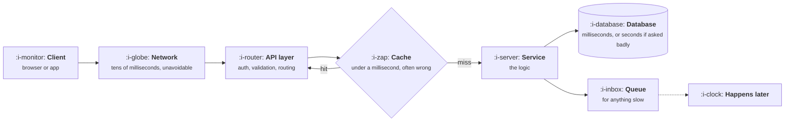

# How a Request Actually Travels

```text
Level: Foundations
Prerequisites: None
Estimated difficulty: 2/5 | Estimated time: 30 min
```

## The idea in one minute

A click becomes a journey through perhaps six layers, and almost every product question with a
technical answer is really a question about which of those layers the work lands in. Reading from a
cache is a thousand times cheaper than computing something across a database, and that ratio, not
anybody's opinion, is why one feature is a day and a very similar one is a month. You do not need
to build any of this. You need a mental model accurate enough that you can tell, before asking,
which of your ideas are cheap and which are architecture.

## A picture



The two branches off the service are the ones that decide product behaviour: a cache makes things
fast and occasionally stale, and a queue makes things possible and no longer immediate.

## How it really works

### The orders of magnitude worth memorising

| Operation | Roughly | What that means for a product decision |
|---|---|---|
| Memory or cache read | Under a millisecond | Free. Do it per item if you like |
| Simple database read by key | 1 to 10 ms | Cheap. Hundreds per request is still fine |
| Database query across many rows | 10 ms to seconds | Depends entirely on indexes and size |
| Network round trip to another service | 20 to 200 ms | Expensive. Doing it in a loop is the classic mistake |
| Call to a third party | 100 ms to seconds | Must be assumed to fail, and usually belongs in a queue |
| Model call | 1 to 30 seconds | A different category. Streams or runs in the background |

The useful habit is asking which row a feature lands in. "Show this number next to every row" is
cheap if it is one query, and quietly catastrophic if it is one query per row.

### Caches make things fast and sometimes wrong

A cache stores an answer so it need not be recomputed. The product consequence is staleness: for
some period, users see a previous answer. Usually invisible, occasionally the whole problem, and
the product decision is how stale is acceptable here, which an engineer cannot answer for you.

"Why did my change not appear?" is a cache question most of the time.

### Queues make slow things possible and no longer immediate

If something takes more than a second or two, it moves to a queue and happens shortly after. That
is an architectural answer to a product problem, and it hands you a different product problem: the
user needs to know it is happening, that it finished, or that it failed. Those states are design
work that only exists because of a technical decision, and they are routinely forgotten.

### Why similar features cost very differently

Three structural reasons, and recognising them is most of the value of this lesson.

1. **Does it fit the data model?** Something the schema already expresses is cheap. Something it
   does not is expensive in proportion to how much already depends on the current shape.
2. **Does it cross a boundary?** Work inside one service is cheap; work spanning several, or
   another company's, is slow and failure prone.
3. **Is it per request or per item?** Per item work in a loop is the single most common reason a
   feature that sounded trivial is not.

### How to ask

The question that gets a useful answer is not "how hard is this" but "where does this land". Ask
whether it fits the current data model, whether it crosses a service boundary, and whether it is
per request or per row. Three answers and you can usually predict the estimate, which makes the
estimate conversation much shorter.

### What fills the box in 2026

The shape is unchanged: a client, an API layer, services, a database, a cache such as Redis, and a
queue. The visible additions are a vector store when retrieval is involved and a model provider,
which is a third party call with the worst latency profile in the table and a cost per use, which
no other row has.

## Sector lens

| Sector | Which row dominates |
|---|---|
| [Enterprise B2B SaaS](../product-by-sector/01-enterprise-b2b-saas.md) | Tenancy and permissions on every query, which makes "simple" reads less simple |
| [Fintech](../product-by-sector/02-fintech.md) | Third party calls to rails, all of which must be assumed to fail midway |
| [Ecommerce and D2C](../product-by-sector/03-ecommerce-and-d2c.md) | Cache staleness on inventory and price, where being wrong has a direct cost |
| [Marketplaces](../product-by-sector/04-marketplaces.md) | Search across many rows, which is the expensive row and the core of the product |
| [Devtools and Infrastructure](../product-by-sector/05-devtools-and-infrastructure.md) | Your own latency is the product, and users will measure it |
| [Healthtech](../product-by-sector/06-healthtech-and-regulated-care.md) | Integrations with record systems, which are slow, elderly and unforgiving |
| [Vertical SaaS](../product-by-sector/07-vertical-saas.md) | File based integrations with industry systems, usually asynchronous by necessity |

## Remember this

* Learn the orders of magnitude. Most technical product questions are which row something lands in.
* Caches trade freshness for speed, and how stale is acceptable is a product decision.
* Queues make slow work possible and create three new states to design: running, done, failed.
* Three things drive cost: fit with the data model, crossing boundaries, and per item work.
* Ask where it lands, not how hard it is.

## Try it

1. Take three features on your roadmap and answer the three questions for each. Compare your
   prediction against the estimates you get.
2. Find one place in your product where stale data is shown. Decide what an acceptable staleness
   actually is, and check whether anyone ever decided that.
3. Find an asynchronous action in your product and check whether the failure state was designed.

## Check yourself

1. Why can a feature that sounds identical to another cost ten times as much to build?
2. What product work does a queue create that did not exist before the decision to use one?
3. Why is "how hard is this" a worse question than "where does this land"?
