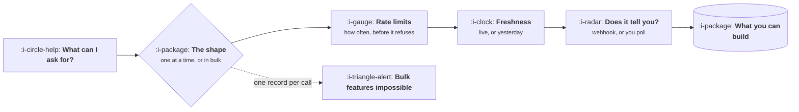

# APIs for Product Managers

```text
Level: Foundations
Prerequisites: How a Request Actually Travels
Estimated difficulty: 2/5 | Estimated time: 30 min
```

## The idea in one minute

An API is a set of promises about what you can ask for and what you will get back, and the shape of
those promises decides which products can be built on top. If an interface returns one record at a
time and you need five hundred, you do not have a slow feature, you have no feature. Most
integration disappointments are this: the product was designed against an imagined interface rather
than the real one. Reading an API well enough to know what it forbids takes about twenty minutes
and saves whole quarters, and it applies equally to the interfaces you consume and the one you
expose.

## A picture



Five questions, asked in that order, tell you what is buildable before anybody writes code.

## How it really works

### The five questions

**What can I ask for?** Which objects, with which filters. If you cannot filter by the thing your
feature needs, you will be fetching everything and filtering yourself, which collides with the next
question.

**In what quantity?** One record per call, or pages of a hundred, or a bulk export. This single
property decides more than any other. A per record interface makes any feature touching thousands
of records impossible at acceptable speed.

**How often may I ask?** Rate limits are usually expressed per minute or per hour. Divide your
expected volume by the limit; if the answer is longer than your users will wait, redesign now.

**How fresh is the answer?** Some interfaces serve live data, others serve something computed
hourly. A feature that promises real time against an hourly source is a promise you cannot keep.

**Will it tell me when something changes?** A webhook pushes changes to you. Without one you poll,
which burns your rate limit and adds delay equal to your polling interval.

### Why this is a product conversation

Each answer maps to a product constraint that you own, not engineering:

| Interface property | What it forbids | What you decide |
|---|---|---|
| Per record only | Bulk operations, instant large imports | Whether to narrow scope or run it in the background |
| Low rate limit | Anything that scales with customer size | Whether large customers get a different experience |
| Hourly freshness | Live dashboards and real time promises | What you tell the user about recency |
| No webhook | Immediate reaction to external change | How long a delay users will accept |
| Thin objects | Showing a joined view without many calls | Whether to store a copy and accept staleness |

### Idempotency, and why it matters to you

If an operation can be safely repeated without doing the thing twice, it is idempotent. This
matters because networks fail halfway and retries happen. Without it, a timeout on a payment leaves
nobody able to say whether it went through, and the product needs a screen for a state that should
not exist.

When you consume an interface, ask whether writes are idempotent. When you expose one, insist that
they are.

### Versioning is a promise about the future

An interface that changes without notice cannot be depended on. The questions are whether there is
a version, what the deprecation window is, and what counts as a breaking change. For interfaces you
expose this becomes central, because your customers' engineers build against your promises and a
broken one costs trust disproportionately. See
[Devtools and Infrastructure](../product-by-sector/05-devtools-and-infrastructure.md).

### What fills the box in 2026

Most interfaces are REST and JSON, often described with OpenAPI, which is worth reading directly:
it answers four of the five questions without talking to anyone. GraphQL solves the thin object
problem and complicates rate limiting. Webhooks are standard and still frequently unreliable, so
anything important needs a reconciliation path. The addition worth noting is that interfaces are
increasingly consumed by agents rather than by code somebody wrote, which puts a premium on clear
naming, predictable errors and machine readable descriptions.

## Sector lens

| Sector | The interface constraint that bites |
|---|---|
| [Enterprise B2B SaaS](../product-by-sector/01-enterprise-b2b-saas.md) | Customers want your interface, with their tenancy and permissions enforced inside it |
| [Fintech](../product-by-sector/02-fintech.md) | Bank interfaces are slow, rate limited and sometimes batch only, which shapes the whole product |
| [Ecommerce and D2C](../product-by-sector/03-ecommerce-and-d2c.md) | Platform interfaces govern what you can do to catalogue and checkout, and often forbid the obvious thing |
| [Marketplaces](../product-by-sector/04-marketplaces.md) | Supply side integrations vary per partner, so the weakest one sets the product |
| [Devtools and Infrastructure](../product-by-sector/05-devtools-and-infrastructure.md) | Your interface is the product, so versioning is a core product decision |
| [Healthtech](../product-by-sector/06-healthtech-and-regulated-care.md) | Record system interfaces are standardised in theory and inconsistent in practice |
| [Vertical SaaS](../product-by-sector/07-vertical-saas.md) | Industry systems often have no interface at all, and the integration is a file on a schedule |

## Remember this

* Five questions: what, how many, how often, how fresh, does it tell you.
* Quantity is the biggest constraint. A per record interface forbids bulk features entirely.
* Divide expected volume by the rate limit before designing anything.
* No webhook means polling, which costs rate limit and adds delay equal to the interval.
* Ask whether writes are idempotent, or design the screen for the state nobody can resolve.
* Reading the specification takes twenty minutes and answers most of this.

## Try it

1. For the next integration on your roadmap, answer the five questions from the published
   specification before asking an engineer anything.
2. Take your largest customer's record count and divide by the rate limit of the interface you
   depend on. How long does a full sync take?
3. Check whether the writes in your own interface are idempotent. If not, find the support ticket
   that already exists because of it.

## Check yourself

1. Why does the quantity question forbid whole categories of feature rather than just slowing them?
2. What product work appears when an interface has no webhook?
3. Why does idempotency produce a user facing screen when it is absent?
