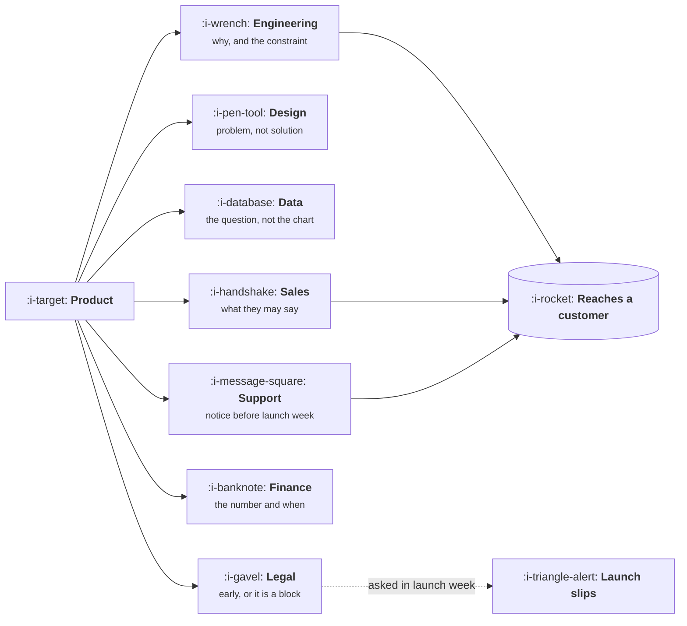

# Who You Actually Depend On

```text
Level: Expert
Prerequisites: Influence Without Authority
Estimated difficulty: 2/5 | Estimated time: 25 min
```

## The idea in one minute

A product team is a small part of the machine that turns an idea into revenue, and seven other
functions have to act for anything to reach a customer. Each of them needs something specific from
you, usually at a specific time, and almost all cross functional friction is one of those needs
being met late or not at all. The useful mental model is not a diagram of the organisation but a
list: for each function, what they need, when they need it, and what happens if it is late. Most
product managers can name three of the seven, and the four they cannot name are where their
launches go wrong.

## A picture



Seven arrows out, three required for anything to ship. The dotted one is the function most often
engaged too late, and it is the one with an actual veto.

## How it really works

### The seven, and what each needs

| Function | What they need from you | When | If late |
|---|---|---|---|
| Engineering | The problem, the constraint, the success bar | Before design is final | They build the wrong thing accurately |
| Design | The problem and the evidence, never a solution | Before any interface exists | You get your own first idea back, polished |
| Data | A question tied to a decision, not a chart request | Before instrumentation is built | The event is missing and you wait a release |
| Sales | What is committed, and what they may tell a customer | Continuously, in writing | They invent an answer, and it becomes a commitment |
| Support | Notice, documentation, and the known failure modes | Two weeks before launch | Tickets arrive with no macro and no answer |
| Finance | Pricing changes, cost implications, the forecast effect | Before the decision, not after | A pricing change is reversed after launch |
| Legal and compliance | Anything touching data, claims, contracts or money | At the idea stage | A veto in launch week, which is the worst time |

### Three are on the critical path to a customer

Engineering, sales and support are usually load bearing for whether a thing reaches anybody. Design
and data make the thing good. Finance and legal can stop it. That distinction tells you where to
spend coordination effort when you cannot spend it everywhere.

### The common failure is timing, not relationship

Almost every cross functional complaint sounds like a people problem and is a sequencing problem.
Legal is not obstructive, it was asked three days before launch about something it needed three
weeks for. Support is not resistant, it found out from the changelog. Data did not refuse, the
event was never instrumented because nobody asked in time.

The fix is boring and effective: a standard list of who is engaged at which stage, applied to every
piece of work above a size threshold, so that engagement is a default rather than a memory test.

### Learn what each function is measured on

People behave according to what they are judged by, and knowing it makes requests land. Sales is
measured on quota attainment this quarter, which is why next quarter's roadmap item does not
motivate them. Support is measured on volume and resolution time, which is why a feature that adds
tickets is a cost to them regardless of how good it is. Finance is measured on forecast accuracy,
which is why a surprise matters more than a bad number.

A request framed in terms of the other person's measure is usually accepted without argument. The
same request framed in terms of yours is a negotiation.

### What product owes in return

This is reciprocal, and the thing product most often fails to supply is closure. Functions that
send you signal, especially sales and support, need to hear what happened to it. A support lead who
reports the same issue three times and never learns whether it reached the roadmap will stop
reporting, and you will have lost the highest volume signal in the company.

## Sector lens

| Sector | The function that matters more than elsewhere |
|---|---|
| [Enterprise B2B SaaS](../product-by-sector/01-enterprise-b2b-saas.md) | Sales and customer success, who hold the customer relationship you do not |
| [Fintech](../product-by-sector/02-fintech.md) | Compliance, which is a veto rather than a stakeholder |
| [Ecommerce and D2C](../product-by-sector/03-ecommerce-and-d2c.md) | Operations and merchandising, who own the parts of the product that are physical |
| [Marketplaces](../product-by-sector/04-marketplaces.md) | Two operations teams, one per side, who often disagree |
| [Devtools and Infrastructure](../product-by-sector/05-devtools-and-infrastructure.md) | Developer relations, who are both marketing and support and are your users |
| [Healthtech](../product-by-sector/06-healthtech-and-regulated-care.md) | Clinical leadership, who hold a veto grounded in patient safety |
| [Vertical SaaS](../product-by-sector/07-vertical-saas.md) | Implementation and services, who absorb everything the product does not do |

## Remember this

* Seven functions, each with a specific need and a specific deadline for it.
* Engineering, sales and support are usually load bearing for reaching a customer. Legal can stop it.
* Nearly all cross functional friction is a sequencing failure wearing the costume of a people
  problem.
* Learn what each function is measured on, and frame requests in those terms.
* Owe them closure. A function that never hears what happened to its signal stops sending it.

## Try it

1. Write the seven row table for your own organisation, with real names and real deadlines. Note
   which rows you had to guess.
2. For your next launch, write down which function is engaged at which stage, before you start.
3. Ask a support lead what happened to the last three things they escalated. Their answer is your
   closure score.

## Check yourself

1. Why does engaging legal at the idea stage cost less than engaging them at launch, even though
   it is the same conversation?
2. Why does a request framed in terms of the other function's measure get accepted without
   negotiation?
3. What specifically breaks when product does not close the loop with support?
