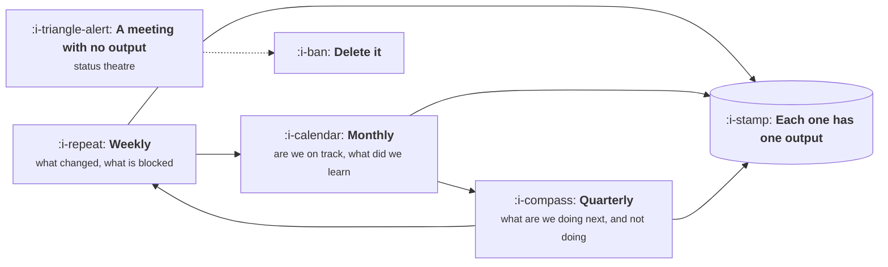

# The Operating Cadence

```text
Level: Expert
Prerequisites: Who You Actually Depend On
Estimated difficulty: 2/5 | Estimated time: 25 min
```

## The idea in one minute

A company runs on a small number of recurring events, and the quality of those events determines
how much of everybody's remaining time is useful. Most organisations accumulate rituals the way a
loft accumulates boxes: something was needed once, a meeting was created, and nothing is ever
removed. The result is a calendar that consumes a fifth of everyone's week and produces decisions
in perhaps a tenth of its slots. The cadence that works is small, each event has a single named
output, and anything that does not produce its output twice in a row is either fixed or deleted.

## A picture



Three loops, each with one output. Anything that cannot name its output belongs in the box on the
right.

## How it really works

### The three loops

**Weekly** is operational: what changed, what is blocked, what needs a decision this week. Output
is a short list of unblocked items and decisions taken. Thirty minutes, no slides.

**Monthly** is corrective: are we on track against what we said, what did we learn from what
shipped, what do we change. Output is a readout and any adjustment to the quarter. This is where
closure rate from [The Product Loop](../the-product-function/02-the-product-loop.md) is enforced,
because if readouts have no home they do not happen.

**Quarterly** is directional: what are we committing to, what are we explicitly not doing, what
allocation goes to each category. Output is the plan and the refusals.

Most companies have all three and the monthly one is usually a status update rather than a
correction, which is why nothing changes between quarters.

### Every event needs one named output

Not an agenda, an output. Something that exists afterwards that did not exist before: a decision, a
written readout, a plan, an unblocked list. If an event runs twice without producing its output,
something is wrong with the format, the attendees or the premise, and the honest options are to fix
it or remove it.

This single rule removes more wasted time than any other change available to a product manager,
and it is unpopular because every recurring meeting is somebody's reassurance.

### The cost is larger than it looks

A weekly hour with eight people is not an hour. It is eight hours of salary, plus the fragmentation
cost of a meeting sitting in the middle of eight afternoons, which is worse than the hour itself
for anybody doing focused work. The arithmetic is worth doing once, out loud, for the recurring
meetings you own.

### Asynchronous by default, synchronous for decisions

Status is better written: it is skimmable, searchable, and does not require everyone to be free at
the same moment. Decisions and disagreements are better live, because written disagreement escalates
and takes three times as long. The common mistake is the inverse, using meetings for status and
documents for decisions, which produces long meetings and decisions nobody noticed were made.

### Who attends

The smallest group who can produce the output. Everybody else gets the written result. Attendance
as a courtesy is how a thirty minute decision meeting becomes a sixty minute briefing with a
decision attached.

## Run the numbers

What a recurring meeting costs per year, and what it has to produce to be worth it.

```go
// cadence.go: the annual cost of a recurring meeting.
package main

import "fmt"

type ritual struct {
	name      string
	minutes   float64
	attendees float64
	perYear   float64
}

const hourly = 75.0 // loaded cost of an average attendee, per hour

func (r ritual) cost() float64 {
	return r.minutes / 60 * r.attendees * r.perYear * hourly
}

func main() {
	rituals := []ritual{
		{"standup", 15, 7, 250},
		{"weekly team sync", 60, 8, 48},
		{"sprint planning", 90, 8, 26},
		{"retro", 60, 8, 26},
		{"backlog refinement", 60, 6, 48},
		{"monthly review", 90, 12, 12},
		{"quarterly planning", 480, 15, 4},
	}
	total, hours := 0.0, 0.0
	fmt.Printf("%-22s %8s %10s %12s\n", "ritual", "per year", "hours", "cost")
	for _, r := range rituals {
		h := r.minutes / 60 * r.attendees * r.perYear
		total += r.cost()
		hours += h
		fmt.Printf("%-22s %8.0f %10.0f %12.0f\n", r.name, r.perYear, h, r.cost())
	}
	fmt.Printf("%-22s %8s %10.0f %12.0f\n", "total", "", hours, total)
	fmt.Printf("\nthat is %.1f full time people spent entirely in these rooms\n", hours/1800)
	fmt.Println("Each one should be able to name the output it produces. Most cannot.")
}
```

The bottom line is the one to read aloud in a planning meeting. The cadence of a single team
consumes the equivalent of a person or more every year, which is a reasonable price for
coordination and an outrageous one for status theatre. The test is not whether the meetings feel
useful, which they always do to the person who called them, but whether each can name what exists
afterwards that did not exist before.

## Sector lens

| Sector | What the cadence must include |
|---|---|
| [Enterprise B2B SaaS](../product-by-sector/01-enterprise-b2b-saas.md) | A standing deal review, because roadmap requests arrive attached to revenue |
| [Fintech](../product-by-sector/02-fintech.md) | A compliance checkpoint, early and recurring, not a launch gate |
| [Ecommerce and D2C](../product-by-sector/03-ecommerce-and-d2c.md) | A weekly trading review, where the numbers move fast enough to act on |
| [Marketplaces](../product-by-sector/04-marketplaces.md) | Separate reviews per side, then one where the conflict is resolved |
| [Devtools and Infrastructure](../product-by-sector/05-devtools-and-infrastructure.md) | A regular pass over public issues and forums, which is your customer contact |
| [Healthtech](../product-by-sector/06-healthtech-and-regulated-care.md) | Clinical review on a fixed cadence, with named clinical sign off |
| [Vertical SaaS](../product-by-sector/07-vertical-saas.md) | A services and implementation review, where the gap between sold and built appears |

## Remember this

* Three loops: weekly operational, monthly corrective, quarterly directional.
* Every event needs one named output. Two failures in a row means fix it or delete it.
* The monthly loop is where readouts live. Without it, closure rate goes to zero.
* Status asynchronous, decisions synchronous. Most teams do the reverse.
* Invite the smallest group who can produce the output.

## Try it

1. Run `cadence.go` with your real rituals. What is the annual figure, and in full time people?
2. For each recurring meeting you own, write its one output. Any blank is a candidate for deletion.
3. Cancel the weakest one for a month and write down beforehand what you expect to break.

## Check yourself

1. Why is a meeting's cost larger than the hours inside it?
2. Why does using meetings for status and documents for decisions produce the worst of both?
3. What happens to closure rate when there is no monthly corrective loop, and why?
