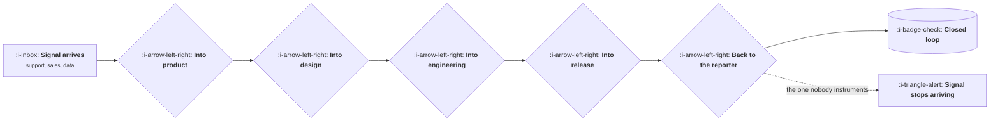

# The Handoffs That Break

```text
Level: Foundations
Prerequisites: The Operating Cadence
Estimated difficulty: 3/5 | Estimated time: 30 min
```

## The idea in one minute

Work does not usually fail inside a function, it fails between them. Each handoff loses a little
context, adds a little delay, and drops a small share of the things passing through it, and because
each individual loss looks acceptable nobody intervenes. Five handoffs that each lose ten percent
deliver under sixty percent of what entered, and the organisation experiences that as "things take
a long time here" rather than as a measurable defect in a specific seam. The fix is to instrument
the seams: count what goes in and what comes out of each one, which turns a cultural complaint into
a number somebody owns.

## A picture



Five seams. The last one, telling the reporter what happened, is the one almost nobody measures and
the only one whose failure stops future input.

## How it really works

### What a handoff actually loses

Three things, and they are different. **Context** is lost because the receiving function gets a
summary rather than the original, and the summary was written by somebody who did not know what
the receiver would need. **Time** is lost to queueing, which is usually far larger than the work
itself. **Items** are lost outright: the thing that was mentioned verbally, the ticket nobody
triaged, the request that arrived during a busy week.

### Instrument the seams

The diagnostic is to count both sides. How many items entered this seam last month, how many came
out, and how long did the median one wait. Most organisations have never measured this and are
surprised by two things: the loss rate is higher than anybody guessed, and the waiting time
dwarfs the working time.

Once a seam has a number and an owner, it improves. Before that, it is everybody's complaint and
nobody's job.

### The seam that matters most is the last one

Closing the loop back to whoever raised the thing is the handoff that is almost never built, and
its failure is the only one that reduces future input. A support lead who escalates five issues and
hears nothing will escalate fewer next quarter, not because they are discouraged but because it is
rational. The signal does not reappear elsewhere; it simply stops.

This is why closure is worth building as a mechanism rather than an intention: a status on the
original item, visible to the person who raised it, updated when something changes.

### Reduce the number of seams before optimising them

Every handoff is a loss, so removing one beats improving one. Common removals: bring the receiving
function into the conversation earlier so there is no handoff at all, give one person end to end
ownership of a class of work, or let the reporter write directly into the destination rather than
through an intermediary.

The classic example is a support engineer who can file a properly formed issue directly, rather
than describing it to a product manager who writes it up. One seam disappears and the context
survives intact.

### Queueing time is the hidden majority

For most work items, the time spent being worked on is a small fraction of the time spent in the
system. If a thing takes two days of effort and three weeks to arrive, improving the two days is
not where the opportunity is. This is unintuitive because the two days are visible to the people
doing them and the three weeks are visible to nobody.

## Run the numbers

Five seams, each with a loss rate and a wait, and what that does to what arrives at the other end.

```go
// seams.go: what crosses five handoffs, and how long it takes.
package main

import "fmt"

type seam struct {
	name     string
	survives float64 // share of items that make it through
	waitDays float64 // median queue time at this seam
	workDays float64 // actual effort once started
}

func main() {
	seams := []seam{
		{"support to product", 0.70, 9, 0.5},
		{"product to design", 0.85, 5, 2},
		{"design to engineering", 0.90, 4, 6},
		{"engineering to release", 0.95, 3, 0.5},
		{"release back to reporter", 0.40, 14, 0.2},
	}
	through, wait, work := 100.0, 0.0, 0.0
	fmt.Printf("%-26s %10s %9s %9s\n", "seam", "of 100 in", "wait", "work")
	for _, s := range seams {
		through *= s.survives
		wait += s.waitDays
		work += s.workDays
		fmt.Printf("%-26s %10.0f %8.0fd %8.1fd\n", s.name, through, s.waitDays, s.workDays)
	}
	fmt.Printf("\n%.0f of every 100 signals complete the round trip\n", through)
	fmt.Printf("elapsed %.0f days, of which %.1f were work and %.0f were waiting\n", wait+work, work, wait)
	fmt.Printf("work is %.0f%% of elapsed time\n", 100*work/(wait+work))
}
```

Two results. Twenty of every hundred signals complete the round trip, and more than half of the
total loss happens at the final seam, telling the reporter what happened, which is also the only
seam with no owner. And work is twenty one percent of elapsed time, so four days in five are spent
waiting, which means every conversation about team efficiency is addressing the smaller fifth.

The leverage is therefore in two places that look like nothing: the queues between functions, and
the seam that closes the loop. Both are unglamorous, both are measurable this week, and neither is
usually anybody's objective.

## Sector lens

| Sector | The seam that breaks |
|---|---|
| [Enterprise B2B SaaS](../product-by-sector/01-enterprise-b2b-saas.md) | Sales to product, where requests arrive as features with a deal attached |
| [Fintech](../product-by-sector/02-fintech.md) | Product to compliance, which is usually engaged too late to be cheap |
| [Ecommerce and D2C](../product-by-sector/03-ecommerce-and-d2c.md) | Product to operations, where a software change creates physical work |
| [Marketplaces](../product-by-sector/04-marketplaces.md) | Between the two side teams, who rarely talk and often conflict |
| [Devtools and Infrastructure](../product-by-sector/05-devtools-and-infrastructure.md) | Public issue to roadmap, where the reporter is a customer watching in public |
| [Healthtech](../product-by-sector/06-healthtech-and-regulated-care.md) | Clinical feedback to product, since clinicians have no time to chase |
| [Vertical SaaS](../product-by-sector/07-vertical-saas.md) | Implementation to product, where every customer workaround is unreported signal |

## Remember this

* Work fails between functions, not inside them. Each seam loses context, time and items.
* Small losses compound. Five seams at ninety percent deliver under sixty.
* Instrument both sides of each seam. A number with an owner improves; a complaint does not.
* The last seam, closing back to the reporter, is unmeasured and is the only failure that stops
  future signal.
* Removing a seam beats improving one. Let the reporter write into the destination.
* Waiting dwarfs working. Efficiency conversations usually address the small part.

## Try it

1. Run `seams.go` with your own survival rates and waits. What share completes the round trip?
2. Pick one seam and count both sides for a month. Compare the number to what people assumed.
3. Ask whoever raised the last five escalations whether they know what happened. That is your final
   seam, measured.

## Check yourself

1. Why does a ninety percent survival rate per seam feel acceptable and produce an unacceptable
   result?
2. Why is the final handoff the only one whose failure reduces future input?
3. Why is reducing queue time usually worth more than reducing work time?
