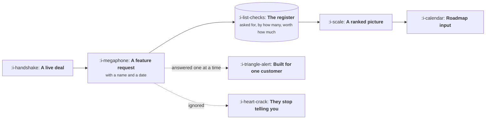

# Working With Sales

```text
Level: Foundations
Prerequisites: The Handoffs That Break
Estimated difficulty: 3/5 | Estimated time: 30 min
```

## The idea in one minute

Sales holds information you cannot get any other way: what a prospect said when money was on the
table. It arrives in the worst possible form, as a specific feature request attached to a specific
deal and a date, which is why product teams learn to discount it and then lose access to the
signal underneath. The job is to convert a stream of individual requests into a ranked picture of
what is actually blocking revenue, which requires a register rather than a response. Teams that
build the register stop having the one deal argument. Teams that do not, oscillate between building
whatever the largest customer asked for and ignoring the field entirely.

## A picture



Two failure modes branch off the same box, and most organisations alternate between them.

## How it really works

### Build the register

Every request that arrives from the field goes into one list with four fields: what was asked for,
which deal or account, the value of that deal, and the stage it was at when the request appeared.
Nothing else is needed and nothing less will do.

Within two quarters the register answers the question that individual requests cannot: which three
things are blocking the most revenue. That is a ranked list with money attached, which is the
strongest roadmap input available in a company with a sales team, and it arrives for free because
the requests were coming anyway.

### Separate the ask from the problem

A request is a salesperson's good faith relay of a customer's guess at a solution. The underlying
problem is usually more general and often already partly solved. Ask two questions: what were they
trying to do, and what happens today if they cannot. Those two answers convert twenty variations
into three problems.

Do this once with a salesperson and they will start doing it themselves, because it also makes
their discovery better.

### Say no in a way that keeps the channel open

A refusal is fine. An unanswered request is not. The difference, from the field's perspective, is
whether they can tell the customer something. Three honest answers cover almost every case: not
planned and here is what to say instead, not planned yet and here is what would change that, or
planned and here is the honesty level you may use.

The third one needs care. Anything you tell sales will be said to a customer, sometimes with more
confidence than you supplied. That is not bad behaviour; it is what happens to information under
quota pressure, and the fix is to be explicit about commitment level in writing rather than to be
vague, because vagueness gets resolved optimistically.

### The one deal problem

A large deal arrives contingent on one feature. The pressure to build it is enormous and sometimes
correct. The questions that settle it: how many other deals in the register asked for the same
thing, would we build it if this deal did not exist, and what does it cost us for the next three
years in maintenance and constraint. A yes to the first and third is a real roadmap item. A no to
both is a services engagement being sold as a product.

### Give them something back every month

A short note on what shipped, what is coming, and what was decided against with reasons. It takes
twenty minutes and it is the mechanism by which the register keeps being fed. Without it, requests
decline, and the decline is invisible because nobody reports that they stopped reporting.

## Run the numbers

The register, after a quarter, turning individual requests into ranked revenue.

```go
// register.go: what is actually blocking revenue.
package main

import (
	"fmt"
	"sort"
)

type ask struct {
	feature string
	deal    string
	value   float64
	lost    bool // did the deal close without it
}

func main() {
	asks := []ask{
		{"audit log", "Northwind", 180_000, true},
		{"audit log", "Contoso", 95_000, true},
		{"audit log", "Fabrikam", 240_000, false},
		{"bulk import", "Contoso", 95_000, false},
		{"bulk import", "Tailspin", 40_000, false},
		{"custom roles", "Northwind", 180_000, true},
		{"SAML", "Fabrikam", 240_000, true},
		{"SAML", "Litware", 310_000, true},
		{"dark mode", "Tailspin", 40_000, false},
	}
	type agg struct {
		count     int
		pipeline  float64
		lostValue float64
	}
	m := map[string]*agg{}
	for _, a := range asks {
		if m[a.feature] == nil {
			m[a.feature] = &agg{}
		}
		m[a.feature].count++
		m[a.feature].pipeline += a.value
		if a.lost {
			m[a.feature].lostValue += a.value
		}
	}
	type row struct {
		name string
		a    *agg
	}
	rows := []row{}
	for k, v := range m {
		rows = append(rows, row{k, v})
	}
	sort.Slice(rows, func(i, j int) bool { return rows[i].a.lostValue > rows[j].a.lostValue })
	fmt.Printf("%-16s %7s %14s %16s\n", "feature", "asks", "pipeline", "lost with it open")
	for _, r := range rows {
		fmt.Printf("%-16s %7d %14.0f %16.0f\n", r.name, r.a.count, r.a.pipeline, r.a.lostValue)
	}
	fmt.Println("\nRank by what was lost, not by how often it was asked for.")
	fmt.Println("The most requested item and the most expensive one are rarely the same.")
}
```

The two right hand columns say different things and the difference is the whole value of the
register. Pipeline tells you what is being asked about; lost value tells you what is actually
costing you deals. A feature mentioned in a large amount of pipeline that never loses a deal is a
conversation topic, not a blocker, and a feature mentioned twice that is present in both losses is
the one to build.

## Sector lens

| Sector | What the field relationship looks like |
|---|---|
| [Enterprise B2B SaaS](../product-by-sector/01-enterprise-b2b-saas.md) | Central. The register is the single best roadmap input you have |
| [Fintech](../product-by-sector/02-fintech.md) | Requests often come from the customer's risk team rather than the buyer |
| [Ecommerce and D2C](../product-by-sector/03-ecommerce-and-d2c.md) | Usually no sales team, so the equivalent signal is merchandising and support |
| [Marketplaces](../product-by-sector/04-marketplaces.md) | A supply side sales team whose requests conflict with demand side interests |
| [Devtools and Infrastructure](../product-by-sector/05-devtools-and-infrastructure.md) | Requests arrive publicly, so refusals are public too and must be written carefully |
| [Healthtech](../product-by-sector/06-healthtech-and-regulated-care.md) | Long cycles mean the register takes a year to become useful, and then it is invaluable |
| [Vertical SaaS](../product-by-sector/07-vertical-saas.md) | Everybody knows each other, so a refusal travels through the industry |

## Remember this

* Sales holds information you cannot get elsewhere, delivered in the worst possible format.
* Build a register: what, which deal, how much, what stage. Four fields.
* Rank by value lost, not by request count. They are rarely the same list.
* Separate the ask from the problem with two questions.
* Always answer, even with a no, because the field needs something to tell the customer.
* Anything you tell sales will reach a customer. State commitment level explicitly in writing.

## Try it

1. Run `register.go` with your last quarter's requests. Does ranking by lost value change the
   order?
2. Start the register this week, even as a spreadsheet, and backfill one quarter from the deals you
   remember.
3. Write the monthly note to the field once. Count how many new requests arrive the following month.

## Check yourself

1. Why do product teams oscillate between building for one customer and ignoring the field, and
   what breaks the oscillation?
2. Why rank by value lost rather than by how often something is requested?
3. Why does vagueness about a roadmap item get resolved optimistically by the time it reaches a
   customer?
