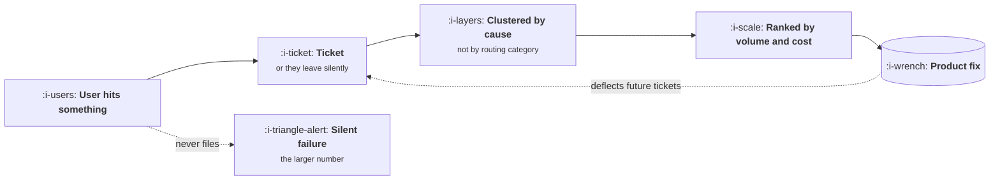

# Working With Support

```text
Level: Foundations
Prerequisites: Working With Sales
Estimated difficulty: 2/5 | Estimated time: 30 min
```

## The idea in one minute

Support is the highest volume, lowest latency source of truth about your product, and in most
companies it is read as a cost centre rather than as an instrument. Every ticket is a user who hit
something they could not resolve, which makes the ticket distribution a direct measurement of where
the product fails. Two things stop teams using it: the volume is beyond reading, and the
categories tickets are filed under were designed for routing rather than for diagnosis. Both are
solvable in an afternoon, and the result is a ranked list of product defects weighted by how many
people hit them, which is exactly what a roadmap wants and rarely has.

## A picture



The loop at the bottom is the return on fixing anything. The dotted branch on the right is the
population you never see and which is always larger.

## How it really works

### Tickets are filed for routing, not for diagnosis

Support categories exist so a ticket reaches the right person quickly. They are therefore organised
by product area or by urgency, which tells you almost nothing about cause. Three tickets categorised
as "billing" may be one pricing page problem, one invoice format problem and one genuine bug.

The useful move is to recluster by cause, ignoring the filed category entirely. This is the single
highest return afternoon available to a product manager who has never done it.

### Volume is not the whole ranking

A ticket type that occurs a thousand times and takes two minutes each is a different problem from
one that occurs fifty times and takes forty minutes plus an engineering escalation. Rank by total
cost, which is volume times handling time, and add the share that escalates, because escalations
consume engineering capacity you were counting on for roadmap work.

### The silent majority

For every user who files a ticket, some larger number hit the same problem and did not. The ratio
varies enormously by product and by how easy you make it to complain, and it is usually somewhere
between five and fifty to one. You cannot measure it directly, but you can bound it: compare the
number of tickets about a flow to the number of users who abandoned that flow in the same period.

The implication is that ticket volume understates every problem, and understates most severely the
problems affecting users who have the least patience for contacting you, which are often the new
ones.

### Deflection is a product outcome

When a fix removes a class of ticket, that is engineering capacity returned, support headcount not
hired, and users not annoyed. It is one of the few product outcomes that shows up directly in
somebody else's budget, which makes it unusually easy to get credit for and unusually easy to
justify.

Measure it honestly: tickets of that type before and after, over equal periods, with volume
normalised. A fix that halves one class while traffic doubles has done nothing.

### Give support what they need

Three things, and they are cheap. Advance notice of anything that changes behaviour, with enough
detail to write a macro. A named person to escalate to. And closure on what they escalated, which
is the same final seam as everywhere else and the same consequence if it is missing.

### What fills the box in 2026

Zendesk, Intercom or Front hold the tickets. Clustering their text with a model is one of the
genuinely strong applications in this course: the volume is far beyond human reading, the output
is a grouping you can verify by opening the cluster, and a wrong grouping is cheap to notice. Use
it for clustering and summarising. Do not use it to decide what matters, because it will rank by
what is frequent in the text rather than by what is expensive.

## Run the numbers

Ticket clusters ranked three ways: by volume, by total handling cost, and by engineering
escalation, which are three different orders.

```go
// tickets.go: what support is actually telling you.
package main

import (
	"fmt"
	"sort"
)

type cluster struct {
	name      string
	perMonth  float64
	minutes   float64 // median handling time
	escalates float64 // share that reach engineering
}

const (
	agentHourly = 32.0
	engHourly   = 95.0
	engMinutes  = 75.0 // engineering time per escalated ticket
)

func (c cluster) agentCost() float64 { return c.perMonth * c.minutes / 60 * agentHourly }
func (c cluster) engCost() float64 {
	return c.perMonth * c.escalates * engMinutes / 60 * engHourly
}
func (c cluster) total() float64 { return c.agentCost() + c.engCost() }

func main() {
	cs := []cluster{
		{"cannot find the export", 820, 4, 0.01},
		{"invoice does not match usage", 140, 22, 0.35},
		{"login loop on mobile", 310, 9, 0.12},
		{"permissions confusing", 260, 14, 0.05},
		{"sync silently failed", 95, 38, 0.60},
	}
	show := func(label string, less func(a, b cluster) bool) {
		s := append([]cluster(nil), cs...)
		sort.Slice(s, func(i, j int) bool { return less(s[i], s[j]) })
		fmt.Printf("%-28s", label)
		for _, c := range s[:3] {
			fmt.Printf("%-30s", c.name)
		}
		fmt.Println()
	}
	fmt.Printf("%-28s%-30s%-30s%s\n", "ranked by", "first", "second", "third")
	show("volume", func(a, b cluster) bool { return a.perMonth > b.perMonth })
	show("total cost", func(a, b cluster) bool { return a.total() > b.total() })
	show("engineering time", func(a, b cluster) bool { return a.engCost() > b.engCost() })
	fmt.Println()
	fmt.Printf("%-30s %12s %12s %12s\n", "cluster", "agent cost", "eng cost", "total")
	for _, c := range cs {
		fmt.Printf("%-30s %12.0f %12.0f %12.0f\n", c.name, c.agentCost(), c.engCost(), c.total())
	}
	fmt.Println("\nVolume disagrees with both cost rankings entirely. It is the default on every dashboard.")
}
```

Note which rankings agree. Total cost and engineering time produce the same top three here, because
the clusters that escalate are also the slow ones, which is common. Volume produces a completely
different list, and that is the one every support dashboard shows by default.

The cluster with the most tickets, at 820 a month, is the second cheapest thing on the table. The
cluster with the fewest, at 95 a month, costs the most and consumes the most engineering time,
because six in ten of those tickets reach an engineer for over an hour each. Ranking by volume
would have you fix a findability problem while a silent sync failure quietly eats the capacity you
budgeted for the roadmap.

## Sector lens

| Sector | What support signal looks like |
|---|---|
| [Enterprise B2B SaaS](../product-by-sector/01-enterprise-b2b-saas.md) | Low volume, high value per ticket, and admins reporting on behalf of users |
| [Fintech](../product-by-sector/02-fintech.md) | Money questions have a deadline and an emotional load, so handling time is long |
| [Ecommerce and D2C](../product-by-sector/03-ecommerce-and-d2c.md) | Where is my order dominates, and most of it is deflectable with order state |
| [Marketplaces](../product-by-sector/04-marketplaces.md) | Disputes between two users, which is a product surface rather than support work |
| [Devtools and Infrastructure](../product-by-sector/05-devtools-and-infrastructure.md) | Support happens in public issues and forums, so the backlog is visible to everyone |
| [Healthtech](../product-by-sector/06-healthtech-and-regulated-care.md) | A ticket may be clinically urgent, so triage has a different meaning |
| [Vertical SaaS](../product-by-sector/07-vertical-saas.md) | Customers call rather than write, so the signal lives in people's heads unless captured |

## Remember this

* Support is the highest volume, lowest latency measurement of where the product fails.
* Filed categories are for routing. Recluster by cause before reading anything into them.
* Rank by cost or by engineering escalation, never by volume. Volume gives a different list, and
  the most frequent ticket is often among the cheapest.
* For every ticket there are five to fifty silent users with the same problem.
* Deflection shows up in somebody else's budget, which makes it easy to justify.
* Advance notice, a named escalation path, and closure. All three are cheap.

## Try it

1. Run `tickets.go` with your own clusters. How far apart are the volume ranking and the cost
   ranking, and which one is on your dashboard?
2. Take last month's tickets and recluster a hundred of them by cause, ignoring the filed category.
   Compare the two distributions.
3. Pick the top cluster by engineering cost and ask what product change would remove it entirely.

## Check yourself

1. Why do filed support categories tell you little about cause?
2. The most frequent ticket cluster is often among the cheapest. Why, and what does that imply
   about default support dashboards?
3. Why does ticket volume understate problems affecting new users more than existing ones?
