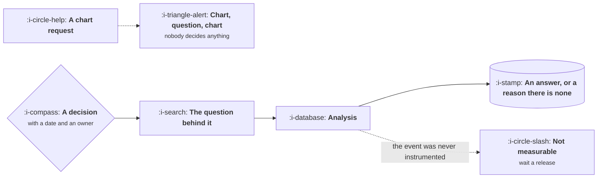

# Working With Data

```text
Level: Foundations
Prerequisites: Working With Support
Estimated difficulty: 3/5 | Estimated time: 30 min
```

## The idea in one minute

The way to get a useful answer from a data team is to bring a decision rather than a chart request.
"Can you pull conversion by channel" produces a chart, a follow up, and three more charts, because
the analyst cannot tell which cut matters without knowing what hangs on it. "We are deciding
whether to keep investing in this channel next quarter, and I think the answer turns on whether
its users retain" produces an answer, often a better question, and occasionally the observation
that the data cannot support the decision at all, which is the most valuable response available
and the one a chart request can never elicit.

## A picture



The dotted branch at the bottom is the answer teams least want and most need, and it arrives
earlier when the decision is stated up front.

## How it really works

### Bring the decision, not the chart

The format that works is four lines: the decision, who makes it and when, what you currently
believe, and what evidence would change that belief. An analyst with those four lines can choose
the method, tell you what is feasible, and warn you when the question is unanswerable with the data
that exists.

The fourth line is the one that does the work. Stating in advance what would change your mind
prevents the most common failure, which is an analysis that is read, agreed with and ignored.

### Instrumentation is a product deliverable

The most common data answer is that the event does not exist, which means waiting a release. That
is a product failure rather than a data one: the measurement plan belongs in the requirements
document, alongside the success bar, and shipping without it is shipping something you cannot
evaluate.

The habit that fixes it permanently is to write the measurement plan at definition time, as
described in [Writing a PRD That Gets Built](../definition-and-delivery/01-writing-a-prd-that-gets-built.md),
and to treat missing events as a blocking defect rather than a followup ticket.

### Understand the difference between the three data layers

| Layer | What it is | What it is good for | Where it misleads |
|---|---|---|---|
| Product analytics | Event streams from the app | Funnels, cohorts, feature usage | Events are defined by whoever added them, often inconsistently |
| The warehouse | Modelled, joined, reconciled tables | Revenue, cross system questions, anything financial | Lags by hours or a day, and definitions are opinionated |
| Operational databases | The live application state | Nothing analytical, ever | Querying it slows the product, and the shapes are wrong for analysis |

Most disagreements between two numbers are two layers answering slightly different questions.
Asking which layer a figure came from resolves a surprising share of them.

### Ask for the shape, not just the number

A single figure hides the distribution, and the distribution is usually where the decision lives.
Ask for the percentiles, the segment breakdown, or the histogram. An average session length of
eleven minutes can be one population at two minutes and another at forty, which is two different
products and two different roadmaps.

### Respect that analysis is slow for real reasons

A question that sounds simple frequently requires joining systems that disagree, backfilling a
definition, and checking the result against something known. Analysts who are pushed for speed
produce numbers with unstated caveats, which is worse than waiting, because the caveats surface
later in front of somebody senior.

### Close the loop here too

Tell the analyst what was decided and what happened. It is the same final seam as with support and
sales, with the same consequence: without it, requests get treated as chart production, because
that is all the evidence suggests they are.

## Sector lens

| Sector | What makes data hard here |
|---|---|
| [Enterprise B2B SaaS](../product-by-sector/01-enterprise-b2b-saas.md) | Small n per account, so segment analysis is anecdote with a percentage sign |
| [Fintech](../product-by-sector/02-fintech.md) | The ledger is the truth and the analytics layer frequently disagrees with it |
| [Ecommerce and D2C](../product-by-sector/03-ecommerce-and-d2c.md) | Abundant data, so the constraint is asking a sharp question rather than getting numbers |
| [Marketplaces](../product-by-sector/04-marketplaces.md) | Every metric needs splitting by side, and the aggregate is usually meaningless |
| [Devtools and Infrastructure](../product-by-sector/05-devtools-and-infrastructure.md) | Usage telemetry is a consent question before it is an analytics one |
| [Healthtech](../product-by-sector/06-healthtech-and-regulated-care.md) | Privacy rules constrain what may be joined, and often forbid the obvious analysis |
| [Vertical SaaS](../product-by-sector/07-vertical-saas.md) | Few customers, so qualitative depth beats quantitative breadth in almost every case |

## Remember this

* Bring a decision, not a chart request. Four lines: decision, owner and date, current belief, what
  would change it.
* The most valuable answer is sometimes that the data cannot settle it. Stating the decision gets
  you there faster.
* Instrumentation belongs in the requirements document. Missing events are a blocking defect.
* Three data layers answer slightly different questions. Most number disputes are a layer mismatch.
* Ask for the distribution. An average hides two populations more often than it describes one.
* Close the loop, or your requests become chart production.

## Try it

1. Take your next data request and rewrite it as the four lines. Note how the conversation changes.
2. For the last feature you shipped, check whether the events needed to evaluate it existed before
   launch.
3. Pick a metric your team quotes and find out which layer it comes from. Then ask whether another
   team quotes a different number for it.

## Check yourself

1. Why does a chart request produce more chart requests?
2. Why is "the data cannot answer this" a valuable response rather than a failure?
3. Two teams report different numbers for the same metric and both are correct. What are the two
   most likely explanations?
