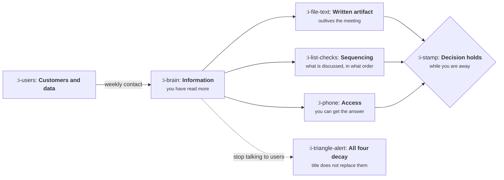

# Influence Without Authority

```text
Level: Foundations
Prerequisites: What a Product Manager Does
Estimated difficulty: 2/5 | Estimated time: 30 min
```

## The idea in one minute

Nobody on your team reports to you, and the role has no budget and no veto. Influence is therefore
not a personality trait you either have or lack; it is a small set of mechanics that can be
practised. Four sources supply it: you have done more of the reading than anyone else, you have
written the decision down, you control what gets discussed in what order, and you can reach the
person who has the answer. All four decay. The first decays fastest and carries the other three,
which is why a product manager who stops talking to customers becomes ineffective within about a
month in a way that no amount of seniority disguises.

## A picture



Notice that three of the four sources hang off the first one. Information is not one lever among
four; it is the supply line.

## How it really works

### The four sources, and how fast each decays

| Source | What it is | Decays in | Rebuilt by |
|---|---|---|---|
| Information | You have talked to more customers and read more tickets and data than anyone in the room | Weeks | Five customer conversations and one hour in the data, weekly |
| Written artifact | The decision exists in a document people can act on without you | Months, through drift | Keeping one page current, or freezing it as a dated memo |
| Sequencing | You decide what gets discussed, with whom, in what order | Immediately, if you stop doing it | Owning the agenda rather than attending it |
| Access | You can get the answer from the person who has it | Slowly, with relationships | Spending the favour occasionally so the channel stays open |

A title can substitute for none of these. This is why experienced product managers joining a new
company are often ineffective for a quarter: every source has to be rebuilt from zero, and the
first one takes about six weeks of real contact.

### Make the decision easy to agree with, not hard to refuse

The common mistake is to build the strongest possible case and present it. That wins arguments and
loses influence, because the other person now has a position to defend. The alternative is to make
agreeing cheap:

1. State the decision in one sentence at the top, before the reasoning.
2. State what you are giving up. A proposal with no cost reads as advocacy and gets discounted.
3. State what would change your mind. This moves the conversation from whether you are right to
   what evidence matters, which is a conversation you can lose without losing anything.
4. Name the thing you already changed because of their earlier objection. People support positions
   they can see themselves in.

### No surprises in the room

A decision meeting where the decision is actually made is a badly run meeting. The people with a
veto should have seen the proposal, objected privately, and had their objection either answered or
visibly incorporated before anyone sits down. The meeting then does what meetings are good for:
confirming, recording and committing.

This is the highest value habit in the whole lesson and the one most often read as politics. It
is the opposite. Wiring the decision in advance means objections are raised where they can be
addressed honestly, rather than performed in front of an audience where everybody hardens.

### Disagreement: escalate the decision, never the person

When agreement fails, the useful move is to write down the disagreement itself: here is the
decision, here are the two positions, here is what each side believes that the other does not, here
is the cost of delay. Then take that to whoever owns the tradeoff.

That is escalating a decision. Escalating a person means arriving with "engineering is blocking
us", which costs you the access source permanently and usually the information source too, because
people stop telling you things.

### The commitment ledger

Influence compounds through kept promises, and the ledger is literal: a short list of what you
said you would do, by when, visible to the people you said it to. Small promises kept reliably
build more influence than large ones kept occasionally, because the thing being established is
predictability rather than capability.

### Three failure patterns

| Pattern | What it looks like | Why it fails |
|---|---|---|
| The escalator | Disagreements go upward quickly, with names | Burns access, and teaches everyone to route around you |
| The consensus seeker | Nothing ships until everyone is happy | Converts the role into a scheduling function, and the loudest objection wins |
| The order taker | Writes down what stakeholders ask for and passes it on | Produces no refusals, so there is no decision to have influence about |

### There is no tool for this

No software raises influence. The products that claim to, mostly stakeholder mapping and
alignment dashboards, are visible evidence that the mechanics above are not being done, and
installing one is read correctly by the team as a substitute for talking to them. The only
instruments here are a weekly habit of customer contact, one page of writing, and an agenda.

## The AI layer

A model is a genuinely good rehearsal partner for this work. Three uses that hold up: generate the
three strongest objections to your proposal before you circulate it, rewrite the same decision for
three different audiences (engineering lead, finance, support) without changing the substance, and
turn a messy argument into the written disagreement format described above. Pennies per attempt,
and it removes the excuse that preparation is expensive.

The failure mode is severe here in a way it is not elsewhere in the job, because the asset at risk
is the information source. If a model wrote your argument and you cannot defend its third
implication under questioning, you do not lose the argument; you lose the standing that made
people listen in the first place, and it does not come back quickly. The rule is to use a model to
find what you have not thought about, and then to do the thinking yourself, out loud, before you
send anything.

## Sector lens

| Sector | What changes about influence |
|---|---|
| [Enterprise B2B SaaS](../product-by-sector/01-enterprise-b2b-saas.md) | Sales holds a competing information source: real customers with real contracts. Beat it by having talked to users rather than buyers |
| [Fintech](../product-by-sector/02-fintech.md) | Compliance and risk have a genuine veto, so influence means learning their framework well enough to propose inside it |
| [Ecommerce and D2C](../product-by-sector/03-ecommerce-and-d2c.md) | Data is abundant and fast, so the information source is cheap to acquire and cheap for others to contest |
| [Marketplaces](../product-by-sector/04-marketplaces.md) | Two internal factions represent the two sides. Neutrality about which side loses is the scarce asset |
| [Devtools and Infra](../product-by-sector/05-devtools-and-infrastructure.md) | Engineers are your users, so they often have better information than you. Credibility comes from using the product daily |
| [Healthtech](../product-by-sector/06-healthtech-and-regulated-care.md) | Clinical staff hold domain authority that cannot be out researched. Influence comes from removing work rather than proposing features |
| [Vertical SaaS](../product-by-sector/07-vertical-saas.md) | Domain fluency is the entire game. Using the customer's vocabulary correctly is worth more than any analysis |

## Remember this

* Four sources: information, written artifact, sequencing, access. A title substitutes for none.
* Three of the four hang off information, which decays in weeks without customer contact.
* Make agreeing cheap: lead with the decision, name the cost, say what would change your mind.
* No surprises in the room. Objections are collected before the meeting, not performed in it.
* Escalate the decision in writing. Escalating a person costs you access permanently.

## Try it

1. Write down, from memory, the last five customer conversations you had and the date of each. If
   you cannot reach five, or the most recent is over three weeks old, that is your information
   source reading.
2. Take a proposal you are about to send. Add the three sentences: the decision, the cost, and what
   would change your mind. Note which one was hardest to write and why.
3. Before your next decision meeting, list everyone who could block it. Speak to each one
   beforehand. Count how many objections you would otherwise have met in the room.

## Check yourself

1. Why does building the strongest possible case sometimes reduce your influence, even when you
   are right?
2. A product manager with ten years of experience is ineffective for their first quarter at a new
   company. Which source is missing, and roughly how long does it take to rebuild?
3. What is the practical difference between escalating a decision and escalating a person, in terms
   of which of the four sources each one spends?
