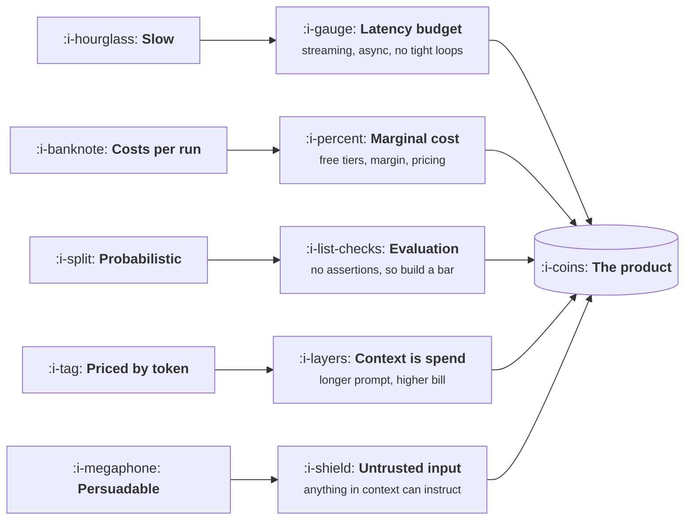

# The Five Facts

```text
Level: Basic
Prerequisites: The Product Loop
Estimated difficulty: 2/5 | Estimated time: 35 min
```

## The idea in one minute

A model has five properties that nothing else in your stack has: it is slow, it costs money every
time it runs, it is probabilistic, it is priced by the amount of text it reads and writes, and it
does whatever the text in front of it convincingly asks. Almost every strange thing about building
AI products is a consequence of one of those five. They are not drawbacks to be engineered away;
they are the shape of the material, and knowing which of the five binds first on your feature tells
you what to work on. For most teams it is not the one they are working on.

## A picture



Five properties, five consequences, one product. The useful question is never "is the model good
enough" but "which of these five binds first for this feature".

## How it really works

### Fact one: it is slow

A model that produces forty tokens a second takes about twelve seconds to write a five hundred
token answer, and several seconds before the first token appears at all. That is three orders of
magnitude slower than the database call next to it.

What follows:

* **Streaming is not a nicety.** Time to first token becomes the latency your users actually
  perceive, and total time becomes something they tolerate only if they can see progress.
* **Nothing in a tight loop.** A model inside a per row operation over ten thousand rows is a batch
  job, not a feature, and must be designed as one.
* **p95, not the mean.** Model latency has a long tail. Designing to the average produces a product
  that feels broken for one user in twenty, and those are the users who write in.

### Fact two: it costs money every time it runs

Every other component in your product has a fixed cost that amortises. A model has a marginal cost
per use, like postage. This is the fact that breaks the most business models, because software
pricing evolved in a world where the tenth thousand user cost nothing to serve.

What follows: free tiers have a real floor, the most engaged users are the most expensive, gross
margin stops being a constant, and usage you cannot predict is spend you cannot forecast.
Arithmetic in [AI Cost and Margin](../ai-cost-and-margin/README.md).

### Fact three: it is probabilistic

The same input can produce a different output, and there is no assertion you can write that will
hold. This is the fact people understand first and underestimate most, because its consequence is
organisational rather than technical: your test suite stops being the thing that tells you whether
a change was safe, and nothing replaces it unless you deliberately build the replacement.

What follows: evaluation sets instead of unit tests, a quality bar expressed as a rate rather than a
pass or fail, support tickets that cannot be reproduced, and an interface that has to assume the
answer is sometimes wrong.

### Fact four: it is priced by the token

Cost scales with how much text goes in as well as how much comes out, and input is usually the
larger half once you are putting real context in front of it. A prompt that grows from two thousand
to twenty thousand tokens is a tenfold cost increase for the same feature, and it is the easiest
cost increase in the world to cause by accident: one more retrieved document, one more example, a
longer conversation history.

This is why context is a budget rather than a setting. See
[Context Engineering](../context-and-knowledge/01-context-engineering.md).

### Fact five: it is persuadable

A model does not distinguish between the instructions you wrote and text it encountered while
working. A support email, a web page, a pull request description or a PDF can contain something that
reads like an instruction, and the model may follow it. There is no parser boundary to defend,
because the instructions and the data are the same thing.

What follows: every piece of content that reaches the context window is untrusted input, and the
question for any feature is what the model is allowed to do if it is talked into it. Treated
properly in [Prompt Injection as a Product Problem](../trust-safety-and-guardrails/01-prompt-injection-as-a-product-problem.md).

### Which one binds first

Teams usually optimise fact three, because quality is the one that feels like the product. In
practice, for a feature at any scale, cost or latency usually binds before quality does, and the
team notices in the month the bill arrives. The program below is the two minutes of arithmetic that
would have told them in advance.

## Run the numbers

One feature, three constraints. The program takes a feature's shape and reports which of latency,
cost and quality fails first as usage grows.

```go
// binds.go: which of the five facts stops your feature first.
package main

import "fmt"

type feature struct {
	name        string
	inTokens    float64 // prompt, context and history
	outTokens   float64
	callsPerDay float64
	errorRate   float64 // share of answers a user would call wrong
	// Each surface tolerates a different amount of each thing.
	latencyBar float64 // seconds before this surface feels broken
	errorBar   float64 // error rate this surface can absorb
}

const (
	inPerM     = 3.00  // dollars per million input tokens
	outPerM    = 15.00 // dollars per million output tokens
	tokPerSec  = 40.0  // output speed
	firstToken = 0.8   // seconds before anything appears
	budget     = 5_000.0
)

func (f feature) costPerCall() float64 {
	return f.inTokens/1e6*inPerM + f.outTokens/1e6*outPerM
}

func (f feature) latency() float64 { return firstToken + f.outTokens/tokPerSec }

// Each ratio is how far over its own bar the feature sits. Above 1 is a problem.
func (f feature) ratios() (lat, cost, qual float64) {
	return f.latency() / f.latencyBar,
		f.costPerCall() * f.callsPerDay * 30 / budget,
		f.errorRate / f.errorBar
}

func main() {
	fs := []feature{
		{"inline autocomplete", 1_200, 40, 400_000, 0.20, 0.5, 0.35},
		{"support draft reply", 6_000, 400, 4_000, 0.12, 8, 0.15},
		{"document summary", 40_000, 900, 2_000, 0.08, 30, 0.10},
		{"agentic ticket triage", 25_000, 1_500, 3_000, 0.05, 120, 0.02},
	}
	fmt.Printf("%-24s %8s %8s %8s   %s\n", "feature", "latency", "cost", "quality", "binds first")
	for _, f := range fs {
		lat, cost, qual := f.ratios()
		binds, worst := "nothing yet", 1.0
		for _, c := range []struct {
			name string
			r    float64
		}{{"latency", lat}, {"cost", cost}, {"quality", qual}} {
			if c.r > worst {
				binds, worst = c.name, c.r
			}
		}
		fmt.Printf("%-24s %8.2f %8.2f %8.2f   %s\n", f.name, lat, cost, qual, binds)
	}
	fmt.Println("\nEach number is a multiple of that surface's own bar. Above 1.00 is a problem.")
	fmt.Println("Only the feature that acts on its own is limited by how good the model is.")
}
```


Read the last column. Autocomplete and summarisation are limited by what they cost, the support
draft is limited by how long it takes, and only the agentic triage, the one that acts on its own
without a person reading each answer, is limited by how good the model is. Every one of those
numbers is available before a line of the feature is written, and all four of them come from a
token count and a call volume you can estimate in ten minutes.

## Sector lens

| Sector | Which fact binds first, usually |
|---|---|
| [Enterprise B2B SaaS](../product-by-sector/01-enterprise-b2b-saas.md) | Persuadable. The model touches customer data under contract, and the security review asks about exactly this |
| [Fintech](../product-by-sector/02-fintech.md) | Probabilistic. A wrong answer moves money or breaks a rule, so the tolerated error rate is near zero |
| [Ecommerce and D2C](../product-by-sector/03-ecommerce-and-d2c.md) | Cost. Margin per order is thin enough that a few cents of inference is a real line item |
| [Marketplaces](../product-by-sector/04-marketplaces.md) | Persuadable. Both sides supply text, and one of them has a reason to manipulate you |
| [Devtools and Infrastructure](../product-by-sector/05-devtools-and-infrastructure.md) | Slow. Developers compare everything to a local command that returns instantly |
| [Healthtech](../product-by-sector/06-healthtech-and-regulated-care.md) | Probabilistic, with a regulatory floor under what error rate is permissible at all |
| [Vertical SaaS](../product-by-sector/07-vertical-saas.md) | Cost. Small contract values leave little room for an expensive feature per seat |

## Remember this

* Five facts: slow, costs per run, probabilistic, priced by token, persuadable.
* Latency is felt as time to first token, and designed against p95 rather than the mean.
* Marginal cost per use breaks pricing models that assumed the tenth thousand user was free.
* Probabilistic means your test suite no longer tells you whether a change was safe.
* Anything that reaches the context window is untrusted input, including your own customer's data.
* The binding constraint is usually cost or latency, and almost everybody works on quality.

## Try it

1. Run `binds.go` with your own feature's token counts and call volume. Which constraint binds, and
   is it the one your team is working on?
2. Set `inTokens` for the document summary to 120,000, as a long context model would allow. What
   does that do to the monthly cost, and would anybody have noticed in review?
3. Take a feature you are planning and write one sentence for each of the five facts saying what it
   implies here. The fact with the shortest sentence is the one you have not thought about.

## Check yourself

1. Why is time to first token a more useful latency target than total response time?
2. Fact four says cost scales with input as well as output. Name two ordinary product decisions that
   multiply input tokens without anybody intending to.
3. There is no parser boundary between instructions and data in a prompt. What does that imply about
   a feature that summarises inbound email?
