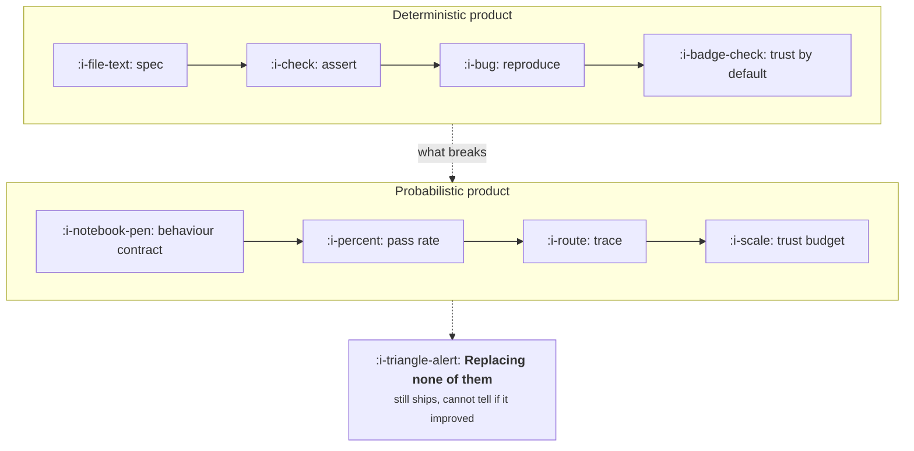

# Deterministic and Probabilistic Products

```text
Level: Foundations
Prerequisites: The Five Facts
Estimated difficulty: 2/5 | Estimated time: 35 min
```

## The idea in one minute

Five things your organisation already does stop working when output varies between runs: the
specification, the test suite, support reproduction, pricing, and the user's own model of whether
the product is trustworthy. None of them degrade gracefully. Each has a replacement, and the
replacements are the actual work of building AI products: a behaviour contract instead of a spec, a
pass rate instead of an assertion, a trace instead of a reproduction, usage pricing instead of
seats, and an interface that assumes it will sometimes be wrong. Teams that skip the replacements
do not notice for about one quarter, which is how long it takes for the first regression nobody
can explain.

## A picture



The top row is not wrong, it is inapplicable. Each item in the bottom row costs real work, and the
dotted branch on the right is what a team gets for free if it builds none of them.

## How it really works

### The five things that break

| What breaks | Why | What replaces it | Where it is covered |
|---|---|---|---|
| The specification | There is no single correct output to describe | A behaviour contract: must, must never, should, may | Specs for Non Deterministic Systems |
| The test suite | An assertion that holds one run fails the next | A dataset with graders and a pass rate against a bar | Evaluation and Quality |
| Support reproduction | The same input does not reproduce the bug | A stored trace of the exact context, tools and output | AI Product Org and Process |
| Pricing | Cost per user varies with how much they use it | A value metric that tracks cost, or a credit meter | AI Pricing and Packaging |
| The user's trust model | Software is assumed correct until proven otherwise | Visible uncertainty, citations, undo, and a trust budget | AI Product UX |

### Why the test suite breaks in a way that surprises people

The naive response to flakiness is to run the check a few times and require every run to pass. This
makes things worse, and the arithmetic is unintuitive enough to be worth stating: if a check passes
92% of the time, requiring three consecutive passes succeeds only 78% of the time, so your false
alarm rate roughly triples.

The move that works is the opposite one. Run it several times and take the majority, or better,
stop asking a yes or no question entirely and measure a rate across many cases. The program below
puts numbers on all three.

### Support cannot reproduce anything

In a deterministic product, a bug report plus the inputs is enough. In a probabilistic one, the
same inputs may produce a perfectly good answer, so "cannot reproduce" becomes the default outcome
and the ticket is closed as a one off. It was not a one off; it was a sample from a distribution
you are not measuring.

The replacement is logging the whole context: the exact prompt after templating, the retrieved
documents, the model and version, the tool calls, the output, and any grader scores. That is a
trace, it is the single highest value piece of infrastructure for an AI feature, and it is almost
always built late because nothing visibly breaks without it.

### Pricing breaks quietly

A deterministic feature costs the same to serve the hundredth user as the tenth. A probabilistic one
costs per run, and the users who love it most cost the most. A seat price assumes the opposite
correlation to the one you actually have.

This is a slow failure. Margin erodes in the direction of your best customers, which is also the
direction your product strategy is pushing, so the two effects hide each other for several quarters.
See [AI Cost and Margin](../ai-cost-and-margin/README.md).

### Trust does not reset

Users arrive expecting software to be right. The first few wrong answers are absorbed as novelty,
and after that a user decides, usually permanently, whether this is a thing they check or a thing
they trust. That decision is made within the first handful of interactions, which means early
quality matters more than steady state quality, and it is why gradual rollouts beat broad launches
for AI features more than for anything else.

### What fills the box in 2026

Tracing and evaluation platforms (Langfuse, LangSmith, Braintrust, Arize Phoenix, Weights and
Biases Weave) exist mainly to solve the reproduction problem, and they are worth adopting earlier
than feels justified. Experiment and flag systems (Statsig, LaunchDarkly) carry the gradual rollout.
Metering for usage pricing is Orb, Metronome or Stripe Billing. None of these write the behaviour
contract, which remains the product manager's job.

## Run the numbers

Three gating strategies against the same flaky check, plus the rate based alternative. The question
is how many false alarms each produces over two hundred commits.

```go
// gating.go: why requiring every run to pass makes flakiness worse.
package main

import (
	"fmt"
	"math"
)

// binom is the exact probability of k successes in n trials at rate p.
func binom(n, k int, p float64) float64 {
	c := 1.0
	for i := 0; i < k; i++ {
		c = c * float64(n-i) / float64(i+1)
	}
	return c * math.Pow(p, float64(k)) * math.Pow(1-p, float64(n-k))
}

// atLeast is the probability of k or more successes in n trials.
func atLeast(n, k int, p float64) float64 {
	t := 0.0
	for i := k; i <= n; i++ {
		t += binom(n, i, p)
	}
	return t
}

func main() {
	const p, commits = 0.92, 200.0
	gates := []struct {
		name string
		pass float64
	}{
		{"single run", p},
		{"3 runs, all must pass", atLeast(3, 3, p)},
		{"3 runs, majority", atLeast(3, 2, p)},
		{"5 runs, majority", atLeast(5, 3, p)},
		{"50 cases, bar at 85%", atLeast(50, 43, p)},
		{"50 cases, bar at 80%", atLeast(50, 40, p)},
		{"200 cases, bar at 85%", atLeast(200, 170, p)},
	}
	fmt.Printf("a check that passes %.0f%% of the time, over %.0f commits\n\n", 100*p, commits)
	fmt.Printf("%-24s %10s %14s\n", "gate", "passes", "false alarms")
	for _, g := range gates {
		fmt.Printf("%-24s %9.1f%% %14.1f\n", g.name, 100*g.pass, commits*(1-g.pass))
	}
	fmt.Println("\nUnanimity amplifies flakiness. Majority suppresses it.")
	fmt.Println("A rate gate is only quiet when the bar sits well below the true rate, or the set is large.")
}
```

Two things to take from the table. Unanimity is the worst option available and it is the one teams
reach for first. And a rate gate is not automatically quiet: fifty cases with the bar at 85% against
a true rate of 92% still cries wolf nine times in two hundred commits, because the bar sits barely
three cases below the mean. Move the bar to 80%, or take the set to two hundred cases, and the false
alarms effectively disappear.

That is the real difference between the two worlds. Flakiness on a single case is something that
happens to you. The noise in a rate gate is a parameter you set, deliberately, by choosing how many
cases to run and where to put the bar relative to the rate you actually achieve. Doing that properly
is [Evaluation and Quality](../evaluation-and-quality/05-the-statistics-you-cannot-skip.md).

## Sector lens

| Sector | What breaks hardest |
|---|---|
| [Enterprise B2B SaaS](../product-by-sector/01-enterprise-b2b-saas.md) | Support reproduction. Enterprise support contracts assume a deterministic product and promise resolution times |
| [Fintech](../product-by-sector/02-fintech.md) | The specification. A regulator expects a described behaviour, and "usually" is not a description |
| [Ecommerce and D2C](../product-by-sector/03-ecommerce-and-d2c.md) | Pricing. Thin margin per order means per run cost is felt immediately |
| [Marketplaces](../product-by-sector/04-marketplaces.md) | Trust. A wrong answer to one side is read as bias toward the other |
| [Devtools and Infrastructure](../product-by-sector/05-devtools-and-infrastructure.md) | The test suite. Your users expect reproducible builds and will file the non determinism as a bug |
| [Healthtech](../product-by-sector/06-healthtech-and-regulated-care.md) | The specification, with a regulatory requirement to document intended behaviour |
| [Vertical SaaS](../product-by-sector/07-vertical-saas.md) | Trust. A small market talks to itself, and one bad story travels |

## Remember this

* Five things break: spec, tests, reproduction, pricing, trust. Each needs a deliberate replacement.
* Requiring several consecutive passes makes flakiness worse, not better. Take the majority.
* The right question is a rate over many cases, not a verdict on one, and the bar has to sit well
  below your true rate or the gate is noisy anyway.
* A stored trace is what makes a support ticket investigable. Build it before you need it.
* Trust is decided in the first few interactions and does not reset, so roll out gradually.

## Try it

1. Run `gating.go`, then set `p` to 0.98. Does the unanimity gate stop being harmful, and how far
   below the true rate does a fifty case bar have to sit before the gate goes quiet?
2. Take the last AI related bug report your team closed as not reproducible. List what you would
   have needed stored to investigate it properly.
3. Write the one sentence replacement your team currently has for each of the five broken things.
   Any blank is work you have not started.

## Check yourself

1. Why does requiring three consecutive passes triple your false alarm rate rather than reducing it?
2. Margin erodes toward your most engaged users while product strategy pushes engagement up. Why do
   those two effects hide each other, and what number would reveal it?
3. Why does early quality matter more than steady state quality for an AI feature, and what rollout
   practice follows from that?
