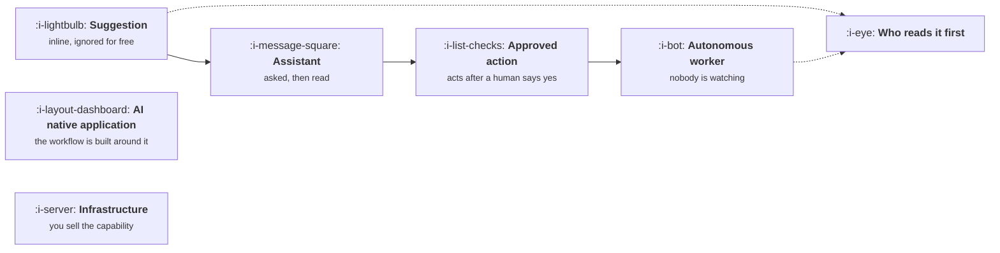

# AI Product Shapes

```text
Level: Foundations
Prerequisites: The Five Facts
Estimated difficulty: 2/5 | Estimated time: 35 min
```

## The idea in one minute

There are six shapes an AI product takes, and the shape tells you more about how to build it than
the industry it sells into does. What separates them is a single question: who reads the output
before anything happens because of it. A suggestion a developer accepts or ignores, an answer a user
reads, an action taken after approval, and an action taken with nobody watching are four different
products even if the model behind them is identical. The shape sets the primary metric, the
interface, the cost per mistake and therefore the accuracy you must reach, and that accuracy
requirement moves by more than an order of magnitude across the six.

## A picture



The first four sit on one axis, how much happens before a human looks. The last two are
orthogonal: an AI native application is usually a composition of the first four, and infrastructure
is the same capability sold to people building their own.

## How it really works

### The six shapes

| Shape | Example | Who reads it first | Primary metric | Dominant failure |
|---|---|---|---|---|
| **Suggestion** | Inline completion, smart reply, autofill | The user, in the moment, before accepting | Acceptance rate | Annoyance, then the feature is switched off |
| **Assistant** | Chat, search answers, a drafting panel | The user, after asking for it | Task success and containment | A confident wrong answer the user believes |
| **Approved action** | Draft reply sent after review, a proposed change | A human approving each one | Intervention rate | Approval fatigue, so review becomes rubber stamping |
| **Autonomous worker** | Triage, reconciliation, overnight processing | Nobody, until something is wrong | End state success and blast radius | Compounding errors nobody sees for days |
| **AI native application** | A vertical tool built around model output | Varies by surface | The workflow's own outcome | The model is the product, so a model problem is an outage |
| **Infrastructure** | An API, a model gateway, an eval platform | Another developer | Reliability, latency, cost per call | A breaking change in somebody else's product |

### Why the shape sets the accuracy you need

A wrong suggestion costs the user two seconds to ignore. A wrong autonomous action costs somebody
an hour to find and undo, plus whatever it did in the meantime. Those two products can use exactly
the same model and need wildly different quality, because quality here means expected damage rather
than correctness.

This is the single most useful consequence of the shape taxonomy: it converts "is the model good
enough" into arithmetic. The program below does that conversion.

### Approval fatigue is a product failure, not a user failure

The approved action shape has a specific and predictable decay. If approvals are nearly always
correct, people stop reading them, usually within a few weeks. The approval then provides the
appearance of oversight with none of the substance, which is worse than autonomy because the
liability has quietly moved onto a person who is no longer actually checking.

If you build this shape, design against it: batch approvals so the reviewer sees a diff rather than
a stream, sample and deliberately surface the uncertain ones, and measure whether reviewers ever
reject anything. A rejection rate near zero is an alarm, not a success.

### Picking a shape is a product decision, not a technical one

Teams usually inherit a shape from whatever was demoed. The deliberate version asks three
questions:

1. **What does a mistake cost, and who absorbs it?** This sets the shape's ceiling.
2. **Is there a natural moment where a human is already looking?** If yes, the approved action shape
   is nearly free. If no, approval is an interruption you are inventing.
3. **Does the value come from the answer or from the work being done?** Answers want an assistant;
   work wants a worker.

### What fills the box in 2026

The shapes are visible in the tooling. Suggestion and assistant surfaces are built directly against
model APIs with a streaming interface. Approved actions and autonomous workers usually need durable
execution, so Temporal, Inngest or a queue appears. Agent frameworks such as LangGraph and CrewAI
target the last two shapes. Infrastructure sellers live or die on the things in
[Model Lifecycle and Drift](../model-lifecycle-and-drift/README.md), because their customers
pinned a version.

## Run the numbers

Same model, 92% correct, four shapes. The question is what each shape costs you per month in
damage, and what accuracy each would need to fit the same error budget.

```go
// shapes.go: how much accuracy each product shape actually requires.
package main

import "fmt"

type shape struct {
	name        string
	perDay      float64 // outputs produced
	minutesLost float64 // human time burned by one wrong output that is acted on
	caught      float64 // share of wrong outputs a human catches before damage
}

const (
	modelAccuracy = 0.92
	hourlyCost    = 60.0     // loaded cost of the person absorbing the mistake
	errorBudget   = 10_000.0 // dollars a month of damage you are willing to carry
)

func (s shape) damagePerMonth(accuracy float64) float64 {
	wrong := s.perDay * (1 - accuracy) * (1 - s.caught)
	return wrong * s.minutesLost / 60 * hourlyCost * 30
}

// neededAccuracy inverts the above: the accuracy at which damage equals the budget.
func (s shape) neededAccuracy() float64 {
	perWrong := s.minutesLost / 60 * hourlyCost * (1 - s.caught)
	if perWrong == 0 {
		return 0
	}
	allowedWrongPerDay := errorBudget / 30 / perWrong
	return 1 - allowedWrongPerDay/s.perDay
}

func main() {
	shapes := []shape{
		{"suggestion", 20_000, 0.1, 0.99},
		{"assistant", 3_000, 4, 0.70},
		{"approved action", 1_500, 20, 0.85},
		{"autonomous worker", 1_500, 70, 0.05},
	}
	fmt.Printf("one model at %.0f%% accuracy, budget %.0f a month of damage\n\n", 100*modelAccuracy, errorBudget)
	fmt.Printf("%-20s %14s %18s\n", "shape", "damage/month", "accuracy needed")
	for _, s := range shapes {
		need := s.neededAccuracy()
		damage := s.damagePerMonth(modelAccuracy)
		switch {
		case need <= 0:
			fmt.Printf("%-20s %14.0f %17s  %s\n", s.name, damage, "none", "mistakes are too cheap to matter")
		case need > modelAccuracy:
			fmt.Printf("%-20s %14.0f %16.2f%%  %s\n", s.name, damage, 100*need, "out of reach today")
		default:
			fmt.Printf("%-20s %14.0f %16.2f%%  %s\n", s.name, damage, 100*need, "fits")
		}
	}
	fmt.Println("\nSame model. The shape, not the model, decides whether the feature is viable.")
}
```

Notice what this does to the usual conversation. Nobody has to argue about whether the model is good
enough in the abstract. Suggestion is unconstrained, because a mistake costs two seconds. The
assistant fits with room to spare. The approved action misses by two thirds of a percentage point,
which is a tuning problem. The autonomous worker needs 99.67%, which is not a tuning problem: no
amount of prompt work closes a gap from 92% to there.

That last row is the useful one, because it tells you to change the shape rather than the model.
Add a review step and it becomes an approved action. Narrow the task until the remaining mistakes
are cheap and `minutesLost` falls. Raise `caught` by routing the uncertain cases to a person. Or do
not build it. Those are four product decisions, and none of them is a better prompt.

## Sector lens

| Sector | The shape that fits, and why |
|---|---|
| [Enterprise B2B SaaS](../product-by-sector/01-enterprise-b2b-saas.md) | Approved action. There is already an approval culture and an audit trail to hang it on |
| [Fintech](../product-by-sector/02-fintech.md) | Assistant and approved action. Autonomy over money needs a regulatory answer first |
| [Ecommerce and D2C](../product-by-sector/03-ecommerce-and-d2c.md) | Suggestion. High volume, cheap mistakes, and the user is already browsing |
| [Marketplaces](../product-by-sector/04-marketplaces.md) | Autonomous worker for matching and moderation, where volume makes review impossible |
| [Devtools and Infrastructure](../product-by-sector/05-devtools-and-infrastructure.md) | Suggestion and infrastructure. Developers accept or reject in the editor, or build on your API |
| [Healthtech](../product-by-sector/06-healthtech-and-regulated-care.md) | Assistant only, in most of the product. A clinician reads everything, by rule |
| [Vertical SaaS](../product-by-sector/07-vertical-saas.md) | AI native application. The whole workflow is narrow enough to rebuild around the model |

## Remember this

* Six shapes, separated by who reads the output before anything happens because of it.
* The shape sets the primary metric, the interface, and the accuracy you need.
* Required accuracy moves by more than an order of magnitude across the shapes, for one model.
* When the accuracy you need is out of reach, change the shape, not the prompt.
* A rejection rate near zero in an approval flow is an alarm. Oversight has become decorative.

## Try it

1. Run `shapes.go` with your own volumes and the real cost of a mistake in your product. Which
   shapes are viable at the accuracy you actually measure?
2. Set `caught` for the approved action to 0.3 to model approval fatigue. How much damage does that
   one behavioural change add?
3. Name the shape of the last AI feature your team shipped. Was it chosen, or inherited from the
   first demo?

## Check yourself

1. Two products use the same model and one is viable while the other is not. What differs, and what
   is the arithmetic that shows it?
2. Why is a near zero rejection rate in an approval flow a worse signal than a high one?
3. You are told the model is not accurate enough for an autonomous worker. Name two changes that
   are not prompt changes and would make the feature viable anyway.
